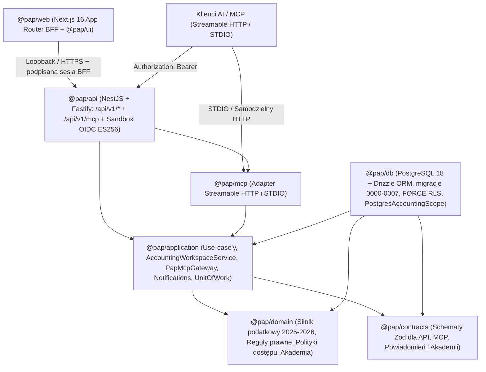

# Polish Accounting Platform 🇵🇱

> **Stan repozytorium na `main` (listopad 2026 r., po scaleniu PR `#45`–`#52`):** kompletny, modularny rdzeń polskiej platformy księgowo-podatkowej został zaimplementowany w monorepo TypeScript (`@pap/domain`, `@pap/contracts`, `@pap/application`, `@pap/db`, `@pap/ui`, `@pap/api`, `@pap/mcp`, `@pap/web`). Obejmuje obsługę trzech profili firmowych (**JDG KPiR**, **JDG Ryczałt**, **Sp. z o.o. — pełne księgi UoR i CIT**), wersjonowany rejestr **32 reguł prawa podatkowego 2025–2026** (42 wersje temporalne) z wyjaśnieniem „§ Dlaczego?”, obieg dokumentów z importem XML KSeF `FA(2)`/`FA(3)` i weryfikacją człowieka, 17- i 19-kolumnową PKPiR (`Dz.U. 2025 poz. 1299`), rejestry VAT i podgląd `JPK_V7M(2)/(3)`, rozrachunki z wyciągami CSV/MT940, kalendarz podatkowy (`art. 12 § 5` Ordynacji podatkowej), powiadomienia e-mail w izolowanej skrzynce `ControlledSandboxMailboxTransport` (RFC 5322), zdalny serwer **Streamable HTTP MCP** (`/api/v1/mcp`), system projektowy **„Księga Współczesna”** oraz **12-modułową Akademię Polskiej Księgowości** (37 lekcji, słownik pojęć, quizy i pomoc kontekstową `?`).
>
> **Zastrzeżenie operacyjne i prawne:** Aplikacja działa obecnie wyłącznie jako środowisko rozwojowe, edukacyjne i prywatny staging testowy na **danych w 100% syntetycznych**. System nie wysyła automatycznie deklaracji ani e-faktur do produkcyjnych bramek Ministerstwa Finansów (`KSeF`, `e-Deklaracje`), ZUS ani banków, nie wysyła wiadomości e-mail na zewnętrzne domeny i **nie stanowi doradztwa podatkowego, prawnego ani księgowego** w rozumieniu ustawy o doradztwie podatkowym.

---

## 1. Czym jest Polish Accounting Platform

**Polish Accounting Platform** to otwartoźródłowa aplikacja webowa oraz zestaw bezpiecznych narzędzi **Model Context Protocol (MCP)** do prowadzenia i organizowania polskiej księgowości, obiegu dokumentów oraz kontroli obowiązków podatkowych i składkowych.

Platforma łączy w jednym rdzeniu:

1. **Deterministyczny silnik podatkowy i księgowy (`@pap/domain`)** — operujący wyłącznie na liczbach całkowitych groszy (`bigint` / safe integer, zero arytmetyki zmiennoprzecinkowej `float`), rozstrzygający przepisy na dzień zdarzenia gospodarczego (`resolveRuleAtDate`) i zwracający pełny ślad obliczeniowy `LegalExplanation` z podstawą prawną (`ISAP` / `Dz.U.` / `M.P.`).
2. **Kontrolę człowieka nad automatyzacją AI i OCR (`ADR-001`)** — ekstraktory OCR, parsery XML oraz agenci MCP mogą wyłącznie przygotowywać szkice i propozycje (`pending_human_approval`). Żaden model językowy nie liczy podatków w pamięci i nie wykonuje samodzielnego zapisu w księgach bez autoryzowanego zatwierdzenia przez człowieka.
3. **Jednolity model bezpieczeństwa dla UI, REST API i MCP (`ADR-004`, `6D-3`, `0007`)** — kryptograficzna weryfikacja tokenów OIDC (`ES256`/`RS256`), deny-by-default polityka ról i grantów podmiotowych `(tenantId, legalEntityId)`, sesja BFF `HttpOnly` podpisana `HMAC-SHA256` oraz fundament PostgreSQL 18 z `FORCE ROW LEVEL SECURITY` na 27 tabelach i atomowym audytem decyzji `allow/deny`.
4. **Wbudowaną warstwę edukacyjną** — publicznie dostępną **Akademię Polskiej Księgowości** (`/academy`) oraz przyciski pomocy kontekstowej `?` (`FieldHelpButton`) bezpośrednio przy polach formularzy podatkowych.

---

## 2. Architektura monorepo

Projekt wykorzystuje **TypeScript strict + Node.js 24 LTS (`24.22.1`), pnpm `12.15.0`, Turborepo, Next.js 16 / React 19, NestJS / Fastify, PostgreSQL 18 / Drizzle ORM oraz oficjalny `@modelcontextprotocol/sdk`** ([ADR-002](docs/adr/002-stos-technologiczny-i-wdrozenia.md)). Kierunek zależności między pakietami jest automatycznie egzekwowany przez reguły ESLint oraz test `test/architecture-boundaries.test.ts`:



| Pakiet / Aplikacja | Ścieżka                | Odpowiedzialność                                                                                                                                                                            |
| ------------------ | ---------------------- | ------------------------------------------------------------------------------------------------------------------------------------------------------------------------------------------- |
| `@pap/domain`      | `packages/domain`      | Czysta logika domenowa bez I/O: arytmetyka groszowa, 32 reguły prawne 2025–2026, kalkulatory KPiR/PIT/VAT/JPK/Ryczałt/ZUS/UoR/CIT, kalendarz `art. 12 § 5` OP, polityki grantów i Akademia. |
| `@pap/contracts`   | `packages/contracts`   | Ścisłe kontrakty walidacyjne Zod (`strict()`) dla API, narzędzi MCP, powiadomień e-mail, dokumentów KSeF i modułów edukacyjnych.                                                            |
| `@pap/application` | `packages/application` | Przypadki użycia, `AccountingWorkspaceService`, transakcyjny `UnitOfWork`, `PapMcpGateway` z sanitacją prompt injection oraz silnik powiadomień i kolejki Outbox.                           |
| `@pap/db`          | `packages/db`          | Schemat PostgreSQL 18 / Drizzle ORM, migracje `0000`–`0007` (27 tabel z `FORCE RLS`), podpisany kontekst sesji HMAC `pap.context` oraz `PostgresAccountingScope`.                           |
| `@pap/ui`          | `packages/ui`          | Biblioteka komponentów Design Systemu **„Księga Współczesna”** (`MoneyAmount`, `NipInput`, `LedgerTable`, `SplitVerificationView`, `FieldHelpButton`, `CriticalConfirmDialog`).             |
| `@pap/api`         | `apps/api`             | Serwer HTTP NestJS/Fastify: chronione REST API `/api/v1/*`, wbudowany zdalny endpoint `/api/v1/mcp` oraz opcjonalny, odgrodzony bezpiecznikami `SandboxOidcService` (`ES256`).              |
| `@pap/mcp`         | `apps/mcp`             | Serwer protokołu MCP obsługujący lokalny transport `STDIO` (`system_status`) oraz autoryzowany transport **Streamable HTTP** (9 narzędzi).                                                  |
| `@pap/web`         | `apps/web`             | Interfejs webowy Next.js 16 (BFF z ciasteczkami `HttpOnly` podpisanymi `HMAC-SHA256`), pulpit operacyjny, ekrany księgowe, kolejka zatwierdzeń MCP oraz publiczna Akademia (`/academy`).    |

---

## 3. Zrealizowane moduły funkcjonalne

| Obszar funkcjonalny             | Zaimplementowany zakres w repozytorium (`#45`–`#52`)                                                                                                                                                                                            |
| ------------------------------- | ----------------------------------------------------------------------------------------------------------------------------------------------------------------------------------------------------------------------------------------------- |
| **Wielopodmiotowość i role**    | Izolacja organizacji (`tenantId`) i podmiotów (`legalEntityId`), role właściciela (`owner`) i księgowej (`accountant`) z jawnymi grantami `read` / `read + write` per firma, cofanie dostępu z natychmiastową blokadą i pełnym śladem audytu.   |
| **Obsługiwane profile firm**    | **JDG KPiR** (skala podatkowa `12%/32%` z kwotą wolną `30 000 PLN` oraz podatek liniowy `19%`), **JDG Ryczałt** (stawki `17%`–`2%` wg PKWiU + monitor limitu zwolnienia VAT `240 000 PLN`), **Sp. z o.o.** (pełne księgi UoR i CIT `9%`/`19%`). |
| **Obieg dokumentów i KSeF**     | Import faktur ustrukturyzowanych XML KSeF `FA(2)` / `FA(3)`, plików CSV oraz szkiców JSON, deduplikacja `SHA-256` (`409 Conflict`), walidacja NIP i dat ISO, widok `SplitVerificationView` oraz obowiązkowe zatwierdzenie przez człowieka.      |
| **PKPiR 2025 / 2026**           | Obsługa dotychczasowego wzoru **17-kolumnowego** (`Dz.U. 2019 poz. 2544`) oraz nowego **19-kolumnowego wzoru PKPiR od 2026 r.** (`Dz.U. 2025 poz. 1299` — kol. 3 Nr KSeF, kol. 5 NIP), wydatek mieszany pojazdu (`50% VAT / 75% KUP`), storno.  |
| **Rejestry VAT i `JPK_V7M`**    | Ewidencja sprzedaży i zakupów VAT (`23%`, `8%`, `5%`, `0%`, `zw.`, `np.`), automatyczny dobór schemy `JPK_V7M(2)` vs `JPK_V7M(3)` (od `02.2026`), oznaczenia `NrKSeF`/`OFF`/`BFK`/`DI`, kody `GTU_01`–`GTU_13`, `MPP` i pola `P_10`–`P_62`.     |
| **Pełne księgi UoR i CIT**      | Zakładowy Plan Kont (Zespoły `0`–`8`), dziennik księgowań wymuszający równowagę podwójnego zapisu `Wn === Ma` (`422` przy niezbilansowaniu), zestawienie obrotów i sald, uproszczony Bilans (`Aktywa === Pasywa`), RZiS oraz zaliczka CIT.      |
| **Rozrachunki i bankowość**     | Należności i zobowiązania z wiekowaniem przeterminowań, kontrola rachunku na Białej Liście KAS, oznaczenie obowiązkowego MPP (`> 15 000 PLN` brutto, zał. nr 15), import wyciągów CSV / MT940 i deterministyczne parowanie przelewów.           |
| **ZUS i Kalendarz podatkowy**   | Kalkulatory Ulgi na start, Preferencyjnego ZUS i Dużego ZUS oraz składki zdrowotnej (skala `9%`, liniowy `4,9%`, progi ryczałtowe `60k`/`300k`), terminy z przesunięciem wg `art. 12 § 5` Ordynacji podatkowej (w tym wolna Wigilia `24.12`).   |
| **Rejestr prawa i „Dlaczego?”** | **32 kody reguł prawnych (42 wersje temporalne 2025–2026)** powiązane z ISAP/Dz.U./M.P., blokada reguł niezweryfikowanych (`UnverifiedLegalRuleError`) oraz szuflada wyjaśniająca krok po kroku każde wyliczenie (`LegalExplanation`).          |
| **Powiadomienia e-mail**        | Harmonogram przypomnień (`-7 dni`, `-2 dni`, `+1 dzień`), jednorazowy token `opt-out`, brak pełnego NIP i kwot w nagłówkach, zakaz podszywania się pod urzędy oraz izolowana skrzynka `ControlledSandboxMailboxTransport` (RFC 5322 MIME).      |
| **Zdalny serwer MCP**           | Endpoint **Streamable HTTP** (`/api/v1/mcp`) oraz STDIO: 9 narzędzi, uwierzytelnianie Bearer JWT przed odczytem body, obrona przed _prompt injection_ / Unicode Bidi oraz dwuetapowe `prepare_*` -> zatwierdzenie kodem wyzwania człowieka.     |
| **Design System i Akademia**    | Estetyka **„Księga Współczesna”** (WCAG 2.2 AA, `tabular-nums`, pełna responsywność `375px`) oraz **12-modułowa Akademia Polskiej Księgowości** (`/academy`: 37 lekcji, słownik pojęć, quizy i pomoc kontekstowa `?` przy polach formularzy).   |

---

## 4. Stos bezpieczeństwa i aktualne granice wdrożeniowe

Zgodnie z zasadą uczciwości inżynieryjnej (`AGENTS.md` Zasada nr 9) rozróżniamy warstwy zaimplementowane i przetestowane w repozytorium od integracji wymagających odrębnej decyzji przed użyciem komercyjnym:

1. **Warstwa PostgreSQL 18 (`@pap/db`, migracje `0000`–`0007`):**
   - **27 tabel objętych `FORCE ROW LEVEL SECURITY`** (11 tabel fundamentu tenantów, tożsamości i audytu `0001`–`0006` oraz 16 tabel rdzenia księgowego w `0007_accounting-core.sql`).
   - Rozdział roli migratora (`pap_*_migrator`) od nieuprzywilejowanej roli uruchomieniowej (`pap_*_app` z `NOBYPASSRLS`, bez praw DDL, `TRUNCATE` i modyfikacji triggerów).
   - Kryptograficznie podpisany kontekst sesji `HMAC-SHA256` (`pap.context` ustawiany transakcyjnie przez `SET LOCAL`), kanoniczny porządek blokad eliminujący wyścigi `TOCTOU`, wyzwalacze niezmienności oraz atomowy zapis decyzji `allow/deny` w `security_decision_event` (`PostgresAccountingScope`).
2. **Warstwa uwierzytelniania OIDC, API i sesji BFF (`@pap/api`, `@pap/web`):**
   - Weryfikacja tokenów dostępowych JWT (`ES256`/`RS256`, `at+jwt`) przez `JwksOidcAccessTokenVerifier`, blokada nagłówków spoofujących (`x-user-id`, `x-tenant-id` -> `401`) oraz egzekwowanie zakresów OIDC (oddzielenie zakresów agenta MCP od ludzkiego zatwierdzania `403 agent_self_approval_forbidden`).
   - Wbudowany `SandboxOidcService` (`ES256`) jest domyślnie wyłączony (`404`) i posiada bezpiecznik podwójnego klucza blokujący uruchomienie w środowiskach produkcyjnych.
   - Aplikacja `apps/web` przechowuje sesję wyłącznie w ciasteczkach `HttpOnly; SameSite=Lax` podpisanych `HMAC-SHA256` (`PAP_WEB_SESSION_SECRET`), weryfikuje `Origin`/`Referer` dla mutacji i ogranicza `API_BASE_URL` zamkniętą białą listą originów.
3. **Co celowo pozostaje poza obecnym etapem testowym:**
   - Serwer HTTP `apps/api` działa obecnie domyślnie na syntetycznym magazynie w pamięci (`InMemoryAccountingWorkspaceStore` w `AccountingWorkspaceService`); przepięcie runtime HTTP na trwały `PostgresAccountingScope` na prywatnym stagingu oraz podłączenie zewnętrznego dostawcy OIDC z MFA stanowi osobny krok infrastrukturalny.
   - Brak produkcyjnej wysyłki kryptograficznej do bramek MF (`KSeF 2.0`, `e-Deklaracje`), ZUS (`PUE/eZUS`), banków (`PSD2`) oraz zewnętrznych serwerów SMTP.
   - Brak modułu płatności/subskrypcji SaaS ([ADR-003](docs/adr/003-administracja-i-uprawnienia-produktowe.md)) oraz brak formalnej certyfikacji doradcy podatkowego dla reguł oznaczonych statusem `requires_expert_review`.

---

## 5. Szybki start developerski i tryb CI

### Wymagania lokalne

- **Node.js `24.22.1`** (`>=24.22.1 <25`) oraz **pnpm `12.15.0`** (w systemie Windows zalecane `pnpm-native.exe` z `npm_config_engine_strict=false` przy drobnym odchyleniu wersji pomocniczej Node).
- Lokalny rozwój i podgląd aplikacji (`pnpm dev`) **nie wymagają lokalnej instalacji PostgreSQL ani Dockera** ([ADR-005](docs/adr/005-rozwoj-lokalny.md)).

### Podstawowe polecenia

```bash
# Instalacja zależności z zamrożonym lockfile
pnpm install --frozen-lockfile

# Uruchomienie lokalnego środowiska webowego Next.js (domyślnie http://localhost:3000)
pnpm dev

# Uruchomienie lokalnego serwera MCP (transport STDIO)
pnpm dev:mcp

# Sprawdzenie granic architektonicznych monorepo
pnpm test:arch

# Jednostkowe i modułowe testy pakietów (Vitest)
pnpm test

# Kontrola typów TypeScript i lintera ESLint
pnpm typecheck
pnpm lint

# Testy integracyjne PostgreSQL 18 (wymagają izolowanej bazy testowej pap_test)
pnpm test:integration
```

### Tryb CI i środowisk (ADR-006)

- **GitHub Actions jest tymczasowo wyłączone z automatycznego CI** decyzją właściciela projektu ([ADR-006 — tymczasowe CI na Hetznerze](docs/adr/006-tymczasowe-ci-hetzner.md), [polityka wewnętrznych merge](docs/internal-development-merge-policy.md)).
- Testy integracyjne PostgreSQL 18.6, weryfikacja migracji `0000`–`0007` oraz odbiór bezpieczeństwa `6D-3` odbywają się na serwerze Hetzner w **całkowicie odizolowanym, efemerycznym środowisku testowym** (`scripts/hetzner/with-ephemeral-pg18.sh` z limitami cgroups v2), nigdy na usługach ani danych prywatnego stagingu (`https://ksiegowosc.roleplayingtech.com`).
- Nie istnieje automatyczny deployment; każde wdrożenie lub migracja na prywatnym stagingu wymaga osobnej zgody właściciela ([instrukcja wdrożenia i ograniczeń](docs/37-wdrozenie-kopie-zapasowe-i-ograniczenia.md)).

---

## 6. Mapa dokumentacji repozytorium

### Przewodniki produktowe, edukacyjne i operacyjne (aktualny stan kodu)

| Dokument                                                                                                | Zawartość                                                                                                      |
| ------------------------------------------------------------------------------------------------------- | -------------------------------------------------------------------------------------------------------------- |
| **[36 — Przewodnik użytkownika, ról, MCP i FAQ](docs/36-przewodnik-uzytkownika-i-faq.md)**              | Praktyczna instrukcja obsługi aplikacji, ról `owner`/`accountant`, klienta MCP, Akademii oraz FAQ podatnika    |
| **[37 — Wdrożenie, kopie zapasowe i ograniczenia](docs/37-wdrozenie-kopie-zapasowe-i-ograniczenia.md)** | Topologia prywatnego stagingu Hetzner, zmienne środowiskowe, backup/deploy/rollback oraz zgodność prawna (§16) |
| **[Akademia Polskiej Księgowości — Program kursu](docs/kurs-ksiegowosci/README.md)**                    | Spis 12 modułów (37 lekcji), profili odbiorców, słownika oraz rejestru pomocy kontekstowej `fieldHelpId`       |
| [31 — Design System „Księga Współczesna”](docs/31-design-system-ksiega-wspolczesna.md)                  | Tokeny wizualne, typografia kwot PLN, dostępność WCAG 2.2 AA i katalog komponentów `@pap/ui`                   |
| [32 — Rejestr reguł prawnych 2025–2026 i matryca JDG](docs/32-rejestr-regul-prawnych-i-matryca-jdg.md)  | Katalog 32 kodów reguł (42 wersje), arytmetyka groszowa, `LegalExplanation` i matryca profilu pilota JDG KPiR  |
| [33 — Zdalny serwer MCP i powiadomienia e-mail](docs/33-mcp-i-powiadomienia.md)                         | Architektura Streamable HTTP MCP, obrona przed prompt injection i silnik powiadomień `ControlledSandbox`       |
| [34 — Architektura REST API, Sandbox OIDC i MCP](docs/34-architektura-api-oidc-i-mcp.md)                | Endpointy `/api/v1/*`, kryptografia `SandboxOidcService` (`ES256`), persony testowe i bramka `/api/v1/mcp`     |
| [35 — Przewodnik interfejsu webowego (`apps/web`)](docs/35-przewodnik-interfejsu-web.md)                | Sesja BFF `HttpOnly`, ochrona SSRF/CSRF, mapa ekranów operacyjnych `/app/*` i integracja Akademii              |

### Fundament bezpieczeństwa, architektura i roadmapa

| Dokument                                                                                                                                                                | Zawartość                                                                                                 |
| ----------------------------------------------------------------------------------------------------------------------------------------------------------------------- | --------------------------------------------------------------------------------------------------------- |
| [12 — Roadmapa i status wdrożenia](docs/12-roadmapa.md)                                                                                                                 | Zrealizowane etapy na `main` (`#45`–`#52`) vs zakres wymagający decyzji przed udostępnieniem komercyjnym  |
| [13 — Kryteria akceptacji i macierz testów](docs/13-kryteria-akceptacji.md)                                                                                             | Wymagania przekrojowe, pokrycie scenariuszy pozytywnych/negatywnych i bramki compliance                   |
| [16 — Zasady architektoniczne](docs/16-zasady-architektoniczne.md)                                                                                                      | Granice modułów, arytmetyka pieniężna, bezpieczeństwo i Definition of Done                                |
| [17 — Struktura repo i standardy](docs/17-struktura-repo-i-standardy.md)                                                                                                | Organizacja monorepo, kierunek importów i konwencje kodu                                                  |
| [18 — Model zagrożeń i uprawnień](docs/18-model-zagrozen-i-uprawnien.md)                                                                                                | Granice zaufania, macierz ról i wektory ataków (TOCTOU, prompt injection, cross-tenant)                   |
| [19 — Przewodnik developera](docs/19-przewodnik-developera.md)                                                                                                          | Konfiguracja narzędzi lokalnych i uruchamianie pakietów                                                   |
| [20 — Strategia testów](docs/20-strategia-testow.md)                                                                                                                    | Poziomy testów jednostkowych, architektonicznych, integracyjnych PG 18 i E2E                              |
| [22–30 — Dokumentacja Security Foundation (`6B`–`6D-3`)](docs/30-security-foundation-integracja.md)                                                                     | Schemat tenantów, cykl dostępu `6D-R`, OIDC `6D-2`, `UnitOfWork`, `FORCE RLS` i atomowy audyt decyzji     |
| [ADR-001](docs/adr/001-rdzen-i-mcp.md) / [ADR-002](docs/adr/002-stos-technologiczny-i-wdrozenia.md) / [ADR-003](docs/adr/003-administracja-i-uprawnienia-produktowe.md) | Kluczowe decyzje architektoniczne (rdzeń vs MCP, stos technologiczny, rozdział ról i przyszłe abonamenty) |
| [ADR-006 (staging)](docs/adr/006-prywatny-staging-hetzner.md) / [ADR-006 (CI)](docs/adr/006-tymczasowe-ci-hetzner.md)                                                   | Zasady prywatnego stagingu oraz izolowanego CI PostgreSQL 18.6 na serwerze Hetzner                        |
| [01–11, 14–15, 21 — Specyfikacje domenowe i UX](docs/01-wizja-i-zakres.md)                                                                                              | Pierwotna wizja, profile podmiotów, model pojęciowy, źródła prawa i kierunek wizualny                     |

---

## 7. Zasady bezpieczeństwa, licencja i wkład w projekt

- **Zakaz publikacji danych rzeczywistych:** nigdy nie umieszczaj w repozytorium, zgłoszeniach Issue ani Pull Requestach prawdziwych faktur, numerów PESEL, prywatnych danych klientów, tokenów dostępowych, haseł ani certyfikatów KSeF/podpisów kwalifikowanych.
- **Zgłaszanie podatności:** potencjalne błędy bezpieczeństwa zgłaszaj odpowiedzialnie zgodnie z procedurą w [SECURITY.md](SECURITY.md).
- **Licencja i rozwój:** kod źródłowy oraz dokumentacja są udostępniane na licencji [MIT](LICENSE). Zasady współpracy opisuje [CONTRIBUTING.md](CONTRIBUTING.md), a reguły pracy agentów AI definiuje [AGENTS.md](AGENTS.md).
