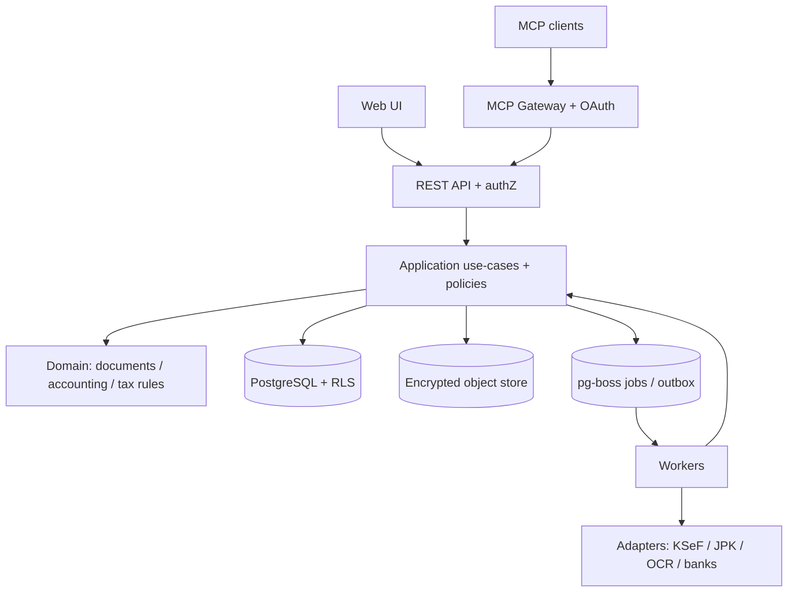

# 05. Architektura techniczna

**Decyzja techniczna:** [ADR-002 — stos i wdrożenia](adr/002-stos-technologiczny-i-wdrozenia.md). **Wymagania obowiązkowe:** [16 — zasady architektoniczne](16-zasady-architektoniczne.md). **Układ katalogów:** [17 — repo i standardy](17-struktura-repo-i-standardy.md).

## Styl

**Modularny monolit z odrębnymi procesami wejściowymi i workerami**, zamiast mikroserwisów na początku. Wspólny silnik domenowy obsługuje UI, API, integracje i MCP; dostawcy zewnętrzni działają przez adaptery. Unikamy zależności domeny od SDK i frameworków.

## Stack (wybrany do startu)

- TypeScript `strict`, Node.js 24 LTS (stan na 2026-10-26).
- Next.js (React) App Router, Tailwind CSS i shadcn/ui.
- NestJS + Fastify dla REST/OpenAPI v1; Zod dla kontraktów.
- PostgreSQL + Drizzle ORM i SQL dla transakcji/RLS.
- `pg-boss` na PostgreSQL jako kolejka i worker; brak dodatkowego Redis w MVP.
- S3-compatible szyfrowany storage dokumentów.
- OIDC/OAuth i MFA, Keycloak jako referencyjny provider; autoryzacja domenowa w aplikacji.
- TypeScript MCP SDK (Streamable HTTP, wersjonowanie protokołu i OAuth).
- pnpm + Turborepo; Vitest/Playwright/Testcontainers, OpenTelemetry.
- Docker Compose w lokalnym środowisku, kontenery i OpenTofu w wydzielonym EU/EOG stage/prod.

Issue #5 dostarcza pierwszą implementację szkieletu i przypięte wersje zależności. Działające pakiety i zakres opisuje [17 — struktura repo](17-struktura-repo-i-standardy.md), a uruchomienie i walidację [19 — przewodnik developera](19-przewodnik-developera.md) oraz [20 — strategia testów](20-strategia-testow.md). Nie wdrożono jeszcze PostgreSQL, Drizzle, OIDC/MFA, tenantów, workerów, integracji ani zdalnego MCP. Poniższe komponenty, przepływ i granice opisują cel architektoniczny; nie należy traktować ich jako obecnych funkcji.

## Docelowe komponenty i odpowiedzialność

| Komponent | Odpowiedzialność | Dostęp |
| --- | --- | --- |
| `apps/web` | UI, przegląd dokumentów i zatwierdzanie | przez API; bez bezpośredniego dostępu DB |
| `apps/api` | polityki, kontrakty, komendy i REST | wywołanie application services |
| `apps/mcp` | transport MCP, OAuth, mapowanie tools | przez autoryzowane API, bez DB |
| `apps/worker` | OCR, import, synchronizacje i raporty | zadania aplikacyjne, kontrolowany dostęp do integracji |
| `packages/domain` | księgowość, faktury, podatki, dokumenty | czyste funkcje i invariants |
| `packages/application` | use-cases, role/ABAC, approvals, porty | jedna polityka dla wszystkich kanałów |
| `packages/db` | Postgres, migracje, RLS, transakcje | tylko aplikacja i infrastruktura |
| `packages/integrations` | KSeF, JPK, NBP, REGON, banki, OCR | za portami, sandbox first |

## Docelowy przepływ

**Ważne:** workery mogą wykonywać komendy aplikacyjne w tym samym procesie/kompozycji, nie potrzebują nowego publicznego REST round-trip; są objęte tymi samymi politykami i audytem. Diagram pokazuje logiczne kierunki, a nie obligatoryjne fizyczne połączenia.

## Wymagane granice bezpieczeństwa i spójności

- `tenant_id` i `legal_entity_id` oraz tożsamość aktora: serwerowa autoryzacja RBAC/ABAC; PostgreSQL RLS jako dodatkowa bariera, osobno testowana z connection pooling.
- Dokument oryginalny write-once, SHA-256, skan AV, retencja i krótkie signed URLs.
- Zapis księgowy atomowy, bez `float`, bez edycji historii; okresy i korekty jako jawny model.
- Reguły podatkowe wersjonowane, trace do źródła urzędowego, recenzent i testy referencyjne.
- Outbox/inbox, `Idempotency-Key`, retry/backoff i DLQ; przy niepewnej wysyłce nie dublować operacji.
- MCP/OCR/LLM przygotowują propozycje; krytyczne wykonanie jest oddzielone od zatwierdzenia przez człowieka.

## Skalowanie i monitoring

- Web/API/MCP są horyzontalnie skalowalne jako kontenery stateless (dla protokołu MCP zastosować współczesny transport zgodny z SDK). Workery oddzielnie skalowane wg backlogu.
- PostgreSQL: początkowo pojedynczy primary zarządzany + backup PITR, później repliki odczytu/partycjonowanie jeśli uzasadni to pomiar.
- `pg-boss` ogranicza koszt wejścia, lecz zużywa wydajność DB. Gdy pomiary wykażą ograniczenia, można wymienić queue adapter bez przerabiania domeny.
- Prometheus/Grafana/OTel lub zgodny vendor: p95, błędy integracji, kolejka, restore drills, redaction PII.

## Bezpieczne wdrażanie

Oddzielne local, CI, staging i production. Lokalne i CI tylko dane syntetyczne; test i sandbox KSeF/urzędów. Deploymenty, migracje produkcyjne, uruchomienie KSeF i wysyłki urzędowe **wyłącznie po odrębnej zgodzie**.

## Decyzje pozostałe do wdrożenia

- Konkretny dostawca infrastruktury/region i estymacja kosztów (bez zmiany vendor-neutralnej architektury).
- Ostateczna wersja pakietów i obrazów w `pnpm-lock.yaml` i IaC.
- Parametry RPO/RTO, polityka backupu i dokładna konfiguracja OIDC przed pilotażem.
- Threat-model (#3) i matryca legal/tax profiles (#1/#4) blokują produkcyjne funkcje księgowe.

Nie są to decyzje o napisaniu kodu ani uruchomieniu usługi.
