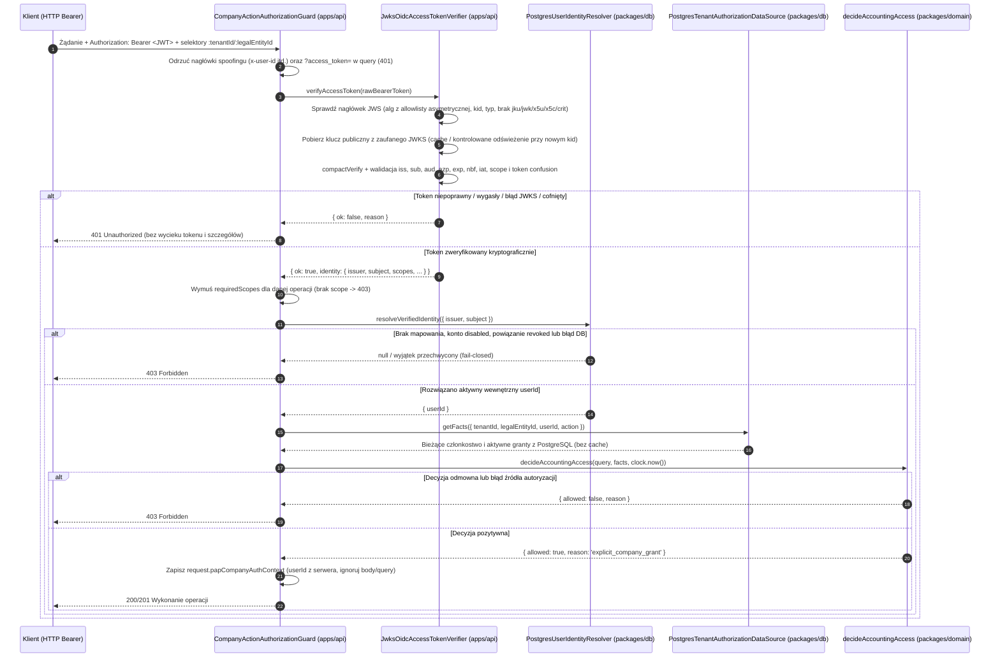

# 25. Serwerowe uwierzytelnianie OIDC, wewnętrzna tożsamość i integracja z autoryzacją — 6D-2

**Data:** 2026-10-28. **Zakres:** etap 6D-2 w [Issue #6](https://github.com/RolePlayingTech/polish-accounting-platform/issues/6); bez zamykania Issue. Obowiązują ADR-001, ADR-002, ADR-003, ADR-004 i ADR-005. To serwerowa warstwa walidacji tokenów dostępu OIDC, mapowania wewnętrznej tożsamości oraz egzekwowania autoryzacji w pipeline API — **nie jest to pełny interaktywny system logowania w przeglądarce ani publiczne udostępnienie operacji księgowych**.

## 1. Architektura 6D-2 i wybrane podejście

Etap 6D-2 domyka lukę pomiędzy zweryfikowanym tokenem dostępu OIDC/OAuth2 a istniejącymi kontraktami autoryzacji (`authorizeCompanyAction` z 6C/6D-1 oraz `manageAccess` z 6D-R), zachowując ścisły podział odpowiedzialności między warstwami monorepo:

- **`packages/domain`**:
  - Czysta polityka autoryzacji operacji administracyjnych `decideAccessManagementAuthorization` (`packages/domain/src/access-management-authorization.ts`).
  - Egzekwuje izolację tenanta, bezwzględny zakaz samodzielnego podwyższania lub modyfikowania własnych uprawnień (`actorUserId !== targetUserId`, także dla `tenant_owner` i `tenant_admin`), hierarchię ról (`tenant_owner` zarządza `tenant_admin` i `tenant_member`; `tenant_admin` wyłącznie `tenant_member`) oraz granice delegacji (`tenant_admin` może nadać lub cofnąć wyłącznie taki grant `legalEntityId + action`, który sam aktualnie posiada w ważnym przedziale czasu).
  - Pozostaje całkowicie niezależna od HTTP, NestJS, Drizzle, PostgreSQL i biblioteki `jose`.
- **`packages/application`**:
  - Porty i kontrakty tożsamości: `VerifiedOidcIdentity`, `UserIdentityResolver`, `OidcAccessTokenVerifier` (`packages/application/src/oidc-authentication.ts`).
  - Use-case'y kompozycji serwerowej: `authenticateOidcActor` oraz `authorizeAuthenticatedCompanyAction`.
  - Serwerowe adaptery dla `manageAccess`: `createOidcAccessManagementActorSource` (implementujący `AccessManagementActorSource` na bazie zweryfikowanego tokenu OIDC i resolvera tożsamości) oraz `createTenantAccessManagementAuthorizer` (implementujący `AccessManagementAuthorizer` w oparciu o `AccessManagementAuthorizationDataSource` i `decideAccessManagementAuthorization`).
- **`packages/db`**:
  - Addytywna migracja `0003_user-identity.sql` wprowadzająca tabele `app_user` oraz `user_oidc_identity` wraz z indeksami, ograniczeniami CHECK/UNIQUE/FK i dwoma triggerami ochronnymi SQL (`protect_user_oidc_identity`, `revoke_oidc_identities_on_user_disable`).
  - `PostgresUserIdentityResolver` — produkcyjny adapter rozwiązujący parę `(issuer, subject)` do wewnętrznego `userId` wyłącznie jednym parametryzowanym zapytaniem `INNER JOIN` po aktywnym koncie i nieodwołanym powiązaniu.
  - `PostgresUserIdentityStore` — jawny, oddzielony od weryfikacji tokenu adapter provisioningu, kontrolowanego dowiązywania kolejnego dostawcy OIDC oraz dezaktywacji konta i powiązań w transakcji `SELECT ... FOR UPDATE`.
  - `PostgresAccessManagementAuthorizationDataSource` — adapter odczytujący fakty autoryzacyjne aktora, użytkownika docelowego i docelowego grantu dla `createTenantAccessManagementAuthorizer`.
- **`apps/api`**:
  - Walidator konfiguracji `loadOidcVerifierConfig` (`apps/api/src/auth/oidc-config.ts`) z podejściem fail-fast oraz blokadą niezabezpieczonych adresów HTTP poza jawnym środowiskiem `local`/`test` na loopbacku.
  - Serwerowy weryfikator kryptograficzny `JwksOidcAccessTokenVerifier` (`apps/api/src/auth/jwks-oidc-token-verifier.ts`) oparty na `jose` (`compactVerify`, `importJWK`), z kontrolowanym pobieraniem, cachem i rotacją kluczy JWKS (z cooldownem) oraz opcjonalnym portem `OidcTokenRevocationChecker`.
  - Guard `CompanyActionAuthorizationGuard` oraz dekorator `@RequireCompanyAction` (`apps/api/src/auth/company-access.guard.ts`) integrujące pełny przepływ w NestJS/Fastify bez duplikowania logiki domenowej w kontrolerach.

Wspólne porty w `packages/application` (`authenticateOidcActor`, `authorizeAuthenticatedCompanyAction`) nie zależą od NestJS ani od obiektów żądania Fastify, dzięki czemu mogą zostać bezpośrednio użyte w przyszłym adapterze MCP (Issue #8).

## 2. Przepływ tożsamości i autoryzacji

## 3. Zasady mapowania `(issuer, subject) -> userId`

1. **Jednoznaczność pary `(issuer, subject)`:** Zgodnie z [OpenID Connect Core 1.0 §5.7](https://openid.net/specs/openid-connect-core-1_0.html#ClaimStability) zewnętrzną tożsamość identyfikuje wyłącznie para `(issuer, subject)`, zabezpieczona w bazie unikalnym ograniczeniem `user_oidc_identity_issuer_subject_uq`.
2. **Wrażliwość na wielkość liter i nieprzezroczystość:** Zarówno `issuer`, jak i `subject` są traktowane jako nieprzezroczyste, case-sensitive ciągi znaków (`text` w PostgreSQL, porównanie dokładne `=`). `Sub-User-1` oraz `sub-user-1` to dwie różne tożsamości.
3. **Izolacja wystawców:** Ten sam `subject` od dwóch różnych wystawców (`issuer`) stanowi dwa odrębne wpisy i nigdy nie jest automatycznie łączony.
4. **Wewnętrzny `userId`:** Aplikacja posługuje się własnym, stabilnym identyfikatorem UUID (`app_user.id`), niezależnym od formatu `sub` u dostawcy OIDC.
5. **Zakaz łączenia kont po e-mailu lub nazwie:** Tabele `app_user` i `user_oidc_identity` celowo nie przechowują ani nie używają `email`, `preferred_username` ani nazwy wyświetlanej do rozpoznawania użytkownika. Zbieżność adresu e-mail w tokenie JWT nigdy nie powoduje powiązania ani przejęcia konta.
6. **Wielu wystawców i migracja IdP:** Jeden rekord `app_user` może posiadać wiele jawnie utworzonych rekordów w `user_oidc_identity` (np. podczas kontrolowanej migracji z jednego klastra Keycloak na drugi), lecz każde powiązanie wymaga jawnego wywołania `PostgresUserIdentityStore.linkOidcIdentity` dla aktywnego konta.
7. **Niezmienność powiązania (SQL trigger):** Trigger `protect_user_oidc_identity` blokuje zmianę `user_id`, `issuer`, `subject` oraz `created_at` istniejącego wpisu, a także zabrania wyczyszczenia `revoked_at` lub przesunięcia go w przyszłość.

## 4. Konfiguracja środowiska i sposób testowania lokalnego

Konfiguracja weryfikatora OIDC jest wczytywana przez `loadOidcVerifierConfig(env)` (`apps/api/src/auth/oidc-config.ts`). Przykładowe zmienne opisano w głównym pliku `.env.example`:

| Zmienna                            | Wymagalność                         | Opis                                                                                                                                                                                     |
| ---------------------------------- | ----------------------------------- | ---------------------------------------------------------------------------------------------------------------------------------------------------------------------------------------- |
| `PAP_OIDC_ENV`                     | Wymagana przy używaniu weryfikatora | `local`, `test`, `staging` lub `production`. W `staging`/`production` wymusza `https://` i blokuje adresy loopback/prywatne.                                                             |
| `PAP_OIDC_ISSUER`                  | Wymagana                            | Dokładny URL wystawcy (`iss`), bez query, fragmentu i końcowego `/`.                                                                                                                     |
| `PAP_OIDC_JWKS_URI`                | Wymagana                            | Dokładny URL endpointu kluczy publicznych JWKS dostawcy OIDC.                                                                                                                            |
| `PAP_OIDC_AUDIENCE`                | Wymagana                            | Oczekiwany odbiorca tokenu (`aud`), np. `pap-api` (lista po przecinku).                                                                                                                  |
| `PAP_OIDC_ALLOWED_ALGS`            | Opcjonalna                          | Dozwolone algorytmy asymetryczne z listy `RS256,RS384,RS512,PS256,PS384,PS512,ES256,ES384,ES512,EdDSA` (domyślnie `RS256,ES256`). Algorytmy `none` oraz `HS*` są bezwzględnie odrzucane. |
| `PAP_OIDC_ALLOWED_AZP`             | Opcjonalna                          | Dozwoleni klienci OAuth2 w claimie `azp` (gdy podano, claim `azp` jest obowiązkowy i musi należeć do listy).                                                                             |
| `PAP_OIDC_REQUIRED_SCOPES`         | Opcjonalna                          | Scopes wymagane w każdym tokenie dostępu na poziomie weryfikatora.                                                                                                                       |
| `PAP_OIDC_CLOCK_TOLERANCE_SECONDS` | Opcjonalna                          | Maksymalna tolerancja zegara w sekundach (`0..60`, domyślnie `30`).                                                                                                                      |
| `PAP_OIDC_MAX_TOKEN_AGE_SECONDS`   | Opcjonalna                          | Maksymalny wiek tokenu względem `iat` (`60..86400`, domyślnie `3600`).                                                                                                                   |

`pnpm dev`, `pnpm test`, `pnpm typecheck` i `pnpm build` **nie wymagają** uruchomionego serwera Keycloak ani zmiennych `PAP_OIDC_*` podczas startu publicznego szkieletu. Testy jednostkowe i pipeline'u API generują syntetyczne pary kluczy asymetrycznych (`RS256`, `ES256`) w pamięci.

## 5. Wymagane scopes, audiences i ochrona przed pomyleniem tokenów

- **Audience (`aud`):** Token musi zawierać claim `aud` (jako string lub tablicę niepustych stringów) obejmujący skonfigurowane `PAP_OIDC_AUDIENCE` (np. `pap-api`).
- **Authorized party (`azp`):** Jeśli skonfigurowano `PAP_OIDC_ALLOWED_AZP` lub token posiada wielu odbiorców w `aud`, weryfikator wymaga obecności `azp` zgodnego z listą dozwolonych klientów.
- **Scopes (`scope`):** Weryfikator odczytuje claim `scope` (rozdzielany spacjami zgodnie z RFC 8693 / OAuth 2.0) i sprawdza zarówno scopes globalne weryfikatora, jak i scopes wymagane dla konkretnej operacji (`requiredScopes` w `@RequireCompanyAction` lub `authorizeAuthenticatedCompanyAction`, np. `pap:accounting`).
- **Ochrona przed pomyleniem ID Token / Refresh Token / Logout Token z Access Tokenem:**
  - Nagłówek `typ` (jeśli obecny) po normalizacji (usunięciu opcjonalnego prefiksu `application/`) musi należeć do dozwolonych typów (`at+jwt`, `jwt`) i jest natychmiast odrzucany dla `id+jwt`, `id`, `refresh+jwt`, `refresh`, `dpop+jwt`, `logout+jwt`, `secevent+jwt`.
  - Payload zawierający `typ` równy `id`, `id_token`, `refresh` lub `refresh_token` (np. konwencja Keycloak `typ: "ID"` / `typ: "Refresh"`), claim `at_hash`, `c_hash` lub `events` (backchannel logout token) jest odrzucany jako `token_type_not_allowed`.
  - Nagłówki JWS zawierające niezaufane referencje do kluczy (`jku`, `jwk`, `x5u`, `x5c`, `crit`) są bezwzględnie odrzucane przed weryfikacją podpisu.

## 6. Model błędów i odmów (`401` vs `403` vs `400`)

Guard `CompanyActionAuthorizationGuard` rozdziela błędy uwierzytelniania od odmów autoryzacji i nigdy nie zwraca w odpowiedzi surowego tokenu, wyjątków SQL, poświadczeń ani informacji o istnieniu cudzego tenanta lub firmy:

- **`401 Unauthorized`** (z nagłówkiem `WWW-Authenticate: Bearer ...`):
  - brak nagłówka `Authorization: Bearer <token>` lub niepoprawny format nagłówka;
  - obecność zabronionych nagłówków spoofingu tożsamości (`x-user-id`, `x-authenticated-user`, `x-forwarded-user`, `x-auth-request-user`, `x-remote-user`, `x-pap-user-id`, `x-pap-actor-id`, `x-pap-tenant-role`, `x-pap-platform-role`) lub przekazanie `?access_token=` w query string;
  - niepoprawny podpis, niedozwolony algorytm, wygasły token (`exp`), token jeszcze nieważny (`nbf`), token z przyszłości (`iat`), błędny `iss`, `aud` lub `azp`, pomylenie ID/Refresh tokenu z Access Tokenem, cofnięty token (`token_revoked`) albo niedostępność/błąd konfiguracji JWKS (`jwks_unavailable`, `verifier_not_configured`).
- **`403 Forbidden`** (jednolity komunikat `Brak uprawnień do wykonania operacji.`):
  - poprawny kryptograficznie token OIDC, któremu brakuje wymaganego scope'u operacji;
  - brak mapowania `(issuer, subject)` w `user_oidc_identity`, wyłączone konto wewnętrzne (`app_user.status = 'disabled'`) lub cofnięte powiązanie (`revoked_at IS NOT NULL`);
  - brak aktywnego członkostwa w żądanym tenancie, brak jawnego grantu do firmy/akcji (`read` vs `write`), rola `tenant_owner`/`tenant_admin`/`platform_operator` bez jawnego grantu księgowego, cofnięte lub wygasłe członkostwo/grant;
  - awaria źródła tożsamości lub źródła faktów autoryzacyjnych (fail-closed).
- **`400 Bad Request`**:
  - niepoprawny składniowo identyfikator zasobu w ścieżce (`tenantId` lub `legalEntityId` niebędący poprawnym UUID).

## 7. Zasady provisioningu i dezaktywacji kont

1. **Brak auto-provisioningu z tokenu:** Poprawny token OIDC dla nieznanej pary `(issuer, subject)` nigdy nie tworzy automatycznie rekordu w `app_user` ani w `user_oidc_identity`.
2. **Jawny provisioning (`PostgresUserIdentityStore`):**
   - `provisionUserWithIdentity({ userId, identityId, issuer, subject })` tworzy w jednej transakcji aktywne konto wewnętrzne i przypisuje mu pierwszą tożsamość OIDC.
   - `linkOidcIdentity({ userId, identityId, issuer, subject })` blokuje wiersz `app_user` (`SELECT ... FOR UPDATE`), weryfikuje, że konto istnieje i ma status `active`, i dopina kolejną tożsamość OIDC (np. przy zmianie dostawcy tożsamości).
3. **Dezaktywacja i odwołanie:**
   - `disableUser(userId)` ustawia `app_user.status = 'disabled'`, `disabled_at = clock_timestamp()` oraz trwale ustawia `revoked_at` na wszystkich powiązaniach OIDC tego użytkownika (dodatkowo egzekwowane przez trigger `revoke_oidc_identities_on_user_disable`).
   - `revokeOidcIdentity(issuer, subject)` trwale unieważnia pojedyncze powiązanie zewnętrzne bez usuwania historii.
4. **Strategia dla cofniętych sesji i tokenów:**
   - Krótki czas życia Access Tokenu (`PAP_OIDC_MAX_TOKEN_AGE_SECONDS`, docelowo 5–15 minut w Keycloak) oraz walidacja `iat`/`exp` przy każdym żądaniu.
   - Wyłączenie konta w `app_user`, odwołanie powiązania w `user_oidc_identity` lub cofnięcie członkostwa/grantu w `manageAccess` działa **natychmiast przy kolejnym żądaniu**, nawet jeśli sam token JWT jeszcze nie wygasł.
   - Dodatkowo `JwksOidcAccessTokenVerifier` udostępnia port `OidcTokenRevocationChecker` (`isRevoked({ issuer, subject, tokenId, sessionId, issuedAt })`), pozwalający podłączyć denylistę identyfikatorów `jti`/`sid` lub backchannel logout z IdP.

## 8. Co zostało zaimplementowane w 6D-2

- Serwerowy weryfikator tokenów dostępu OIDC (`JwksOidcAccessTokenVerifier`) i walidator konfiguracji (`loadOidcVerifierConfig`) w `apps/api`.
- Schemat bazy danych i migracja `0003_user-identity.sql` (`app_user`, `user_oidc_identity`) z triggerami integralności oraz adapterami `PostgresUserIdentityResolver` i `PostgresUserIdentityStore` w `packages/db`.
- Czysta polityka autoryzacji administracyjnej `decideAccessManagementAuthorization` w `packages/domain` oraz serwerowe adaptery `createOidcAccessManagementActorSource`, `createTenantAccessManagementAuthorizer` i `PostgresAccessManagementAuthorizationDataSource` dla `manageAccess`.
- Pełna integracja przepływu `Verified OIDC identity -> Internal userId -> TenantAuthorizationDataSource -> authorizeCompanyAction` w `packages/application` oraz guardzie `CompanyActionAuthorizationGuard` w `apps/api`.
- Testy jednostkowe, integracyjne PostgreSQL i testy pipeline'u HTTP NestJS/Fastify (kontroler testowy ładowany wyłącznie w module testowym, bez wystawiania publicznych endpointów księgowych ani mutujących w produkcyjnym `AppModule`).

## 9. Ograniczenia, ryzyka i co pozostaje do wykonania w 6D-3

Etap 6D-2 celowo **nie wystawia publicznych endpointów księgowych ani mutujących endpointów administracyjnych** i pozostawia `tenantAuthorization: 'not_available'` w publicznym `/api/v1/system/status` z uwagi na następujące udokumentowane blokery architektoniczne zaplanowane na etap **6D-3**:

1. **TOCTOU pomiędzy autoryzacją a operacją na danych biznesowych:**
   - W 6D-2 `authorizeAuthenticatedCompanyAction` oraz `createTenantAccessManagementAuthorizer` odczytują aktualny stan członkostwa i grantów z PostgreSQL w momencie sprawdzania dostępu, przed wykonaniem docelowej operacji.
   - Równoległa transakcja może cofnąć członkostwo lub uprawnienie administratora pomiędzy odczytem autoryzacyjnym a właściwym zapytaniem biznesowym lub transakcją `manageAccess`.
   - **Plan na 6D-3:** Wprowadzenie wspólnego transakcyjnego `UnitOfWork`, który wykonuje weryfikację uprawnień (lub ponowne potwierdzenie pod blokadą `FOR SHARE` / `FOR UPDATE`) oraz ustawia kontekst `SET LOCAL` wewnątrz tej samej transakcji PostgreSQL co operacja na danych.
2. **Brak ograniczonej roli runtime DB i polityk PostgreSQL RLS:**
   - Obecne konta `pap_local` i `pap_test` są właścicielami schematu używanymi do migracji DDL i nie podlegają ograniczeniom `NOBYPASSRLS` wobec własnych tabel.
   - **Plan na 6D-3:** Wydzielenie nieuprzywilejowanej roli aplikacyjnej runtime (bez praw DDL, `TRUNCATE`, `BYPASSRLS` i wyłączania triggerów), wdrożenie polityk Row-Level Security (RLS) na tabelach wielotenantowych jako defense-in-depth oraz testy prób obejścia autoryzacji bezpośrednim zapytaniem SQL.
3. **Audyt decyzji autoryzacyjnych i odmów API/MCP:**
   - Obecny audyt w `access_management_event` (6D-R) obejmuje mutacje członkostw i grantów.
   - **Plan na 6D-3:** Dodanie strukturalnego audytu decyzji dostępu (allow/deny) oraz prób nieautoryzowanego dostępu z zachowaniem redakcji tokenów i danych wrażliwych.
4. **Interaktywne logowanie użytkownika w przeglądarce (UI / BFF):**
   - Etap 6D-2 dostarcza serwerową walidację tokenów Bearer i integrację z autoryzacją.
   - **Poza 6D-2 (osobny etap):** Interaktywny przepływ OIDC Authorization Code + PKCE (`state`, `nonce`), zarządzanie bezpieczną sesją HTTP-only i ochrona CSRF w `apps/web` / `apps/api`.
