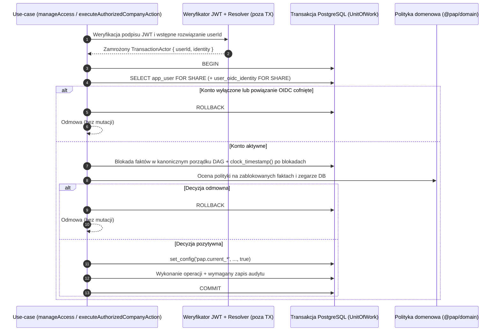

# 26. Transakcyjna autoryzacja, UnitOfWork i eliminacja TOCTOU — 6D-3A

**Data:** 2026-10-29. **Zakres:** pierwszy podetap 6D-3 w [Issue #6](https://github.com/RolePlayingTech/polish-accounting-platform/issues/6); bez zamykania Issue. Obowiązują ADR-001, ADR-002, ADR-003, ADR-004, ADR-005 i ADR-006. Etap 6D-3A eliminuje okno wyścigu **TOCTOU (Time-of-Check to Time-of-Use)** pomiędzy decyzją autoryzacyjną a wykonaniem krytycznej operacji w PostgreSQL oraz przygotowuje reużywalny mechanizm transakcyjny pod operacje na dokumentach i przyszłe polityki RLS w **6D-3B**.

---

## 1. Problem TOCTOU sprzed 6D-3A

W etapie [6D-2](25-uwierzytelnianie-oidc-i-tozsamosc-6d2.md) weryfikacja uprawnień oraz wykonanie mutacji odbywały się w osobnych zapytaniach/transakcjach bazodanowych:

1. Administrator A przechodził walidację tokenu OIDC i rozwiązanie `userId` (`PostgresUserIdentityResolver`).
2. `manageAccess` wywoływało `authorizer.authorize(actor, command)` poza transakcją zapisu (`PostgresAccessManagementAuthorizationDataSource`).
3. W oknie pomiędzy krokiem 2 a krokiem 4 równoległa transakcja (np. właściciela B lub administratora tożsamości) mogła:
   - cofnąć członkostwo administratora A (`revoke_membership`),
   - cofnąć lub wygasić delegowalny grant `company_access_grant` administratora A (`revoke_grant`),
   - wyłączyć konto wewnętrzne `app_user` (`disableUserAccount`),
   - odwołać powiązanie `user_oidc_identity` użytego tokenu (`revokeOidcIdentity`).
4. Dopiero potem `PostgresAccessManagementStore.execute` otwierało transakcję blokującą wyłącznie docelowego użytkownika (`command.userId`) i zapisywało mutację na podstawie nieaktualnej decyzji.

Analogiczne okno istniało dla odczytu/zapisu danych firmy, gdyby aplikacja polegała wyłącznie na wcześniejszym wywołaniu `authorizeAuthenticatedCompanyAction` (np. w guardzie HTTP) przed otwarciem transakcji bazodanowej.

---

## 2. Porównanie etapów: 6D-2 vs 6D-3A vs 6D-3B (i 6D-3C)

| Obszar | 6D-2 (zrealizowane) | 6D-3A (ten etap) | 6D-3B / 6D-3C (kolejne PR-y) |
| --- | --- | --- | --- |
| Weryfikacja kryptograficzna JWT OIDC i JWKS | Tak, serwerowo poza DB (`JwksOidcAccessTokenVerifier`) | Tak, nadal poza transakcją DB (brak trzymania blokad na sieci) | Bez zmian |
| Sprawdzenie `app_user` i `user_oidc_identity` | Osobny `SELECT` przed autoryzacją | Ponowna weryfikacja i blokada `FOR SHARE` **wewnątrz tej samej transakcji** co decyzja i operacja | Dodatkowe wymuszenie przez rolę runtime i RLS (6D-3B) |
| Pobranie faktów autoryzacyjnych (`tenant_membership`, `company_access_grant`, `legal_entity`) | Nieblokujące `SELECT` poza transakcją zapisu (podatne na TOCTOU) | Transakcyjne pobranie pod kanonicznymi blokadami `FOR SHARE` / `FOR UPDATE` z zegarem `clock_timestamp()` po blokadach | Dodatkowa ochrona defense-in-depth przez PostgreSQL RLS (6D-3B) |
| Wykonanie operacji i atomowy audyt mutacji | Osobna transakcja w `PostgresAccessManagementStore.execute` | Wspólna transakcja `UnitOfWork`: decyzja -> kontekst sesji -> mutacja -> `access_management_event` -> `COMMIT` (lub fizyczny `ROLLBACK`) | Rozszerzenie o strukturalny audyt decyzji `allow/deny` w 6D-3C |
| Kontekst sesji pod RLS (`pap.current_*`) | Brak | Wiązanie `set_config(..., true)` wewnątrz transakcji `UnitOfWork` (przygotowanie techniczne; RLS nie jest jeszcze włączone) | Polityki `ENABLE/FORCE ROW LEVEL SECURITY` i ograniczona rola runtime DB bez DDL/`BYPASSRLS` (6D-3B) |
| Publiczne endpointy firmowe i administracyjne w `AppModule` | Niewystawione (`not_available`) | Nadal niewystawione (`not_available`) | Odblokowywane dopiero po domknięciu 6D-3B i 6D-3C |

---

## 3. Architektura transakcyjnego `UnitOfWork`

Etap 6D-3A nie tworzy drugiego systemu autoryzacji — wykorzystuje istniejące czyste polityki domenowe (`decideAccessManagementAuthorization` oraz `decideAccountingAccess`), rozdzielając wyraźnie odpowiedzialności:

1. **Uwierzytelnianie kryptograficzne (poza transakcją DB):**
   - `authenticateOidcActor` weryfikuje podpis i claims JWT (`JwksOidcAccessTokenVerifier`) oraz wstępnie rozwiązuje wewnętrzny `userId` (`PostgresUserIdentityResolver`).
   - Żadne połączenie z puli PostgreSQL ani blokada wierszowa nie są utrzymywane podczas ewentualnego odświeżania kluczy JWKS.
   - Zwrócony aktor jest zamrażany przez `freezeTransactionActor` wraz z opcjonalną parą `(issuer, subject)`.
2. **Otwarcie zarządzanej transakcji (`runManagedTransaction`):**
   - Jedna transakcja PostgreSQL obejmuje wszystkie kroki od rewalidacji konta do zapisu audytu.
   - Jeżeli predykat zatwierdzenia zwróci `false` (odmowa autoryzacji lub walidacji biznesowej), adapter wymusza fizyczny `ROLLBACK` po stronie PostgreSQL (przez wewnętrzny, otypowany znacznik kontrolny), zwalniając wszystkie blokady i czyszcząc zmienne `SET LOCAL`, po czym zwraca ustrukturyzowany wynik odmowy.
3. **Rewalidacja i blokada konta aktora (`verifyAndLockActorInTx`):**
   - Potwierdza pod blokadą `FOR SHARE`, że rekord `app_user` istnieje, ma `status = 'active'` i `disabled_at IS NULL`, a dla ścieżki OIDC również że powiązanie `user_oidc_identity(issuer, subject)` pozostaje `active` (`revoked_at IS NULL`) i wskazuje dokładnie tego samego `userId`.
4. **Pobranie i zablokowanie faktów autoryzacyjnych oraz zegara DB:**
   - Pobiera wszystkie fakty, których równoległa zmiana mogłaby unieważnić decyzję (członkostwo aktora, członkostwo docelowe, firmę i granty), stosując kanoniczny porządek blokad (sekcja 4).
   - Odczytuje `date_trunc('milliseconds', clock_timestamp())` **po** uzyskaniu wszystkich blokad (eliminując użycie nieaktualnego `transaction_timestamp()` sprzed oczekiwania na blokadę).
5. **Decyzja polityki domenowej:**
   - Czysta funkcja w `@pap/domain` podejmuje decyzję na podstawie zablokowanych faktów i zegara transakcyjnego DB (`facts.now`).
6. **Transakcyjny kontekst sesji (`applyLocalRlsSessionContext`):**
   - Wiąże z bieżącą transakcją parametry lokalne `pap.current_tenant_id`, `pap.current_actor_user_id` oraz `pap.current_legal_entity_id` za pomocą `set_config(..., true)` (`is_local = true`).
7. **Wykonanie operacji i atomowy audyt:**
   - Dla `manageAccess`: sprawdza idempotencję `operation_id`, wykonuje mutację na już zablokowanych wierszach i zapisuje zdarzenie `access_management_event` bez wewnętrznego `catch` (awaria audytu wycofuje całą transakcję).
   - Dla `executeAuthorizedCompanyAction`: wywołuje przekazaną operację odczytu/zapisu z tym samym kontekstem transakcji `tx`.
8. **Commit wyłącznie po powodzeniu całości.**

---

## 4. Model blokad i odporność na zakleszczenia (Deadlock-Freedom)

Samo `SELECT ... FOR SHARE` na pojedynczym wierszu nie eliminuje TOCTOU, ponieważ decyzja zależy jednocześnie od konta wewnętrznego, powiązania OIDC, członkostwa w tenancie, przynależności firmy do tenanta oraz (dla `tenant_admin` i operacji firmowych) od aktywnych grantów w `company_access_grant`. Co więcej, naiwne blokowanie wierszy w kolejności „najpierw aktor, potem cel” doprowadziłoby do klasycznego zakleszczenia (`40P01`) przy równoległych operacjach krzyżowych (`A -> B` oraz `B -> A`).

Wszystkie ścieżki zapisu i autoryzacji w `@pap/db` (zarówno `PostgresUserIdentityStore`, `PostgresAccessManagementStore`, jak i `PostgresTransactionalUnitOfWork`) przestrzegają ścisłego, acyklicznego porządku blokad (**DAG**):

| Poziom | Tabela | Tryb blokady | Klucz porządkowania wewnątrz poziomu | Cel ochrony |
| --- | --- | --- | --- | --- |
| **1** | `app_user` | `FOR SHARE` (weryfikacja) / `FOR UPDATE` (`disableUserAccount`) | `id` (pojedynczy aktor) | Blokuje równoległe wyłączenie konta aktora (zwykłe `FOR KEY SHARE` nie zablokowałoby `UPDATE status = 'disabled'`). |
| **2** | `user_oidc_identity` | `FOR SHARE` (weryfikacja) / `FOR UPDATE` (`revokeOidcIdentity`) | `(issuer, subject)` | Zgodna kolejność z `revokeOidcIdentity` (`app_user` -> `user_oidc_identity`); wykrywa odwołanie konkretnego linku IdP. |
| **3** | `tenant_membership` | Aktor: `FOR SHARE`; Cel mutacji: `FOR UPDATE`; Akcja firmowa: `FOR SHARE` | `(tenant_id, user_id ASC)` | **Kluczowa ochrona przed deadlockiem:** gdy `actor.userId < target.userId`, blokujemy najpierw aktora (`FOR SHARE`), potem cel (`FOR UPDATE`); gdy `target.userId < actor.userId`, najpierw cel (`FOR UPDATE`), potem aktora (`FOR SHARE`). |
| **4** | `legal_entity` | `FOR SHARE` | `(tenant_id, id)` | Potwierdza przynależność firmy do tenanta i pokrywa wymagania klucza obcego przy `INSERT` do `company_access_grant`. |
| **5** | `company_access_grant` | Granty aktora / akcja firmowa: `FOR SHARE`; Cofany grant docelowy: `FOR UPDATE` | `(tenant_id, user_id ASC, grant_id ASC)` | Oddzielne zapytania (bez `LEFT JOIN ... FOR SHARE`), posortowane po `(user_id ASC, grant_id ASC)`. Unika eskalacji blokady `FOR SHARE -> UPDATE` na cofanym grancie. |
| **6** | `access_management_event` | `SELECT` idempotencji + `INSERT` append-only | `operation_id` | Wykonywane na końcu transakcji po zablokowaniu wszystkich poprzednich poziomów; błąd audytu wycofuje całość. |

### Dodatkowe zabezpieczenia modelu blokad

- **Nieblokujący pre-check aktora przed poziomem 3:** Zanim transakcja `manageAccess` zablokuje wiersz docelowy `FOR UPDATE` (co mogłoby nastąpić przed blokadą aktora, gdy `target.userId < actor.userId`), wykonuje szybki nieblokujący odczyt wiersza `tenant_membership` samego aktora. Użytkownik spoza tenanta lub zwykły `tenant_member` jest natychmiast odrzucany **bez zakładania żadnych blokad `FOR UPDATE`** na członkostwach w docelowym tenancie (ochrona przed blokowaniem obcych tenantów). Jeżeli natomiast aktor był aktywnym administratorem, a równoległa transakcja właśnie cofa jego członkostwo, właściwy krok poziomu 3 zatrzymuje się na `FOR SHARE` i po zatwierdzeniu tamtej zmiany widzi `status = 'revoked'` w trybie `READ COMMITTED`.
- **Kompatybilność równoległych operacji jednego administratora:** Ponieważ wiersz aktora w `app_user`, `user_oidc_identity`, `tenant_membership` i `company_access_grant` jest blokowany w trybie `FOR SHARE`, ten sam uprawniony właściciel lub administrator może równolegle modyfikować dostęp dwóch różnych użytkowników (`MEMBER_1` i `MEMBER_2`) bez wzajemnego blokowania się na własnym wierszu.
- **Brak trzymania połączenia z błędem `25P02` i brak wycieku GUC:** Każdy wyjątek SQL oraz każda odmowa autoryzacji kończy blok `db.transaction(...)` przez `ROLLBACK`, dzięki czemu połączenie zwracane do puli `postgres.js` nie pozostaje w stanie przerwanej transakcji ani nie przenosi zmiennych `pap.current_*` do kolejnego żądania.

---

## 5. Zmiany w kontraktach i adapterach

- **`packages/application/src/transactional-unit-of-work.ts`**:
  - `TransactionActor` oraz `freezeTransactionActor` — kanoniczny, zamrożony aktor transakcyjny (`userId` + opcjonalne `VerifiedOidcIdentity`).
  - `TransactionSessionContext` — kontrakt wiązania kontekstu tenanta/aktora/firmy z transakcją DB pod przyszłe RLS.
  - `CompanyActionTransactionContext`, `CompanyActionUnitOfWork` oraz `executeAuthorizedCompanyAction` — reużywalny przepływ transakcyjny dla odczytu i zapisu dokumentów firmowych.
- **`packages/application/src/access-management.ts`**:
  - Rozszerzenie `AccessManagementActor` o opcjonalne `identity?: VerifiedOidcIdentity` (przekazywane przez `createOidcAccessManagementActorSource`).
  - Rozszerzenie `AccessManagementAuthorizationFacts` o `now?: Date` (zegar transakcyjny DB po blokadach).
  - Dodanie `AccessManagementTransaction` oraz `AccessManagementStore.runInTransaction`.
  - Aktualizacja `createTenantAccessManagementAuthorizer` (opcjonalny `fallbackSource`; wewnątrz transakcji zawsze używa zablokowanego `AccessManagementTransaction` oraz `facts.now`) i `manageAccess` (uruchamia pełną ścieżkę w `store.runInTransaction`, zachowując kompatybilność wsteczną dla prostych mocków in-memory w testach jednostkowych).
- **`packages/db/src/transaction-primitives.ts` oraz `packages/db/src/transactional-unit-of-work.ts`**:
  - `runManagedTransaction`, `readTransactionClockNow`, `verifyAndLockActorInTx`, `applyLocalRlsSessionContext`, `lockCompanyActionFactsInTx` oraz `PostgresTransactionalUnitOfWork`.
- **`packages/db/src/access-management.ts`**:
  - Pełna implementacja transakcyjnego `runInTransaction` w `PostgresAccessManagementStore` ze współdzieleniem zablokowanego snapshotu docelowego i zegara `now` pomiędzy autoryzacją a mutacją i audytem.
- **`apps/api/src/auth/company-access.guard.ts`**:
  - Doprecyzowanie roli `CompanyActionAuthorizationGuard` jako wczesnej bramki transportowej HTTP oraz dodanie helpera `executeHttpAuthorizedCompanyAction` wykonującego operację HTTP wewnątrz transakcyjnego `UnitOfWork`. Produkcyjny `AppModule` pozostaje bez zmian (nadal wystawia wyłącznie `/health` i `/api/v1/system/status`).

---

## 6. Testy współbieżności i weryfikacja na PostgreSQL

Zestaw `packages/db/test/transactional-authz.integration.ts` weryfikuje deterministycznie na rzeczywistym PostgreSQL 18 (z wykorzystaniem barier synchronizujących oraz `pg_blocking_pids`, bez opierania wyścigów na przypadkowych opóźnieniach czasowych):

1. Cofnięcie członkostwa aktora po weryfikacji OIDC (bariera przed transakcją) oraz w trakcie konkurencji na blokadzie wierszowej (`pg_blocking_pids` na `tenant_membership`), a także odwrotna serializacja, gdy aktor posiada już `FOR SHARE`.
2. Równoległe cofnięcie delegowalnego grantu `tenant_admin` (w tym bezpośrednia blokada wiersza `company_access_grant` potwierdzona przez `pg_blocking_pids`).
3. Wyłączenie konta `app_user` (`disableUserAccount` trzymające `FOR UPDATE` na `app_user` wobec `FOR SHARE`) oraz cofnięcie pojedynczego powiązania `user_oidc_identity` przy zachowaniu drugiego aktywnego powiązania.
4. Równoczesna modyfikacja dostępu w tym samym tenancie przez dwóch administratorów (serializacja na wspólnym użytkowniku docelowym oraz brak blokowania operacji na różnych użytkownikach docelowych).
5. Brak odtworzenia historycznych grantów po reaktywacji członkostwa — zarówno dla odczytu firmowego (`executeAuthorizedCompanyAction`), jak i dla delegacji administracyjnej przez reaktywowanego `tenant_admin`.
6. Izolacja między tenantami (blokady i zmiany w `TENANT_B` nie blokują ani nie zmieniają decyzji w `TENANT_A`; administrator spoza tenanta nie zakłada blokad `FOR UPDATE` w cudzym tenancie).
7. Macierz odmów bez mutacji i bez wpisu audytowego (niezmapowany OIDC, sfałszowany JWT, zwykły `tenant_member`, `platform_operator`, self-dealing właściciela, przekroczenie hierarchii lub zakresu delegacji `tenant_admin`, brak domyślnego dostępu księgowego ról administracyjnych).
8. Wycofanie całej transakcji (członkostwa, grantów i zdarzenia) przy błędzie zapisu audytu (`BEFORE INSERT ON access_management_event`).
9. Idempotencja powtórzeń `operation_id` dla uprawnionego aktora, `operation_conflict` przy zmianie treści/aktora oraz blokada odpytywania historycznych potwierdzeń przez aktora, któremu w międzyczasie cofnięto uprawnienia.
10. Brak zakleszczeń (`40P01` przy `deadlock_timeout = '50ms'`) dla równoległych operacji krzyżowych (`OWNER -> ADMIN` kontra `ADMIN -> OWNER`) w obu porządkach UUID (`owner < admin` oraz `admin < owner`).
11. Bezpieczne ponowne użycie tego samego połączenia z puli (`maxConnections: 1`, weryfikacja identycznego `pg_backend_pid()`) po odmowie autoryzacji i po błędzie SQL (`SELECT 1 / 0`), wraz z potwierdzeniem ustawienia i automatycznego wyczyszczenia zmiennych lokalnych `pap.current_*` (`set_config(..., true)`).
12. Transakcyjna eliminacja TOCTOU w `executeAuthorizedCompanyAction` przy równoległym cofnięciu grantu `write` do firmy.

---

## 7. Jawne ograniczenia 6D-3A i plan następnego PR (6D-3B / 6D-3C)

Etap 6D-3A rozwiązuje problem spójności transakcyjnej i wyścigów TOCTOU w warstwie aplikacji i adaptera PostgreSQL, ale **nie udaje wdrożenia mechanizmów zaplanowanych na kolejne PR-y**:

1. **Plan na PR 6D-3B — ograniczona rola runtime PostgreSQL oraz polityki Row-Level Security (RLS):**
   - Wydzielenie nieuprzywilejowanej roli aplikacyjnej runtime (bez własności obiektów, bez DDL, `TRUNCATE`, `BYPASSRLS` i wyłączania triggerów), odrębnej od roli migracyjnej.
   - Włączenie `ENABLE ROW LEVEL SECURITY` oraz `FORCE ROW LEVEL SECURITY` na tabelach wielotenantowych w oparciu o przygotowane już w 6D-3A zmienne transakcyjne `current_setting('pap.current_tenant_id', true)` / `pap.current_actor_user_id` / `pap.current_legal_entity_id`.
   - Ograniczenie bezpośrednich operacji DML z roli runtime oraz testy negatywne prób obejścia izolacji tenanta bezpośrednim zapytaniem SQL na połączeniu runtime.
2. **Plan na PR 6D-3C — strukturalny audyt decyzji `allow/deny`:**
   - Zapisywanie audytu decyzji dostępu i odmów autoryzacyjnych (w tym prób cross-tenant i nieautoryzowanych operacji administracyjnych) bez utrwalania tokenów, sekretów ani treści dokumentów.
3. **Brak zmian na serwerze Hetzner i brak publicznych endpointów:**
   - Ten PR nie wprowadza migracji bazodanowych, nie modyfikuje konfiguracji serwera Hetzner/stagingu ani nie wystawia nowych publicznych tras HTTP w `AppModule`.
