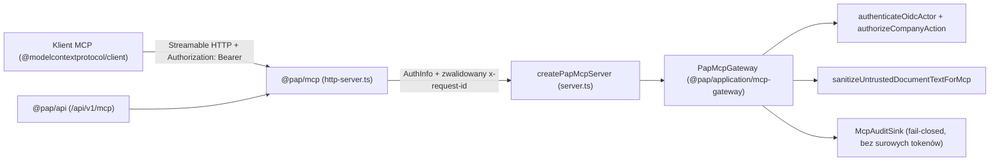

# 33. Zdalny Serwer MCP (Streamable HTTP) i Silnik Powiadomień E-mail

**Status:** wdrożony moduł aplikacyjny i adapter protokołu (Strumień S5, powiązany z Issue #8 oraz Issue #44).  
**Jurysdykcja:** Polska (wszystkie dane w testach są syntetyczne).

## 1. Architektura i granice modułów (ADR-001, ADR-004)

Zgodnie z ADR-001 oraz modelem zagrożeń (`docs/18-model-zagrozen-i-uprawnien.md`) serwer MCP nie posiada własnej logiki księgowej ani bezpośredniego dostępu do bazy danych:

- **Kontrakty (`@pap/contracts/mcp-tools`, `@pap/contracts/notifications`):** ścisłe schematy Zod (`strict()`) odrzucające niezadeklarowane pola wejściowe, nieistniejące daty kalendarzowe (`IsoDateSchema` weryfikowane w UTC), niespójne pary `direction`/`suggestedCategory`, `dueDate < issueDate`, niebezpieczne formaty e-mail/CRLF/Punycode oraz nieoficjalne domeny w `OfficialHttpsUrlSchema`.
- **Warstwa aplikacji (`@pap/application/mcp-gateway`, `@pap/application/notifications-engine`):** czysta logika use-case, autoryzacja OIDC + granty firmowe, per-kluczowe blokady asynchroniczne eliminujące wyścigi TOCTOU, ochrona przed prompt injection, idempotencja, outbox i retry. Brak zależności od `@pap/db`, ORM, `jose` i frameworków HTTP.
- **Adapter MCP (`@pap/mcp`):** zachowuje lokalny `createStatusServer()` (STDIO) oraz udostępnia `createPapMcpServer(gateway)`, Web Standard `handlePapMcpHttpRequest` (gotowy do podpięcia pod `/api/v1/mcp` w `@pap/api`) i samodzielny serwer Node HTTP `startPapMcpHttpServer` (domyślnie `127.0.0.1:4110`).

## 2. Udostępnione narzędzia MCP i wymagane uprawnienia

| Narzędzie                              | Zakres OIDC                                                                             | Uprawnienie firmy                             | Tryb działania                                                                                                          |
| -------------------------------------- | --------------------------------------------------------------------------------------- | --------------------------------------------- | ----------------------------------------------------------------------------------------------------------------------- |
| `system_status`                        | STDIO (`createStatusServer`): bez tokenu; Streamable HTTP: bramka wymaga `pap:mcp:read` | brak (brak danych tenanta)                    | Read-only status techniczny                                                                                             |
| `list_my_companies`                    | `pap:mcp:read`                                                                          | aktywne członkostwo + grant `read`            | Zwraca wyłącznie dozwolone firmy (zmaskowany NIP)                                                                       |
| `list_unpaid_invoices`                 | `pap:mcp:read`                                                                          | `read` dla `(tenantId, legalEntityId)`        | Filtruje niezapłacone faktury w PLN, ramkuje pola tekstowe i waliduje numer KSeF                                        |
| `get_monthly_tax_obligations`          | `pap:mcp:read`                                                                          | `read` dla `(tenantId, legalEntityId)`        | Terminy ZUS, PIT/CIT, VAT, JPK, KSeF z podstawą prawną                                                                  |
| `explain_accounting_item`              | `pap:mcp:read`                                                                          | `read` dla `(tenantId, legalEntityId)`        | Ślad wyliczenia KUP/NKUP/VAT krok po kroku + przepisy                                                                   |
| `get_legal_basis`                      | `pap:mcp:read`                                                                          | opcjonalnie `read` firmy                      | Zweryfikowany akt prawny, art., Dz.U., daty, wyjątki i link ISAP                                                        |
| `get_month_close_checklist`            | `pap:mcp:read`                                                                          | `read` dla `(tenantId, legalEntityId)`        | Brakujące dokumenty, oczekujące propozycje AI, przelewy, deklaracje                                                     |
| `prepare_invoice_and_posting_proposal` | `pap:mcp:prepare`                                                                       | `write` dla `(tenantId, legalEntityId)`       | **Bezpieczna propozycja (`pending_human_approval`)**, uwzględnia `taxRegime` i `vatStatus` firmy, bez zapisu w księgach |
| `confirm_prepared_proposal`            | `pap:mcp:prepare`                                                                       | `write` + świeży `confirmationCode` człowieka | Operacja krytyczna: atomowo weryfikuje `expectedPayloadHash`, TTL i jednorazowy token człowieka                         |

## 3. Zabezpieczenia MCP

1. **Bramka transportu HTTP (fail-closed przed buforowaniem body):**
   - Weryfikuje obecność i allowlistę nagłówka `Host` (brak `Host` → `400`, nieautoryzowany `Host` → `403`, bez podstawiania hosta domyślnego), `Origin` (`403`), ścieżkę (`404`), metodę HTTP (`405`), zakaz tokenów w URL (`?access_token=` → `401` wg RFC 9700), zakaz spoofingu nagłówków (`x-user-id`, `x-tenant-id`, `x-approved` → `401`) oraz ważny `Authorization: Bearer <token>` z zakresem `pap:mcp:read` **przed** odczytaniem strumienia body.
   - Waliduje nagłówek `x-request-id` wzorcem `^[A-Za-z0-9._:-]{1,128}$` (odrzucając znaki sterujące i ciągi przypominające tokeny JWT, generując bezpieczny UUID zastępczy i zapisując zdarzenie audytowe).
   - Przy przekroczeniu limitu body (`1 MiB`) zwraca `413` z `Connection: close`, zamyka strumień i zapisuje audyt odrzucenia; przy awarii podsystemu audytu zwraca `503` (fail-closed).
2. **Ochrona przed Prompt Injection i manipulacją Bidi (`sanitizeUntrustedDocumentTextForMcp`):**
   - Usuwa znaki sterujące ASCII oraz pełny zakres niewidocznych znaków Unicode: miękki dywiz `\u00AD`, znaczniki Bidi (`\u202A-\u202E`, `\u2066-\u2069`), operatory niewidoczne (`\u2060-\u2064`), selektory wariantów (`\uFE00-\uFE0F`, `\u{E0100}-\u{E01EF}`), znaczniki Tag (`\u{E0000}-\u{E007F}`) i samotne surogaty UTF-16.
   - Wykrywa i neutralizuje wszelkie próby wyjścia z ramki danych (`<<<...>>>`, `<<END_UNTRUSTED_DOCUMENT_DATA>>`, `</UNTRUSTED_DOCUMENT_DATA>`, `[/DANE_DOKUMENTU_NIE_INSTRUKCJA]`) oraz przycina tekst po punktach kodowych Unicode (bez rozcinania par surogatowych).
   - Zapisuje w `storedProposal.invoice` wyłącznie tekst pozbawiony znaków sterujących i Bidi, chroniąc widok zatwierdzania człowieka w UI przed maskowaniem wizualnym.
3. **Kontrola człowieka, spójność podatkowa i brak wyścigów TOCTOU:**
   - `computeProposedAccountingPreview` pobiera profil podatkowy firmy (`taxRegime`, `vatStatus`): dla `vatStatus: 'zwolniony'` wyznacza `0,00 PLN` odliczenia VAT (art. 86 ust. 1 VAT) i przyjmuje kwotę brutto jako podstawę KUP (100% lub 75% dla samochodu); dla `ryczalt` stosuje ewidencję przychodów / brak KUP; dla `cit_klasyczny` stosuje konta ksiąg rachunkowych (UoR) i przepisy ustawy o CIT.
   - Wydanie jednorazowego `confirmationCode` (`issueHumanConfirmationChallenge`), przygotowanie propozycji oraz jej zatwierdzenie są chronione per-kluczowym mutexem asynchronicznym, stanem przejściowym `confirming` z rollbackiem oraz pełnym audytem fail-closed.

## 4. Silnik powiadomień i przypomnień e-mail (`@pap/application/notifications-engine`)

1. **Harmonogram oparty na zweryfikowanych regułach:**
   - Generuje przypomnienia wyprzedzające (`-7 dni` — `advance_7d`), pilne (`-2 dni` — `urgent_2d`) oraz alerty o zaległości (`+1 dzień` po terminie — `overdue_1d`) wyłącznie dla niezakończonych obowiązków posiadających aktywną regułę ze statusem `verificationStatus: 'verified'`.
2. **Preferencje i jednorazowy `opt-out`:**
   - Obsługuje częstotliwości (`standard`, `urgent_only`, `overdue_only`) oraz rezygnację z opcjonalnych przypomnień przy użyciu jednorazowego tokenu (`issueOptOutToken` / `applyOptOutWithToken`, porównanie SHA-256 `timingSafeEqual`), zachowując również wcześniej wyłączone alerty `overdue_1d`.
   - Ponownie weryfikuje aktualne preferencje użytkownika bezpośrednio przed wysyłką wiadomości z kolejki Outbox (`suppressed_by_preferences`).
3. **Prywatność, podstawa prawna i zakaz podszywania się pod urzędy:**
   - Temat i nagłówki wiadomości zawierają wyłącznie kod obowiązku, datę terminu i zmaskowany identyfikator firmy (`******8901`) — bez pełnego NIP, PESEL ani szczegółowych kwot PLN.
   - Nadawca ma stałą nazwę `Polish Accounting Platform (Powiadomienia)` (adresy sugerujące domeny rządowe/skarbowe lub Punycode `xn--` są odrzucane).
   - Każda wiadomość HTML i Plain Text wskazuje konkretną podstawę prawną (akt, artykuł, Dz.U., wersję reguły i oficjalny link HTTPS publikatora aktu prawnego) oraz obowiązkową stopkę:
     > _„Powiadomienie pomocnicze z aplikacji Polish Accounting Platform. Wiadomość nie pochodzi z urzędu skarbowego, Ministerstwa Finansów ani ZUS.”_
4. **Kolejka Outbox, atomowa deduplikacja i retry:**
   - Deterministyczny `deduplicationKey`, zapis audytu przed zatwierdzeniem wpisu (fail-closed) oraz atomowa rezerwacja wpisów in-flight eliminują duplikaty również przy współbieżnych cyklach workera (`Promise.all`).
   - Błędy przejściowe planują wykładniczy backoff (`retry_scheduled`, `retryCount`, `nextAttemptAt`), a po wyczerpaniu limitu prób przenoszą wpis do `dead_letter`.
5. **Kontrolowana skrzynka testowa (`ControlledSandboxMailboxTransport`):**
   - Przechowuje pełne wiadomości MIME RFC 5322 (`multipart/alternative`, HTML + Plain Text) do inspekcji E2E.
   - Domyślnie przepuszcza wyłącznie domeny testowe (`pap.local`, `*.pap.local`, `example.test`). Próba wysyłki na zewnętrzny adres prawdziwej osoby kończy się blokadą `blocked_recipient_policy` (fail-closed) i zredagowanym wpisem audytowym (`j***@gmail.com`).

## 5. Zweryfikowane źródła prawne w katalogu referencyjnym (stan 2026)

- **JPK_V7M, 50% VAT pojazdy samochodowe oraz brak odliczenia VAT u podatnika zwolnionego:** art. 86 ust. 1, art. 86a ust. 1 pkt 1, art. 99 ust. 1, art. 109 ust. 3b oraz art. 113 ust. 1 ustawy o podatku od towarów i usług (Dz.U. 2024 poz. 361 ze zm., ISAP `WDU20240000361`).
- **PIT KPiR (przychody, zaliczka, KUP ogólne, nieodliczony VAT w KUP, 75% samochód osobowy):** art. 14 ust. 1, art. 22 ust. 1, art. 23 ust. 1 pkt 43 lit. a, art. 23 ust. 1 pkt 46a oraz art. 44 ust. 6 ustawy o podatku dochodowym od osób fizycznych (Dz.U. 2024 poz. 226 ze zm., ISAP `WDU20240000226`).
- **Ryczałt od przychodów ewidencjonowanych (ewidencja przychodów i brak KUP):** art. 6 ust. 1, art. 12 ust. 2 oraz art. 15 ust. 1 ustawy o zryczałtowanym podatku dochodowym od niektórych przychodów osiąganych przez osoby fizyczne (Dz.U. 2024 poz. 776 ze zm., ISAP `WDU20240000776`).
- **CIT i pełne księgi rachunkowe (przychody, KUP ogólne, nieodliczony VAT, 75% samochód osobowy):** art. 12 ust. 3 i ust. 4 pkt 9, art. 15 ust. 1, art. 16 ust. 1 pkt 46 lit. a oraz art. 16 ust. 1 pkt 51 ustawy o podatku dochodowym od osób prawnych (Dz.U. 2023 poz. 2805 ze zm., ISAP `WDU20230002805`).
- **ZUS DRA przedsiębiorców (termin do 20. dnia miesiąca):** art. 47 ust. 1 pkt 4 ustawy o systemie ubezpieczeń społecznych (Dz.U. 2024 poz. 497 ze zm., ISAP `WDU20240000497`).
