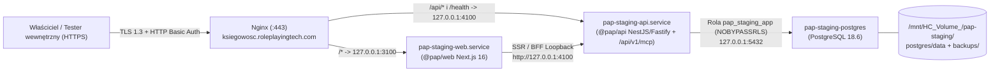

# 37. Instrukcja wdrożenia prywatnego stagingu, kopii zapasowych oraz znanych ograniczeń (§13, §14, §16)

> **Zasada nadrzędna (`AGENTS.md`, `ADR-006`):** W projekcie Polish Accounting Platform **nie istnieje automatyczny deployment**. Każde wdrożenie nowego wydania, wykonanie migracji bazy danych lub zmiana konfiguracji usług na serwerze Hetzner (`hetz-1`) wymaga **odrębnej, jawnej zgody właściciela projektu**. Niniejszy dokument pełni rolę instrukcji operacyjnej (runbooka) oraz jawnego rejestru ograniczeń prawnych i technicznych.
>
> **Redakcja bezpieczeństwa:** Zgodnie z polityką bezpieczeństwa repozytorium żadne prawdziwe hasła, klucze kryptograficzne, tokeny, publiczne adresy IPv4/IPv6 hosta ani numeryczne identyfikatory zasobów chmurowych nie są publikowane w dokumentacji (ścieżka dodatkowego wolumenu blokowego jest oznaczona jako `/mnt/HC_Volume_<ID>/pap-staging/`).

---

## 1. Topologia usług i granice operacyjne hosta (`hetz-1`)

### 1.1. Architektura uruchomieniowa prywatnego stagingu

Kanonicznym i jedynym docelowym adresem prywatnego środowiska testowego jest **`https://ksiegowosc.roleplayingtech.com`** (ASCII, bez domen Punycode/IDN). Cały ruch sieciowy przechodzi przez brzegowy serwer Nginx do procesów powiązanych wyłącznie z interfejsem loopback `127.0.0.1`:



| Warstwa / Jednostka            | Adres i port                                 | Konto / Izolacja zasobów                                                                                         | Przeznaczenie                                                                                                                        |
| ------------------------------ | -------------------------------------------- | ---------------------------------------------------------------------------------------------------------------- | ------------------------------------------------------------------------------------------------------------------------------------ |
| **Nginx Reverse Proxy**        | `:80`, `:443` (publiczny przez `firewall-1`) | `www-data`, certyfikat Let's Encrypt (`--webroot /var/lib/pap-acme`) + bramka `/etc/nginx/pap-staging.htpasswd`  | Ochrona brzegowa całego vhosta (bez wyjątków w Basic Auth) oraz nagłówek `X-Robots-Tag: noindex, nofollow, noarchive`.               |
| **`pap-staging-web.service`**  | `127.0.0.1:3100`                             | `pap` (`uid=999`, `/usr/sbin/nologin`), `MemoryHigh=256M`, `MemoryMax=384M`, `MemorySwapMax=64M`, `CPUQuota=50%` | Serwer Next.js 16 App Router (BFF) uruchamiany z `/opt/pap-runtime/current/bin/node` (`v24.22.1`).                                   |
| **`pap-staging-api.service`**  | `127.0.0.1:4100`                             | `pap` (`uid=999`, `/usr/sbin/nologin`), `MemoryHigh=256M`, `MemoryMax=384M`, `MemorySwapMax=64M`, `CPUQuota=50%` | Serwer NestJS/Fastify wystawiający `/health`, `/api/v1/*` oraz zdalny serwer Streamable HTTP MCP `/api/v1/mcp`.                      |
| **`pap-staging-postgres`**     | `127.0.0.1:5432`                             | Kontener `postgres:18.6-alpine` (przypięty po SHA-256), `mem_limit: 384m`, `memswap_limit: 384m`, `cpus: 0.50`   | Baza `pap_staging` na wolumenie `/mnt/HC_Volume_<ID>/pap-staging/postgres/data` (rozszerzenie `btree_gist`, migracje `0000`–`0007`). |
| **Efemeryczne CI (`ADR-006`)** | `127.0.0.1:<port != 5432>` (np. `55432`)     | `systemd-run --user --scope` (`MemoryMax=768M`, `MemorySwapMax=0`, `CPUQuota=50%`)                               | Całkowicie odseparowany katalog `/mnt/HC_Volume_<ID>/pap-ci-ephemeral` obsługiwany przez `scripts/hetzner/with-ephemeral-pg18.sh`.   |

### 1.2. Nienaruszalne granice operacyjne współdzielonego serwera

Serwer `hetz-1` posiada `3.7 GiB` RAM, `2 vCPU` i współdzieli zasoby z innymi aktywnymi projektami właściciela. Podczas jakichkolwiek prac obowiązują bezwzględne zakazy:

1. **Zakaz dotykania innych kontenerów, procesów PM2 i usług `systemd`:** usługi m.in. `shorts-api`, `reels-api`, `durnoty`, `mumro-articles`, `swiadek-dziejow-articles`, `social-media-manager`, `historia-technologii` oraz `mfc-backend` są całkowicie poza zakresem projektu PAP.
2. **Zakaz aktualizacji systemowego Node.js:** globalne binarium `/usr/bin/node` (`v20.20.2`) należy do istniejących aplikacji; Polish Accounting Platform korzysta wyłącznie z odizolowanego katalogu `/opt/pap-runtime/current` (`Node.js 24.22.1` + `pnpm 12.15.0`).
3. **Zakaz kompilacji (`pnpm build` / `next build`) na hoście stagingu:** ze względu na limit pamięci RAM i aktywny plik wymiany (`swap`), paczka wydania `.tar.gz` musi zostać zbudowana poza usługami stagingu i dostarczona w postaci gotowych artefaktów (`dist/`, `.next/`).
4. **Zakaz modyfikacji Nginx, DNS, reguł zapory `firewall-1` oraz certyfikatów innych domen** (w tym nieudanych historycznych odnowień w globalnym `certbot.service`) bez odrębnego polecenia właściciela.
5. **Zakaz używania bazy `pap_staging` (`:5432`) do testów automatycznych CI:** testy integracyjne korzystają wyłącznie z efemerycznych kontenerów uruchamianych przez `scripts/hetzner/with-ephemeral-pg18.sh`.

---

## 2. Wymagane zmienne środowiskowe (wyłącznie nazwy i przeznaczenie)

Pliki środowiskowe na serwerze znajdują się w katalogu `/etc/pap/` z uprawnieniami `0640 root:pap`. **Nigdy nie zapisuj ich zawartości w repozytorium Git.**

### 2.1. Proces interfejsu webowego (`/etc/pap/pap-staging-web.env`)

| Zmienna środowiskowa     | Wymagana wartość / format (bez sekretów) | Przeznaczenie                                                                                                               |
| ------------------------ | ---------------------------------------- | --------------------------------------------------------------------------------------------------------------------------- |
| `NODE_ENV`               | `production`                             | Wymusza produkcyjne reguły bezpieczeństwa BFF, flagę `Secure` ciasteczek oraz zamkniętą białą listę `API_BASE_URL`.         |
| `HOSTNAME` / `HOST`      | `127.0.0.1`                              | Bindowanie serwera Next.js wyłącznie do interfejsu loopback.                                                                |
| `PORT`                   | `3100`                                   | Dedykowany port lokalny dla vhosta Nginx.                                                                                   |
| `API_BASE_URL`           | `http://127.0.0.1:4100`                  | Bezpośrednia komunikacja SSR/BFF Web → API po loopbacku (omija zewnętrzną bramkę HTTP Basic Auth bez tworzenia w niej luk). |
| `PAP_WEB_SESSION_SECRET` | `<LOSOWY_SEKRET_MIN_32_BAJTY>`           | Klucz serwerowy do podpisywania `HMAC-SHA256` ciasteczka sesji kontekstowej `pap_session_ctx` (`timingSafeEqual`).          |

### 2.2. Proces serwera API i MCP (`/etc/pap/pap-staging-api.env`)

| Zmienna środowiskowa                  | Wymagana wartość / format (bez sekretów)                                | Przeznaczenie                                                                                                 |
| ------------------------------------- | ----------------------------------------------------------------------- | ------------------------------------------------------------------------------------------------------------- |
| `NODE_ENV`                            | `production`                                                            | Tryb produkcyjny NestJS/Fastify i walidatorów konfiguracji.                                                   |
| `HOST`                                | `127.0.0.1`                                                             | Nasłuchiwanie wyłącznie na interfejsie loopback.                                                              |
| `PORT`                                | `4100`                                                                  | Port docelowy dla ścieżek `/api/*` oraz `/health` z Nginx.                                                    |
| `PAP_MCP_ALLOWED_HOSTS`               | `ksiegowosc.roleplayingtech.com,127.0.0.1,localhost`                    | Biała lista nagłówka `Host` wymagana przez bramkę zdalnego serwera Streamable HTTP MCP (`/api/v1/mcp`).       |
| `PAP_MCP_ALLOWED_ORIGINS`             | `https://ksiegowosc.roleplayingtech.com`                                | Biała lista nagłówka `Origin` dla wywołań przeglądarkowych/zdalnych do `/api/v1/mcp`.                         |
| `PAP_DATABASE_ENV` _(gdy aktywne PG)_ | `staging`                                                               | Włącza profil połączenia stagingowego w `@pap/db` (wymaga `NODE_ENV=production` i adresu loopback).           |
| `DATABASE_URL` _(gdy aktywne PG)_     | `postgres://pap_staging_app:<HASLO_RUNTIME>@127.0.0.1:5432/pap_staging` | Połączenie wyłącznie z ograniczoną rolą runtime posiadającą `NOBYPASSRLS` (brak praw DDL i `TRUNCATE`).       |
| `PAP_DB_CONTEXT_KEY_ID`               | `<IDENTYFIKATOR_KLUCZA_KONTEKSTU>`                                      | Identyfikator aktywnego klucza podpisu kontekstu sesji RLS w PostgreSQL (`6D-3B`).                            |
| `PAP_DB_CONTEXT_KEY_HEX`              | `<LOSOWY_KLUCZ_256_BIT_HEX_64_ZNAKI>`                                   | Sekret `HMAC-SHA256` podpisujący transakcyjny kontekst `pap.context` weryfikowany przez polityki `FORCE RLS`. |

#### Bezpiecznik podwójnego klucza dla Sandbox OIDC w prywatnym środowisku testowym

Domyślnie dostawca person testowych (`SandboxOidcService` z kluczami `ES256`) jest **całkowicie zablokowany (`404` / `OidcConfigError`)** w `NODE_ENV=production` oraz dla zewnętrznych adresów `https://`.

1. **Tryb prywatnego testu z personami syntetycznymi (za bramką Nginx HTTP Basic Auth):** aby świadomie odblokować logowanie personami testowymi na prywatnym stagingu, administrator musi ustawić **jednocześnie wszystkie trzy poniższe zmienne** (brak którejkolwiek lub jednoczesne podanie `PAP_OIDC_JWKS_URI` przerywa start API błędem `OidcConfigError`):
   - `PAP_OIDC_ENV=private_test`
   - `PAP_SANDBOX_AUTH_ENABLED=true`
   - `PAP_ALLOW_PRIVATE_TEST_SANDBOX_OIDC=true`
   - oraz `PAP_OIDC_ISSUER=https://ksiegowosc.roleplayingtech.com` i `PAP_OIDC_AUDIENCE=pap-api` _(bez ustawiania `PAP_OIDC_JWKS_URI`)_.
2. **Tryb zewnętrznego dostawcy tożsamości OIDC (docelowy Etap B+):**
   - `PAP_SANDBOX_AUTH_ENABLED=false` (oraz brak `PAP_ALLOW_PRIVATE_TEST_SANDBOX_OIDC`),
   - `PAP_OIDC_ENV=staging`, `PAP_OIDC_ISSUER=<URL_ISSUERA_HTTPS>`, `PAP_OIDC_JWKS_URI=<URL_JWKS_HTTPS>`, `PAP_OIDC_AUDIENCE=pap-api`, `PAP_OIDC_ALLOWED_ALGORITHMS=ES256,RS256`, `PAP_OIDC_ALLOWED_AZP=<CLIENT_ID>`, `PAP_OIDC_REQUIRED_SCOPES=openid,pap:accounting`.

### 2.3. Konfiguracja migratora bazy danych (`/etc/pap/pap-staging-migrate.env`)

Używana **wyłącznie** na czas wykonywania jawnych migracji schematu Drizzle (`0000`–`0007`), nigdy przez proces `pap-staging-api.service`:

- `NODE_ENV=production`
- `PAP_DATABASE_ENV=staging`
- `DATABASE_URL=postgres://pap_staging_migrator:<HASLO_MIGRATORA>@127.0.0.1:5432/pap_staging` (właściciel schematu z prawem DDL, nadal z `NOSUPERUSER` i `NOBYPASSRLS`).

---

## 3. Procedury operacyjne: kopie zapasowe, wdrożenie, testy dymne i rollback

> **Warunek wstępny:** poniższe polecenia na hoście `hetz-1` wykonuje wyłącznie właściciel projektu lub upoważniony operator po uzyskaniu jawnej zgody na konkretny numer SHA wydania.

### 3.1. Kopia zapasowa bazy danych przed wdrożeniem (`pap-db-backup.sh`)

Jeżeli na hoście uruchomiona jest baza `pap_staging` (`127.0.0.1:5432`), przed każdą migracją lub wdrożeniem nowego wydania należy wykonać świeży zrzut `pg_dump` wraz z weryfikacją sumy kontrolnej `SHA-256`:

```bash
# Wykonanie kopii przedwdrożeniowej do /mnt/HC_Volume_<ID>/pap-staging/backups/pre-deploy/
sudo /var/www/pap-staging/bin/pap-db-backup.sh --reason pre-deploy

# Opcjonalny test odtwarzalności kopii na tymczasowej bazie weryfikacyjnej (Restore Drill)
sudo /var/www/pap-staging/bin/pap-db-restore-drill.sh
```

- Cykliczne kopie dobowe realizuje jednostka `pap-staging-backup.timer` (`03:15 UTC`, katalog `backups/daily/`).
- Kopia na lokalnym wolumenie blokowym jest wystarczająca **wyłącznie dla danych syntetycznych**. Przed ewentualnym dopuszczeniem jakichkolwiek danych trwałych obowiązkowe jest skonfigurowanie szyfrowanego po stronie klienta (`age` / `restic`) backupu **off-host** w odrębnej lokalizacji UE/EOG w modelu append-only.

### 3.2. Przygotowanie paczki wydania (poza serwerem) i atomowe wdrożenie (`pap-deploy-release.sh`)

1. **Zbuduj paczkę wydania na maszynie budującej Linux (`x86_64`, Node `24.22.1`, `pnpm 12.15.0`)**, zachowując relatywne symlinki POSIX w drzewie `node_modules` (bez flagi `--dereference`):

   ```bash
   pnpm install --frozen-lockfile
   pnpm build
   tar --exclude='./.git' \
       --exclude='./.github' \
       --exclude='./.turbo' \
       --exclude='*/.turbo' \
       --exclude='./apps/web/.next/cache' \
       --exclude='./test-results' \
       --exclude='./playwright-report' \
       -czf "pap-release-${RELEASE_SHA}.tar.gz" .
   ```

2. **Prześlij archiwum do `/tmp/` na serwerze i uruchom skrypt atomowego wdrożenia:**

   ```bash
   # Wariant z wykonaniem migracji Drizzle (wymaga aktywnego pap-staging-postgres i zgody na migrację):
   sudo /var/www/pap-staging/bin/pap-deploy-release.sh "${RELEASE_SHA}" "/tmp/pap-release-${RELEASE_SHA}.tar.gz" --with-db-migrate

   # Wariant bez migracji DB (tryb Web/API in-memory Etapu A):
   sudo /var/www/pap-staging/bin/pap-deploy-release.sh "${RELEASE_SHA}" "/tmp/pap-release-${RELEASE_SHA}.tar.gz"
   ```

   Skrypt `pap-deploy-release.sh`:
   - rozpakowuje archiwum do niezmienialnego katalogu `/var/www/pap-staging/releases/<id>/`,
   - weryfikuje obecność skompilowanych artefaktów (`apps/api/dist/main.js`, `apps/web/.next/BUILD_ID`, `packages/{contracts,domain,application,ui}/dist/index.js`),
   - podlinkowuje współdzielony katalog cache Next.js (`apps/web/.next/cache -> /var/www/pap-staging/shared/next-cache`),
   - opcjonalnie (gdy podano `--with-db-migrate`) wykonuje migracje na koncie `pap_staging_migrator`,
   - zapisuje poprzedni cel w symlinku `previous`, atomowo przepina `/var/www/pap-staging/current` i restartuje wyłącznie usługi `pap-staging-api.service` oraz `pap-staging-web.service`.

### 3.3. Testy dymne po wdrożeniu (`pap-smoke-test.sh`)

Bezpośrednio po przełączeniu wydania należy zweryfikować zarówno gniazda lokalne loopback, jak i publiczny brzeg HTTPS:

```bash
# 1. Kontrola lokalna po loopbacku (127.0.0.1:4100/health, /api/v1/system/status oraz 127.0.0.1:3100/app)
sudo /var/www/pap-staging/bin/pap-smoke-test.sh --local-only

# 2. Pełna kontrola brzegowa HTTPS (wymuszenie 401 bez Basic Auth, 200 z poświadczeniami, ważność certyfikatu TLS >= 21 dni)
sudo /var/www/pap-staging/bin/pap-smoke-test.sh --edge
```

_Uwaga dot. TLS:_ ponieważ globalny `certbot.service` na współdzielonym hoście raportuje błąd z powodu historycznych domen innych projektów, ważność certyfikatu dla `ksiegowosc.roleplayingtech.com` jest sprawdzana bezpośrednio na gnieździe `:443` (`openssl x509 -checkend $((21 * 86400))`) oraz celowanym testem `sudo certbot renew --cert-name ksiegowosc.roleplayingtech.com --dry-run`.

### 3.4. Natychmiastowy rollback aplikacji (`pap-rollback.sh`)

W razie wykrycia regresji po wdrożeniu (lub automatycznie, gdy krok weryfikacji w `pap-deploy-release.sh` zakończy się błędem) operator przywraca poprzednie wydanie w czasie poniżej kilku sekund:

```bash
sudo /var/www/pap-staging/bin/pap-rollback.sh
sudo /var/www/pap-staging/bin/pap-smoke-test.sh --local-only
```

- Skrypt `pap-rollback.sh` przepina symlink `/var/www/pap-staging/current` z powrotem na `/var/www/pap-staging/previous` i restartuje wyłącznie `pap-staging-api.service` oraz `pap-staging-web.service`.
- **Gwarancja bezpieczeństwa danych:** rollback aplikacji **nigdy nie usuwa tabel, rekordów ani zdarzeń audytowych z bazy PostgreSQL**. Dlatego wszystkie migracje SQL w `@pap/db` muszą zachowywać kompatybilność addytywną (expand-and-contract).

---

## 4. Zgodność prawna, bezpieczeństwo i znane ograniczenia (§16)

Poniższe zestawienie stanowi jawne oświadczenie o granicach odpowiedzialności i technicznych ograniczeniach platformy w obecnym stanie repozytorium:

1. **Brak automatycznej wysyłki do instytucji publicznych i banków:**
   - System **nie wysyła** e-faktur ani zapytań synchronizacyjnych do produkcyjnych lub testowych serwerów Ministerstwa Finansów **KSeF 2.0** (import XML `FA(2)`/`FA(3)` odbywa się z plików lub ładunków lokalnych).
   - System **nie podpisuje ani nie wysyła** plików `JPK_V7M`, `JPK_PKPIR`, `JPK_EWP`, `JPK_KR_PD`, deklaracji `PIT`/`CIT` ani dokumentów rozliczeniowych `ZUS DRA` do bramek `e-Deklaracje` / `e-Urząd Skarbowy` / `PUE (eZUS)`.
   - System **nie łączy się** na żywo z rachunkami bankowymi przez interfejsy `PSD2` i nie zleca przelewów bankowych (obsługuje wyłącznie kontrolowany import plików wyciągów `CSV` i `MT940`).
2. **Blokada zewnętrznej wysyłki wiadomości e-mail (Fail-Closed):**
   - Silnik powiadomień używa wyłącznie izolowanego transportu **`ControlledSandboxMailboxTransport`** przechowującego wiadomości w formacie **MIME RFC 5322** do inspekcji wewnątrz aplikacji (`/app/notifications`).
   - Każda próba zaadresowania wiadomości poza dozwolone domeny testowe/rezerwowe (`pap.local`, `*.pap.local`, `.example`, `.test`, `.invalid`, `.localhost`), np. na rzeczywistą skrzynkę `@gmail.com` lub domenę firmową, kończy się natychmiastową blokadą **`403 Forbidden` (`blocked_recipient_policy`)** i zredagowanym wpisem w audycie.
   - Szablony wiadomości nie zawierają w tematach i nagłówkach pełnego numeru NIP ani kwot podatków oraz posiadają obowiązkową stopkę informującą, że powiadomienie nie pochodzi z urzędu skarbowego, Ministerstwa Finansów ani ZUS.
3. **Wyłącznie dane syntetyczne — zakaz wprowadzania danych rzeczywistych:**
   - Środowisko rozwojowe oraz prywatny staging `https://ksiegowosc.roleplayingtech.com` nie są środowiskiem produkcyjnym RODO.
   - Obowiązuje całkowity zakaz wprowadzania prawdziwych faktur, danych osobowych kontrahentów i pracowników, numerów PESEL, rzeczywistych wyciągów bankowych, tokenów KSeF oraz kluczy podpisu kwalifikowanego.
4. **Aktualny stan trwałej persystencji warstwy HTTP vs schematu PostgreSQL 18:**
   - W pakiecie `@pap/db` wdrożono pełny łańcuch migracji `0000`–`0007` (**27 tabel z `FORCE ROW LEVEL SECURITY`**, rolą `NOBYPASSRLS`, podpisanym kontekstem `pap.context`, triggerami niezmienności i `PostgresAccountingScope`).
   - Jednocześnie warstwa HTTP `apps/api` korzysta w bieżącej konfiguracji domyślnie z deterministycznego, syntetycznego magazynu w pamięci procesu (`InMemoryAccountingWorkspaceStore` w `AccountingWorkspaceService`), co pozwala na bezstanowe testy i restarty środowiska demonstracyjnego bez ryzyka gromadzenia trwałych danych. Przepięcie produkcyjnego runtime HTTP bezpośrednio na `PostgresAccountingScope` oraz zewnętrzny IdP OIDC z MFA stanowi osobny krok przedprodukcyjny.
5. **Bezwzględny obowiązek ludzkiej autoryzacji operacji księgowych:**
   - Modele AI, mechanizmy OCR oraz zewnętrzni klienci MCP pełnią rolę wyłącznie pomocniczą (`prepare_*`). Każde ujęcie dokumentu w księgach wymaga świadomej weryfikacji i zatwierdzenia przez uprawnionego człowieka (`SplitVerificationView` -> `approve-and-post` lub jednorazowy kod wyzwania człowieka `confirmationCode` w MCP).
6. **Brak charakteru doradztwa podatkowego i prawnego:**
   - Reguły prawne 2025–2026 zaimplementowane w `@pap/domain`, wyjaśnienia „§ Dlaczego?” oraz lekcje **Akademii Polskiej Księgowości** mają charakter wyłącznie edukacyjny, informacyjny i pomocniczy.
   - Oprogramowanie nie zastępuje indywidualnej interpretacji przepisów prawa podatkowego (KIS) ani usług licencjonowanego doradcy podatkowego lub uprawnionego biura rachunkowego. Przypadki szczególne oznaczone flagą `requires_expert_review` (m.in. indywidualna stopa wypadkowa `ZUS IWA` czy pełne `100%` odliczenia od pojazdów samochodowych z `VAT-26` i ewidencją przebiegu) zawsze wymagają odrębnej weryfikacji dokumentacji źródłowej przez specjalistę.
