# Plan wdrożenia i pierwszej publikacji na serwerze Hetzner

- **Data:** 2026-10-28
- **Powiązane zadanie:** [Issue #19](https://github.com/RolePlayingTech/polish-accounting-platform/issues/19), [Audyt serwera Hetzner](HETZNER_SERVER_AUDIT_2026-10-28.md), [Architektura stagingu](HETZNER_STAGING_ARCHITECTURE.md), [Checklista gotowości](HETZNER_READINESS_CHECKLIST.md)
- **Status:** Plan operacyjny — **żaden krok wykonawczy nie jest uruchamiany bez osobnej zgody właściciela projektu**.

---

## 1. Dwu-etapowa strategia publikacji

Aby możliwie najszybciej udostępnić właścicielowi działającą wersję aplikacji pod docelową domeną `https://księgowość.roleplayingtech.com` (`xn--ksigowo-c5a1nq1a.roleplayingtech.com`) bez naruszania zasad bezpieczeństwa z `AGENTS.md` i [Issue #6](https://github.com/RolePlayingTech/polish-accounting-platform/issues/6), publikację dzielimy na dwa wyraźnie odseparowane etapy.

### Etap A — Prywatny staging techniczny (najszybsze bezpieczne uruchomienie)

**Cel:** Uruchomienie rzeczywistego frontendu (`@pap/web`), backendu (`@pap/api`), endpointów `/health` i `/api/v1/system/status` oraz zweryfikowanego połączenia HTTPS pod domeną `https://księgowość.roleplayingtech.com`, z dostępem ograniczonym wyłącznie do właściciela.

- **Zakres funkcjonalny:**
  - Interfejs webowy (`/`, `/app`, statyczne `/settings`, `/platform`) pobierający po stronie serwera żywy status z NestJS/Fastify API (`/api/v1/system/status`).
  - Endpoint zdrowia `GET /health` zwracający `{"status":"ok"}`.
  - Pełny TLS (Let's Encrypt) dla `xn--ksigowo-c5a1nq1a.roleplayingtech.com` (oraz opcjonalne przekierowanie `308` z `ksiegowosc.roleplayingtech.com`).
  - Opcjonalny podetap **A.2 (techniczny staging bazy danych)**: uruchomienie lokalnej instancji PostgreSQL 18.6 (`127.0.0.1:5432`, baza `pap_staging`), wykonanie migracji `0000`, `0001` i `0002` oraz testu backup/restore — nadal **bez wystawiania jakichkolwiek endpointów firmowych**.
- **Ograniczenia bezpieczeństwa (Gwarancje Etapu A):**
  - **Brak publicznego dostępu:** cały vhost Nginx jest chroniony bramką uwierzytelniającą właściciela (HTTP Basic Auth z hasłem bcrypt/apr1 w `/etc/nginx/pap-staging.htpasswd` + nagłówek `X-Robots-Tag: noindex, nofollow, noarchive`).
  - **Brak publicznych operacji na firmach i brak kont użytkowników końcowych:** API nie wystawia tras odczytu/zapisu tenantów ani firm.
  - **Brak rzeczywistych danych księgowych:** wyłącznie syntetyczny status techniczny szkieletu.
- **Co już pozwala to zrobić dzisiaj (**[Potwierdzone w repo]**):**
  - `@pap/web` i `@pap/api` budują się przez `pnpm build` i działają produkcyjnie bez wymagania połączenia z bazą danych podczas startu.
  - W `apps/web/lib/read-system-status.ts` przy `NODE_ENV=production` wystarczy podać `API_BASE_URL=https://xn--ksigowo-c5a1nq1a.roleplayingtech.com` (z wyłączeniem `auth_basic` dla wewnętrznego adresu loopback `127.0.0.1` na ścieżce `/api/v1/system/status`) albo w drobnym PR dopuścić loopback `http://127.0.0.1:4100`.
  - Do podetapu A.2 (uruchomienie migracji Drizzle na `pap_staging`) wymagany jest jeden wąski PR rozszerzający `packages/db/src/database-config.ts` o środowisko `PAP_DATABASE_ENV=staging`.

### Etap B — Funkcjonalny staging (dopiero po zamknięciu bramek bezpieczeństwa Issue #6)

**Cel:** Testowanie pełnego przepływu wielopodmiotowego na danych syntetycznych: logowanie użytkownika, bezpieczny wybór firmy, weryfikacja uprawnień, cofanie dostępu i audyt.

- **Bezwzględne warunki wejścia (Stop-gate przed Etapem B):**
  1. **Pakiet `6D-R` (Secure Access Lifecycle — scalony w PR #21, wymaga domknięcia ograniczeń roli DB w `6D-3`):** transakcyjny `manageAccess` z blokadą `SELECT FOR UPDATE`, trwałe odwołanie wszystkich grantów przy cofnięciu członkostwa, brak przywracania historycznych grantów po reaktywacji oraz guardy triggerowe w `0002_access-lifecycle.sql`.
  2. **Ukończony i scalony pakiet `6D-2` (OIDC + egzekwowanie w API):** serwerowy adapter OIDC, walidacja `iss`/`aud`/`exp`/`nbf`, mapowanie `(issuer, subject) -> userId`, produkcyjny autoryzator administracyjny i egzekwowanie `authorizeCompanyAction` w API.
  3. **Ukończony i scalony pakiet `6D-3` (Rola runtime DB + RLS + Audyt):** dedykowana rola `pap_staging_app` z `NOBYPASSRLS` (bez praw DDL/`TRUNCATE`/wyłączania triggerów i bez dowolnego DML omijającego kontrolowaną ścieżkę mutacji), polityki PostgreSQL RLS z `FORCE ROW LEVEL SECURITY`, transakcyjny kontekst `set_config(..., true)` (`SET LOCAL`) eliminujący TOCTOU między decyzją a operacją na danych, testy reużycia puli połączeń i audyt decyzji fail-closed.
  4. **Ukończony pakiet `6E`:** bezpieczny wybór kontekstu firmy w UI.

### Porównanie trzech poziomów dojrłości środowiska

| Cecha | Etap A: Prywatny staging techniczny | Etap B: Funkcjonalny staging (syntetyczny) | Przyszła Produkcja |
| --- | --- | --- | --- |
| **Odbiorcy** | Wyłącznie właściciel projektu | Właściciel / testerzy wewnętrzni | Rzeczywiste firmy i księgowi |
| **Ochrona brzegu** | Bramka Nginx Basic Auth / IP allowlist | Bramka Nginx + logowanie OIDC z MFA | Publiczny brzeg z WAF/rate-limit + OIDC z MFA |
| **Baza danych** | Brak w API (w A.2: tylko techniczna migracja `0000`/`0001` na `pap_staging`) | `pap_staging` z rolą `NOBYPASSRLS`, RLS, `SET LOCAL` i audytem | Dedykowany serwer DB w UE/EOG z szyfrowaniem, PITR i KMS |
| **Dozwolone dane** | Wyłącznie stałe metadane statusu modułów | **Wyłącznie dane syntetyczne** (fikcyjne NIP/firmy/dokumenty) | Dane rzeczywiste (po przeglądzie prawnym, RODO i eksperckim) |
| **Połączenia z MF / KSeF** | Brak | Brak (lub wyłącznie testowe stuby/sandbox) | Tylko jawnie zatwierdzone adaptery po odbiorze profilu |

---

## 2. Procedura przygotowania i wdrożenia Etapu A (krok po kroku — po zgodzie właściciela)

Poniższe kroki stanowią dokładną instrukcję wykonawczą, która zostanie zrealizowana **dopiero po zatwierdzeniu planu przez właściciela**.

### Krok 1: Konfiguracja DNS (w panelu domeny `roleplayingtech.com`)

1. Dodać rekord dla docelowej domeny IDN (`księgowość.roleplayingtech.com`):
   - Typ: `A`
   - Nazwa (Host): `xn--ksigowo-c5a1nq1a`
   - Wartość: `<HETZNER_IPV4>` (ten sam adres IPv4 co istniejący rekord `ksiegowosc.roleplayingtech.com`)
   - TTL: `600`
2. *(Opcjonalnie, rekomendowane dla spójności dual-stack)* Dodać rekord `AAAA`:
   - Nazwa (Host): `xn--ksigowo-c5a1nq1a`
   - Wartość: `<HETZNER_IPV6_PREFIX>::1`
   - TTL: `600`
3. Zweryfikować propagację:
   ```bash
   dig +short xn--ksigowo-c5a1nq1a.roleplayingtech.com A
   ```

### Krok 2: Przygotowanie izolowanego konta, katalogów i runtime Node.js 24 na serwerze

Na wzór działającego na serwerze `/opt/durnoty-runtime` (**[Potwierdzone na serwerze]**), bez modyfikacji `/usr/bin/node`:
1. Utworzyć konto systemowe `pap`:
   ```bash
   sudo useradd --system --user-group --home-dir /var/lib/pap-staging --create-home --shell /usr/sbin/nologin pap
   ```
2. Utworzyć strukturę katalogów:
   ```bash
   sudo install -d -m 0755 -o root -g root /opt/pap-runtime
   sudo install -d -m 0750 -o root -g pap /var/www/pap-staging /var/www/pap-staging/releases /etc/pap
   sudo install -d -m 0700 -o root -g root /var/lib/pap-acme
   sudo install -d -m 0700 -o root -g root /mnt/HC_Volume_<REDACTED>/pap-staging/backups
   ```
3. Zainstalować oficjalne wydanie Node.js `v24.22.1` (`linux-x64`) oraz `pnpm@12.15.0` wyłącznie w `/opt/pap-runtime` (ze sprawdzeniem oficjalnej sumy `SHASUMS256.txt`).

### Krok 3: Wydanie certyfikatu TLS (tryb `webroot`, bez naruszania innych vhostów)

Aby uniknąć problemów z wtyczką `--nginx` Certbota (która obecnie zawodzi przy globalnym `certbot renew` z powodu historycznych domen `app.mumro.io` i `roleplayingtech.com-0001` **[Potwierdzone na serwerze]**):
1. Dodać vhost HTTP (`:80`) dla `xn--ksigowo-c5a1nq1a.roleplayingtech.com` (oraz opcjonalnie `ksiegowosc.roleplayingtech.com`) obsługujący `/.well-known/acme-challenge/` z katalogu `/var/lib/pap-acme` (identycznie jak działający vhost `durnoty.pl`).
2. Przetestować konfigurację przez `sudo nginx -t` i przeładować bez przerywania połączeń: `sudo systemctl reload nginx`.
3. Wydać certyfikat przez:
   ```bash
   sudo certbot certonly --webroot -w /var/lib/pap-acme \
     -d xn--ksigowo-c5a1nq1a.roleplayingtech.com \
     -d ksiegowosc.roleplayingtech.com
   ```
   *(Dzięki `authenticator = webroot` odnowienie tego certyfikatu nie zależy od parsera wszystkich plików Nginx).*

### Krok 4: Konfiguracja jednostek `systemd` i reverse proxy Nginx z bramką autoryzacji

1. Utworzyć plik `/etc/nginx/pap-staging.htpasswd` (`root:www-data`, `0640`) z silnym hasłem właściciela.
2. Skonfigurować `/etc/nginx/sites-available/ksiegowosc.roleplayingtech.com`:
   - Przekierowanie `301`/`308` z HTTP (`:80`) na HTTPS (`https://xn--ksigowo-c5a1nq1a.roleplayingtech.com$request_uri`).
   - Przekierowanie `308` z `https://ksiegowosc.roleplayingtech.com` na `https://xn--ksigowo-c5a1nq1a.roleplayingtech.com$request_uri`.
   - W głównym bloku `server` (`server_name xn--ksigowo-c5a1nq1a.roleplayingtech.com;`):
     - `auth_basic "Polish Accounting Platform — Private Staging";`
     - `auth_basic_user_file /etc/nginx/pap-staging.htpasswd;`
     - Nagłówki bezpieczeństwa: `Strict-Transport-Security`, `X-Content-Type-Options: nosniff`, `X-Frame-Options: DENY`, `Referrer-Policy: no-referrer`, `X-Robots-Tag: noindex, nofollow, noarchive`.
     - Proxy `/api/` oraz `/health` do `http://127.0.0.1:4100`.
     - Proxy `/` do `http://127.0.0.1:3100`.
3. Skonfigurować i uruchomić utwardzone jednostki `pap-staging-api.service` (`127.0.0.1:4100`) oraz `pap-staging-web.service` (`127.0.0.1:3100`).

---

## 3. Plan CI/CD, ochrona gałęzi `main` i aktualizacje z GitHuba

### 3.1. Ochrona gałęzi `main` (Branch Ruleset)

Badanie przez GitHub API wykazało, że gałąź `main` ma obecnie status `protected: false` (**[Potwierdzone w repo]**). Przed uruchomieniem jakiegokolwiek wdrożenia ze zdalnego repozytorium należy skonfigurować w GitHubie (`Settings -> Rules -> Rulesets`) regułę dla `main`:

- **Block force pushes:** Włączone.
- **Require a pull request before merging:** Włączone (`Required approvals: 1`, `Dismiss stale pull request approvals when new commits are pushed`).
- **Require status checks to pass before merging:** Włączone (`Require branches to be up to date before merging`), z obowiązkowymi wszystkimi 3 jobami z `.github/workflows/ci.yml`:
  1. `PostgreSQL migrations, constraints and authorization adapter` (`db-integration`)
  2. `Lint, typecheck, test, build and dependency audit` (`checks`)
  3. `Scan repository history for secrets` (`secrets`)
- **Require linear history:** Włączone (zgodnie z dotychczasową praktyką squash merge).

### 3.2. Przepływ wdrożeniowy (CD) z ręczną bramką zatwierdzania

**Zasada nadrzędna:** Żadnego automatycznego deploymentu po zwykłym `git push` bez zatwierdzenia.

```mermaid
flowchart LR
    PR["Pull Request"] --> CI["CI: lint, typecheck, test,<br/>db-integration, e2e, gitleaks, audit"]
    CI --> Merge["Merge do main<br/>(po review)"]
    Merge --> Dispatch["Ręczne wyzwolenie<br/>workflow_dispatch (wybór SHA)"]
    Dispatch --> Gate["GitHub Environment: staging<br/>Required Reviewer (Właściciel)"]
    Gate --> Build["Budowanie artefaktu wydania<br/>na runnerze GitHub + SHA-256"]
    Build --> Backup["Backup bazy pap_staging<br/>przed migracją"]
    Backup --> Migrate["Migracja Drizzle<br/>(konto pap_staging_migrator)"]
    Migrate --> Switch["Atomowe przełączenie symlinka<br/>current + restart usług PAP"]
    Switch --> Smoke["Health check (/health, /app)<br/>Automatyczny rollback przy błędzie"]
```



1. **Budowanie poza serwerem:** Artefakt wydania (`release-<sha>.tar.zst` z wynikami `pnpm build`) powstaje na runnerze GitHub Actions, po przejściu wszystkich testów. Zatrzymanie któregokolwiek testu przerywa proces przed połączeniem z serwerem.
2. **Izolowany klucz wdrożeniowy:** Połączenie z Hetznerem używa dedykowanego klucza SSH przypisanego do środowiska GitHub Environment `staging` (chronionego wymogiem ręcznego kliknięcia `Approve` przez właściciela) oraz ograniczonych uprawnień `sudo` wyłącznie dla poleceń `systemctl restart/status pap-staging-*`.
3. **Brak wpływu na inne aplikacje:** Skrypt wdrożeniowy operuje wyłącznie na katalogu `/var/www/pap-staging/` i jednostkach `pap-staging-api.service` oraz `pap-staging-web.service`. Nigdy nie wykonuje `systemctl restart nginx` (co najwyżej bezprzerwowe `reload` przy zmianie pliku vhosta), nie dotyka kontenerów `shorts-api` / `reels-api` ani procesów PM2.
4. **Procedura Rollbacku:**
   - W `/var/www/pap-staging/releases/` zachowywane są minimum 3 ostatnie wersje.
   - Jeżeli po przełączeniu symlinka `current` i restarcie usług test `curl --fail http://127.0.0.1:4100/health` lub `http://127.0.0.1:3100/app` nie zwróci `200 OK` w ciągu 15 sekund, skrypt automatycznie przepina symlink `current` z powrotem na poprzednie wydanie i restartuje usługi `pap-staging-*`.
   - Zgodnie z [ADR-002](adr/002-stos-technologiczny-i-wdrozenia.md) rollback aplikacji **nigdy nie kasuje tabel ani danych z bazy PostgreSQL** — migracje muszą być kompatybilne w przód (`expand -> migrate -> contract`).

---

## 4. Ocena zależności `esbuild 0.18.20` (GHSA-67mh-4wv8-2f99) i polityka aktualizacji

Zgodnie z wymaganiem w [Issue #19](https://github.com/RolePlayingTech/polish-accounting-platform/issues/19) przeprowadzono analizę łańcucha zależności w `pnpm-lock.yaml` (**[Potwierdzone w repo]**):

1. **Źródło zależności:**
   - W repozytorium występują trzy wersje `esbuild`:
     - `esbuild@0.28.2` (w `tsx@4.23.15` i `vite@8.3.5` używanym przez `vitest@5.0.5`) — **bezpieczna**.
     - `esbuild@0.25.12` (bezpośrednia zależność `drizzle-kit@0.31.11`) — **bezpieczna**.
     - `esbuild@0.18.20` — wciągana przechodnio wyłącznie przez `drizzle-kit@0.31.11 -> @esbuild-kit/esm-loader@2.6.5 -> @esbuild-kit/core-utils@3.3.2`.
2. **Ocena ryzyka:**
   - Podatność `GHSA-67mh-4wv8-2f99` (poziom `moderate`) dotyczy wyłącznie lokalnego serwera HTTP uruchamianego poleceniem `esbuild --serve`.
   - Pakiet `drizzle-kit` jest zależnością deweloperską (`devDependencies` w `packages/db/package.json`), używaną wyłącznie lokalnie przez CLI `pnpm db:generate`. Nie jest używany podczas `pnpm db:migrate` (które korzysta z `drizzle-orm/postgres-js/migrator` i `tsx`) ani nie wchodzi w skład runtime `@pap/web`, `@pap/api` i `@pap/mcp`.
   - Dlatego obecność `esbuild@0.18.20` **nie stwarza zagrożenia dla środowiska stagingowego na Hetznerze**.
3. **Polityka docelowa:**
   - W osobnym technicznym PR zależności można przetestować wymuszenie w głównym `package.json`:
     ```json
     "pnpm": {
       "overrides": {
         "@esbuild-kit/core-utils>esbuild": "0.25.12"
       }
     }
     ```
     i zweryfikować działanie `pnpm db:generate` oraz `pnpm test`, lub zaktualizować `drizzle-kit` po wydaniu wersji usuwającej przestarzały `@esbuild-kit/*`.

---

## 5. Estymacja prac pozostałych do pierwszego prywatnego stagingu (Etap A)

| Zadanie | Typ pracy | Szacowany czas realizacji (po zgodzie właściciela) |
| --- | --- | --- |
| 1. Dodanie rekordu DNS `A` (i opcjonalnie `AAAA`) dla `xn--ksigowo-c5a1nq1a.roleplayingtech.com` | Konfiguracja DNS (właściciel) | ~5–10 min (+ propagacja TTL 600s) |
| 2. Wąski PR konfiguracyjny w repozytorium (obsługa loopback HTTP w `readPublicSystemStatus` + profil `PAP_DATABASE_ENV=staging` w `@pap/db`) | Kod + testy jednostkowe + PR | ~1–2 godz. |
| 3. Przygotowanie `/opt/pap-runtime` (Node 24.22.1 + pnpm 12.15.0), konta `pap`, katalogów `/var/www/pap-staging` i jednostek `systemd` | Konfiguracja serwera Hetzner | ~30–45 min |
| 4. Wydanie certyfikatu Let's Encrypt (`webroot`) i konfiguracja vhosta Nginx z bramką Basic Auth | Konfiguracja Nginx / TLS | ~20–30 min |
| 5. Opcjonalny podetap A.2: uruchomienie `postgres:18.6-alpine` na `127.0.0.1:5432`, inicjalizacja ról `pap_staging_migrator`/`pap_staging_app`, migracje `0000`/`0001` i test `pap-staging-backup.service` | Konfiguracja DB + Restore Drill | ~45–60 min |
| **Łącznie do uruchomienia Etapu A:** | — | **ok. 2,5 – 4 godzin pracy inżynieryjnej** |
