# Plan wdrożenia i pierwszej publikacji na serwerze Hetzner

- **Data:** 2026-10-28
- **Powiązane zadanie:** [Issue #19](https://github.com/RolePlayingTech/polish-accounting-platform/issues/19), [Audyt serwera Hetzner](HETZNER_SERVER_AUDIT_2026-10-28.md), [Architektura stagingu](HETZNER_STAGING_ARCHITECTURE.md), [Checklista gotowości](HETZNER_READINESS_CHECKLIST.md)
- **Docelowa domena (jedyna kanoniczna):** `https://ksiegowosc.roleplayingtech.com`
- **Status:** Środowisko serwerowe przygotowane w stanie nieaktywnym (`READY TO DEPLOY`) — **uruchomienie usług i aktywacja vhosta wymagają osobnej zgody właściciela projektu**.

---

## 1. Dwu-etapowa strategia publikacji

Aby możliwie najszybciej udostępnić właścicielowi działającą wersję aplikacji pod docelową domeną **`https://ksiegowosc.roleplayingtech.com`** bez naruszania zasad bezpieczeństwa z `AGENTS.md` i [Issue #6](https://github.com/RolePlayingTech/polish-accounting-platform/issues/6), publikację dzielimy na dwa wyraźnie odseparowane etapy.

### Etap A — Prywatny staging techniczny (najszybsze bezpieczne uruchomienie)

**Cel:** Uruchomienie rzeczywistego frontendu (`@pap/web`), backendu (`@pap/api`), endpointów `/health` i `/api/v1/system/status` oraz zweryfikowanego połączenia HTTPS pod domeną `https://ksiegowosc.roleplayingtech.com`, z dostępem ograniczonym wyłącznie do właściciela.

- **Zakres funkcjonalny:**
  - Interfejs webowy (`/`, `/app`, statyczne `/settings`, `/platform`) pobierający po stronie serwera żywy status z NestJS/Fastify API (`/api/v1/system/status`).
  - Endpoint zdrowia `GET /health` zwracający `{"status":"ok"}`.
  - Pełny TLS (Let's Encrypt) wyłącznie dla kanonicznej domeny `ksiegowosc.roleplayingtech.com` (bez domeny IDN/Punycode i bez przekierowań z innych domen).
  - Opcjonalny podetap **A.2 (techniczny staging bazy danych)**: uruchomienie lokalnej instancji PostgreSQL 18.6 (`127.0.0.1:5432`, baza `pap_staging`), wykonanie migracji `0000`, `0001` i `0002` oraz testu backup/restore — nadal **bez wystawiania jakichkolwiek endpointów firmowych**.
- **Ograniczenia bezpieczeństwa (Gwarancje Etapu A):**
  - **Brak publicznego dostępu:** cały vhost Nginx jest chroniony bramką uwierzytelniającą właściciela (HTTP Basic Auth w `/etc/nginx/pap-staging.htpasswd` + nagłówek `X-Robots-Tag: noindex, nofollow, noarchive`).
  - **Brak publicznych operacji na firmach i brak kont użytkowników końcowych:** API nie wystawia tras odczytu/zapisu tenantów ani firm.
  - **Brak rzeczywistych danych księgowych:** wyłącznie syntetyczny status techniczny szkieletu.
- **Stan przygotowania w repozytorium i na hoście:**
  - [PR #23](https://github.com/RolePlayingTech/polish-accounting-platform/pull/23) wprowadza w `apps/web/lib/read-system-status.ts` przy `NODE_ENV=production` zamkniętą allowlistę originów (`http://127.0.0.1:4100` dla komunikacji serwerowej loopback oraz `https://ksiegowosc.roleplayingtech.com` z `redirect: 'error'`). Dzięki temu **nie otwieramy żadnego wyjątku od Basic Auth w Nginx dla `/api/v1/system/status`**.
  - [PR #24](https://github.com/RolePlayingTech/polish-accounting-platform/pull/24) rozszerza `packages/db/src/database-config.ts` o środowisko `PAP_DATABASE_ENV=staging` z rozdziałem ról `pap_staging_migrator` i `pap_staging_app` na potrzeby podetapu A.2.

### Etap B — Funkcjonalny staging (dopiero po zamknięciu bramek bezpieczeństwa Issue #6)

**Cel:** Testowanie pełnego przepływu wielopodmiotowego na danych syntetycznych: logowanie użytkownika, bezpieczny wybór firmy, weryfikacja uprawnień, cofanie dostępu i audyt.

- **Bezwzględne warunki wejścia (Stop-gate przed Etapem B):**
  1. **Pakiet `6D-R` (Secure Access Lifecycle — scalony w PR #21, wymaga domknięcia ograniczeń roli DB w `6D-3`):** transakcyjny `manageAccess` z blokadą `SELECT FOR UPDATE`, trwałe odwołanie wszystkich grantów przy cofnięciu członkostwa, brak przywracania historycznych grantów po reaktywacji oraz guardy triggerowe w `0002_access-lifecycle.sql`.
  2. **Ukończony i scalony pakiet `6D-2` (OIDC + egzekwowanie w API):** serwerowy adapter OIDC z `redirect_uri` na `https://ksiegowosc.roleplayingtech.com`, walidacja `iss`/`aud`/`exp`/`nbf`, mapowanie `(issuer, subject) -> userId`, produkcyjny autoryzator administracyjny i egzekwowanie `authorizeCompanyAction` w API.
  3. **Ukończony i scalony pakiet `6D-3` (Rola runtime DB + RLS + Audyt):** dedykowana rola `pap_staging_app` z `NOBYPASSRLS` (bez praw DDL/`TRUNCATE`/wyłączania triggerów), polityki PostgreSQL RLS z `FORCE ROW LEVEL SECURITY`, transakcyjny kontekst `set_config(..., true)` (`SET LOCAL`) eliminujący TOCTOU między decyzją a operacją na danych, testy reużycia puli połączeń i audyt decyzji fail-closed.
  4. **Ukończony pakiet `6E`:** bezpieczny wybór kontekstu firmy w UI.

### Porównanie trzech poziomów dojrzałości środowiska

| Cecha | Etap A: Prywatny staging techniczny | Etap B: Funkcjonalny staging (syntetyczny) | Przyszła Produkcja |
| --- | --- | --- | --- |
| **Odbiorcy** | Wyłącznie właściciel projektu | Właściciel / testerzy wewnętrzni | Rzeczywiste firmy i księgowi |
| **Ochrona brzegu** | Bramka Nginx Basic Auth (cały vhost bez wyjątków) / IP allowlist | Bramka Nginx + logowanie OIDC z MFA | Publiczny brzeg z WAF/rate-limit + OIDC z MFA |
| **Baza danych** | Brak w API (w A.2: pełny łańcuch migracji `0000–0002` na `pap_staging`) | `pap_staging` z rolą `NOBYPASSRLS`, RLS, `SET LOCAL` i audytem | Dedykowany serwer DB w UE/EOG z szyfrowaniem, PITR i KMS |
| **Kopie zapasowe (Backup)** | Lokalny `pg_dump` na drugim wolumenie hosta + test restore (wystarczający wyłącznie dla danych syntetycznych) | Lokalny `pg_dump` + szyfrowany backup off-host (przed utrzymywaniem trwałych środowisk testowych) | Szyfrowany backup off-host (append-only w innej lokalizacji UE/EOG) + PITR + cykliczny restore drill |
| **Dozwolone dane** | Wyłącznie stałe metadane statusu modułów | **Wyłącznie dane syntetyczne** (fikcyjne NIP/firmy/dokumenty) | Dane rzeczywiste (po przeglądzie prawnym, RODO i eksperckim) |
| **Połączenia z MF / KSeF** | Brak | Brak (lub wyłącznie testowe stuby/sandbox) | Tylko jawnie zatwierdzone adaptery po odbiorze profilu |

---

## 2. Procedura uruchomienia Etapu A (po zgodzie właściciela)

### Krok 1: Weryfikacja DNS (już skonfigurowany i rozpropagowany)

Rekord `A` dla jedynej docelowej domeny `ksiegowosc.roleplayingtech.com` jest już skonfigurowany w strefie `roleplayingtech.com` i wskazuje na adres IPv4 serwera `hetz-1` (`[Potwierdzone na serwerze]`). Przed startem należy jedynie potwierdzić brak zmian:
```bash
dig +short ksiegowosc.roleplayingtech.com A
/var/www/pap-staging/bin/pap-preflight-check.sh
```

### Krok 2: Izolowane konto, katalogi i runtime Node.js 24 na serwerze (ZREALIZOWANE)

Na serwerze przygotowano (bez modyfikacji `/usr/bin/node` i bez uruchamiania usług):
1. Konto systemowe `pap` (`uid=999(pap) gid=987(pap)`, `/usr/sbin/nologin`, zablokowane hasło).
2. Strukturę katalogów:
   - `/opt/pap-runtime` (`0755 root:root`, Node.js `v24.22.1` + `pnpm 12.15.0`)
   - `/var/www/pap-staging` (`0750 root:pap`), `/var/www/pap-staging/releases`, `/var/www/pap-staging/shared`, `/var/www/pap-staging/bin`
   - `/etc/pap` (`0750 root:pap`, pliki środowiskowe `0640 root:pap`)
   - `/var/lib/pap-acme/.well-known/acme-challenge` (`0750 root:www-data` — brak prawa zapisu dla `www-data`)
   - `/mnt/HC_Volume_<REDACTED>/pap-staging` (`0700 root:root` — podkatalogi `postgres/data`, `backups/daily`, `backups/pre-deploy`, `compose`, `sql`)

### Krok 3: Wydanie certyfikatu TLS dla `ksiegowosc.roleplayingtech.com` (po zgodzie właściciela)

Aby uniknąć problemów z wtyczką `--nginx` Certbota (która zawodzi przy globalnym `certbot renew` z powodu historycznych domen `app.mumro.io` i `roleplayingtech.com-0001` **[Potwierdzone na serwerze]**):
1. Aktywować przygotowany vhost bootstrap HTTP (`:80`):
   ```bash
   sudo ln -sfn /etc/nginx/sites-available/pap-staging.bootstrap-http.conf /etc/nginx/sites-enabled/pap-staging.conf
   sudo nginx -t && sudo systemctl reload nginx
   ```
2. **Przeprowadzić obowiązkowy test odczytu pliku challenge przez Nginx (`www-data`) przed uruchomieniem Certbota:**
   ```bash
   sudo sh -c 'printf "acme-challenge-read-ok\n" > /var/lib/pap-acme/.well-known/acme-challenge/healthcheck.txt'
   sudo chown root:www-data /var/lib/pap-acme/.well-known/acme-challenge/healthcheck.txt
   sudo chmod 0640 /var/lib/pap-acme/.well-known/acme-challenge/healthcheck.txt
   curl --fail --silent --show-error http://ksiegowosc.roleplayingtech.com/.well-known/acme-challenge/healthcheck.txt
   sudo rm -f /var/lib/pap-acme/.well-known/acme-challenge/healthcheck.txt
   ```
3. Wydać certyfikat wyłącznie dla `ksiegowosc.roleplayingtech.com` z jawnym hookiem przeładowania Nginx:
   ```bash
   sudo certbot certonly --webroot -w /var/lib/pap-acme \
     --cert-name ksiegowosc.roleplayingtech.com \
     -d ksiegowosc.roleplayingtech.com \
     --deploy-hook "systemctl reload nginx"
   ```
4. **Zweryfikować proces odnawiania tego konkretnego certyfikatu (`--dry-run`) i skonfigurować monitoring ważności:**
   ```bash
   sudo certbot renew --cert-name ksiegowosc.roleplayingtech.com --dry-run
   ```
   *Ważne:* samo użycie `--webroot` dla nowej domeny **nie naprawia globalnego stanu `failed` jednostki `certbot.service`**, dopóki w `/etc/letsencrypt/renewal/` znajdują się nieaktualne pliki `app.mumro.io.conf` i `roleplayingtech.com-0001.conf` należące do innych projektów. Dlatego skrypt `/var/www/pap-staging/bin/pap-smoke-test.sh --edge` monitoruje bezpośrednio datę wygaśnięcia certyfikatu prezentowanego na porcie `443` (`openssl s_client -servername ksiegowosc.roleplayingtech.com -connect 127.0.0.1:443 ... -checkend $((21 * 86400))`).

### Krok 4: Aktywacja jednostek `systemd` i docelowego vhosta HTTPS z bramką Basic Auth

1. Utworzyć plik `/etc/nginx/pap-staging.htpasswd` (`root:www-data`, `0640`) z silnym hasłem właściciela.
2. Wdrożyć paczkę artefaktów z CI za pomocą przygotowanego skryptu:
   ```bash
   sudo systemctl enable pap-staging-api.service pap-staging-web.service pap-staging-healthcheck.timer
   sudo /var/www/pap-staging/bin/pap-deploy-release.sh <release-sha> /tmp/pap-release-<sha>.tar.gz
   ```
3. Przełączyć vhost Nginx na docelową konfigurację HTTPS (`/etc/nginx/sites-available/pap-staging.https.conf`):
   ```bash
   sudo ln -sfn /etc/nginx/sites-available/pap-staging.https.conf /etc/nginx/sites-enabled/pap-staging.conf
   sudo nginx -t && sudo systemctl reload nginx
   ```
4. Wykonać pełny test brzegowy:
   ```bash
   sudo /var/www/pap-staging/bin/pap-smoke-test.sh --edge
   ```

---

## 3. Plan CI/CD, ochrona gałęzi `main` i aktualizacje z GitHuba

### 3.1. Ochrona gałęzi `main` (Branch Ruleset)

Badanie przez GitHub API wykazało, że gałąź `main` ma obecnie status `protected: false` (**[Potwierdzone w repo]**). Przed uruchomieniem jakiegokolwiek wdrożenia ze zdalnego repozytorium należy skonfigurować w GitHubie (`Settings -> Rules -> Rulesets`) regułę dla `main`:

- **Block force pushes:** Włączone.
- **Require a pull request before merging:** Włączone (`Required approvals: 1`, `Dismiss stale pull request approvals when new commits are pushed`).
- **Require status checks to pass before merging:** Włączone (`Require branches to be up to date before merging`), z obowiązkowymi wszystkimi 3 jobami z `.github/workflows/ci.yml`:
  1. `PostgreSQL migrations, constraints and authorization adapter` (`db-integration`)
  2. `Lint, typecheck, test, build and dependency audit` (`checks`)
  3. `Scan repository history for secrets` (`secrets`)
- **Require linear history:** Włączone (zgodnie z dotychczasową praktyką squash merge).

### 3.2. Przepływ wdrożeniowy (CD) z ręczną bramką zatwierdzania

**Zasada nadrzędna:** Żadnego automatycznego deploymentu po zwykłym `git push` bez zatwierdzenia.

```mermaid
flowchart LR
    PR["Pull Request"] --> CI["CI: lint, typecheck, test,<br/>db-integration, e2e, gitleaks, audit"]
    CI --> Merge["Merge do main<br/>(po review)"]
    Merge --> Dispatch["Ręczne wyzwolenie<br/>workflow_dispatch (wybór SHA)"]
    Dispatch --> Gate["GitHub Environment: staging<br/>Required Reviewer (Właściciel)"]
    Gate --> Build["Budowanie artefaktu wydania<br/>na runnerze GitHub + SHA-256"]
    Build --> Backup["Backup bazy pap_staging<br/>przed migracją"]
    Backup --> Migrate["Migracja Drizzle<br/>(konto pap_staging_migrator)"]
    Migrate --> Switch["Atomowe przełączenie symlinka<br/>current + restart usług PAP"]
    Switch --> Smoke["Health check (/health, /app)<br/>Automatyczny rollback przy błędzie"]
```



1. **Budowanie poza serwerem:** Artefakt wydania (`release-<sha>.tar.gz` z wynikami `pnpm build`) powstaje poza serwerem Hetzner, po przejściu wszystkich testów.
2. **Brak wpływu na inne aplikacje:** Skrypt `/var/www/pap-staging/bin/pap-deploy-release.sh` operuje wyłącznie na katalogu `/var/www/pap-staging/` i jednostkach `pap-staging-api.service` oraz `pap-staging-web.service`.
3. **Procedura Rollbacku (`/var/www/pap-staging/bin/pap-rollback.sh`):**
   - Jeżeli po przełączeniu symlinka `current` i restarcie usług test `/var/www/pap-staging/bin/pap-smoke-test.sh --local-only` nie zwróci `0`, skrypt automatycznie przepina symlink `current` z powrotem na `/var/www/pap-staging/previous` i restartuje wyłącznie usługi `pap-staging-*`.
   - Rollback aplikacji **nigdy nie kasuje tabel ani danych z bazy PostgreSQL**.

---

## 4. Ocena zależności `esbuild 0.18.20` (GHSA-67mh-4wv8-2f99) i polityka aktualizacji

1. **Źródło zależności:** `esbuild@0.18.20` jest wciągana przechodnio wyłącznie przez `drizzle-kit@0.31.11 -> @esbuild-kit/esm-loader@2.6.5 -> @esbuild-kit/core-utils@3.3.2`.
2. **Ocena ryzyka:** Podatność `GHSA-67mh-4wv8-2f99` (poziom `moderate`) dotyczy wyłącznie lokalnego serwera HTTP `esbuild --serve`. Pakiet `drizzle-kit` nie wchodzi w skład runtime `@pap/web`, `@pap/api` i `@pap/mcp` ani nie jest używany podczas `pnpm db:migrate`.

---

## 5. Podsumowanie stanu gotowości do pierwszego uruchomienia (Etap A)

| Element | Status | Pozostały czas po zgodzie właściciela |
| --- | --- | --- |
| 1. DNS dla `ksiegowosc.roleplayingtech.com` i zamknięcie portu `3001` w `firewall-1` | **GOTOWE (`[Potwierdzone na serwerze]`)** | 0 min |
| 2. PR #23 (komunikacja Web–API loopback) i PR #24 (`PAP_DATABASE_ENV=staging`) | **GOTOWE (CI 3/3 PASS — oczekują na review i merge)** | ~5 min (merge) |
| 3. Konto `pap`, `/opt/pap-runtime` (Node 24.22.1 + pnpm 12.15.0), katalogi, nieaktywne jednostki `systemd`, skrypty i szablony Nginx | **GOTOWE (`[Potwierdzone na serwerze]`)** | 0 min |
| 4. Wydanie certyfikatu Let's Encrypt dla `ksiegowosc.roleplayingtech.com`, utworzenie `htpasswd`, wdrożenie paczki artefaktów i start usług Etapu A | **Oczekuje na zgodę właściciela** | ~15–20 min |
| 5. Opcjonalny podetap A.2: uruchomienie `postgres:18.6-alpine` na `127.0.0.1:5432`, inicjalizacja ról, migracje `0000–0002` i Restore Drill | **Oczekuje na merge PR #24 i zgodę właściciela** | ~20–30 min |
