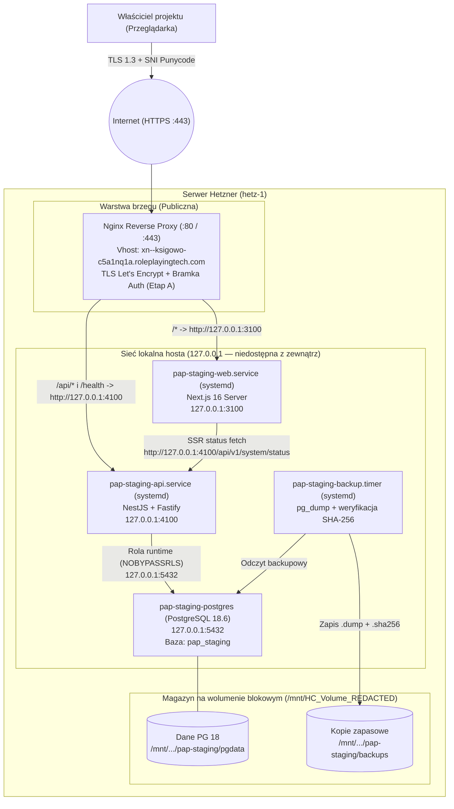

# Architektura prywatnego stagingu na serwerze Hetzner

- **Data:** 2026-10-28
- **Powiązane zadanie:** [Issue #19](https://github.com/RolePlayingTech/polish-accounting-platform/issues/19), [ADR-002](adr/002-stos-technologiczny-i-wdrozenia.md), [ADR-005](adr/005-rozwoj-lokalny.md), [Audyt serwera Hetzner](HETZNER_SERVER_AUDIT_2026-10-28.md)
- **Status:** Projekt architektury (wymaga zatwierdzenia właściciela przed jakimikolwiek działaniami na serwerze).

---

## 1. Założenia projektowe i ograniczenia rzeczywistego hosta

Na podstawie odczytowego audytu serwera `hetz-1` (**[Potwierdzone na serwerze]**) architektura stagingu musi respektować następujące warunki brzegowe:

1. **Ograniczona pamięć RAM (`3.7 GiB` łącznie, `~2.3 GiB` dostępne) i 2 vCPU:**
   - Budowanie aplikacji (`pnpm build`, kompilacja TypeScript i bundlowanie Next.js) **nie może odbywać się na serwerze**, ponieważ szczytowe zużycie pamięci podczas `next build` mogłoby wypchnąć inne działające usługi do pliku wymiany (`swap`) lub wywołać `OOM Killer`.
   - Serwer otrzymuje wyłącznie gotowy, zbudowany i przetestowany w GitHub Actions artefakt wydania.
2. **Współistnienie z 9 aktywnymi usługami i 14 vhostami Nginx:**
   - Globalne binarium `/usr/bin/node` (`v20.20.2`) jest wykorzystywane przez `mumro-articles`, `swiadek-dziejow-articles`, `historia-technologii` oraz `mfc-backend` — **nie wolno go aktualizować globalnie**.
   - Wszystkie nowe procesy i bazy muszą działać pod dedykowanymi nazwami, na nieużywanych portach loopback i w wydzielonych katalogach.
3. **Brak aktywnego firewalla pakietowego na wejściu hosta (`ufw inactive`, `INPUT ACCEPT`):**
   - Żaden proces aplikacji ani bazy danych nie może nasłuchiwać na `0.0.0.0` lub `[::]`. Wszystkie gniazda wewnętrzne są bindowane wyłącznie do `127.0.0.1`.
   - Jedynym punktem wejścia z sieci publicznej jest istniejący serwer Nginx na porcie `443` (HTTPS).

---

## 2. Porównanie modeli uruchomienia: Docker Compose vs. procesy systemowe (`systemd`)

Zgodnie z wymaganiami zadania nie zakładamy z góry wyższości kontenerów. Poniższa tabela zestawia trzy warianty na badanym hoście Hetzner:

| Kryterium | Wariant 1: Pełny Docker Compose (Web + API + PG 18 w kontenerach) | Wariant 2: Czysty `systemd` (Web + API + pakiet PGDG `postgresql-18` na hoście) | Wariant 3 (REKOMENDOWANY): `systemd` dla Web/API + izolowany kontener `postgres:18.6-alpine` (lub PGDG `postgresql-18`) |
| --- | --- | --- | --- |
| **Zużycie RAM w spoczynku** | Wyższe (`~450–650 MiB` przez narzut osobnych runtime w kontenerach i procesów `containerd-shim`) | Najniższe (`~220–320 MiB` łącznie) | Niskie (`~240–350 MiB` łącznie: Web `~90 MiB`, API `~70 MiB`, `postgres:18.6-alpine` `~50 MiB`) |
| **Spójność z istniejącym hostem** | Częściowa (`shorts-api` i `reels-api` są w Dockerze, ale aplikacje webowe Node są w `systemd`) | Wysoka — powiela sprawdzony na tym serwerze wzorzec `durnoty.service` (`/opt/durnoty-runtime` + `systemd` sandboxing) | **Najwyższa** — Web/API używają wzorca `durnoty.service` z Node 24 w `/opt/pap-runtime`, a baza nie wymaga modyfikacji systemowych repozytoriów `apt` |
| **Dostępność PostgreSQL 18 na Ubuntu 24.04** | Natychmiastowa — oficjalny obraz `postgres:18.6-alpine` (identyczny SHA256 jak w `.github/workflows/ci.yml`) | Wymaga dodania zewnętrznego klucza GPG i repozytorium `apt.postgresql.org` (PGDG) do systemu hosta, gdyż Ubuntu 24.04 posiada tylko `postgresql-16` | Natychmiastowa dzięki `postgres:18.6-alpine` (100% zgodności z CI, w tym `btree_gist`), bez dodawania repozytoriów `apt` na hoście |
| **Bezpieczeństwo sieciowe przy `ufw inactive`** | Wymaga szczególnej ostrożności (błędne `-p 3100:3100` zamiast `127.0.0.1:3100:3100` otwiera port na świat przez łańcuch `DOCKER`) | Procesy Node z `HOST=127.0.0.1` i `systemd` (`PrivateTmp`, `ProtectSystem=strict`, `NoNewPrivileges`) nigdy nie modyfikują `iptables` | Web i API działają bez uprawnień root i bez `iptables`, a jedyny kontener DB ma sztywny binding `127.0.0.1:5432:5432` chroniony regułą `nftables raw PREROUTING` (`iifname != "lo" drop`) |
| **Wygoda aktualizacji i rollbacku** | Wymaga budowania/pobierania obrazów i `docker compose up -d` | Atomowe przełączenie symlinka `/var/www/pap-staging/current` + `systemctl restart` (`< 2 s`) | Atomowe przełączenie symlinka dla Web/API (`< 2 s`) oraz przypięty po digest obraz bazy danych |

### Uzasadnienie rekomendacji (Wariant 3)

1. **Web (`@pap/web`) i API (`@pap/api`) jako utwardzone jednostki `systemd`:**
   - Na serwerze `hetz-1` dokładnie ten model został już wdrożony dla `durnoty.service` (**[Potwierdzone na serwerze]**): dedykowany runtime Node 24 w `/opt/`, niemodyfikowalne drzewo systemu (`ProtectSystem=strict`), izolowany `/tmp` (`PrivateTmp=true`), brak dostępu do `/home` (`ProtectHome=true`), brak możliwości podniesienia uprawnień (`NoNewPrivileges=true`) oraz natywne logowanie do `systemd-journald`.
   - Pozwala to uniknąć budowania i przechowywania wielogigabajtowych obrazów Docker aplikacji na dysku `/dev/sda1` (gdzie zostało `15 GiB` wolnego miejsca) oraz umożliwia błyskawiczny rollback przez przepięcie symlinka `/var/www/pap-staging/current -> releases/<poprzednie-wydanie>`.
2. **PostgreSQL 18 (`postgres:18.6-alpine`) jako pojedynczy, przypięty po SHA256 kontener na `127.0.0.1:5432` (z danymi na wolumenie `/mnt/HC_Volume_<REDACTED>`):**
   - Domyślne repozytoria Ubuntu 24.04 na serwerze mają wyłącznie `postgresql-16` (**[Potwierdzone na serwerze]**). Użycie tego samego obrazu co w CI (`postgres:18.6-alpine@sha256:10a5c69a83035ab5239f5620d708520e8b28f5aa1f2b20143e6024532edadfb5` **[Potwierdzone w repo]**) daje gwarancję identycznego zachowania constraints, `btree_gist` oraz `EXCLUDE USING gist` bez modyfikowania globalnych źródeł `apt` serwera.
   - *Alternatywa dopuszczalna za zgodą właściciela:* instalacja natywnego pakietu `postgresql-18` z oficjalnego repozytorium PGDG (`apt.postgresql.org`) i bindowanie `listen_addresses = '127.0.0.1'` w `/etc/postgresql/18/main/postgresql.conf`. Oba warianty są z punktu widzenia aplikacji (`127.0.0.1:5432`) całkowicie przezroczyste.

---

## 3. Schemat architektury i komunikacji

### Zasady przepływu ruchu

1. **Żądania przeglądarki (`https://księgowość.roleplayingtech.com` / `https://xn--ksigowo-c5a1nq1a.roleplayingtech.com`):**
   - Trafiają na port `443` do dedykowanego vhosta Nginx.
   - W **Etapie A (prywatny staging techniczny)** Nginx weryfikuje uwierzytelnienie brzegowe właściciela (`auth_basic` z plikiem `/etc/nginx/pap-staging.htpasswd` i/lub allowlistą IP) **zanim** przekaże jakiekolwiek żądanie do procesów Node.js.
   - Ścieżki `/api/v1/*` oraz `/health` (lub `/api/health`) są kierowane do `http://127.0.0.1:4100`.
   - Pozostałe ścieżki (`/`, `/app`, `/settings`, `/platform`, `/_next/*`) są kierowane do `http://127.0.0.1:3100`.
2. **Komunikacja Server-Side Rendering (Web -> API):**
   - Proces Next.js (`127.0.0.1:3100`) odpytuje API o status systemu.
   - Obecnie w `apps/web/lib/read-system-status.ts` (**[Potwierdzone w repo]**) przy `NODE_ENV=production` wymagany jest protokół `https:` dla `API_BASE_URL`.
   - Rekomendujemy dwie opcje (do decyzji w małym PR konfiguracyjnym):
     - **Opcja 1 (zalecana technicznie):** dopuścić w `read-system-status.ts` jawny adres loopback `http://127.0.0.1:<port>` również przy `NODE_ENV=production` (komunikacja wewnątrz jądra Linux bez wychodzenia na interfejs sieciowy i bez zależności od brzegowego Basic Auth na Nginx), odrzucając jednocześnie każde zdalne `http://`.
     - **Opcja 2 (bez zmian w `read-system-status.ts`):** ustawić `API_BASE_URL=https://xn--ksigowo-c5a1nq1a.roleplayingtech.com` i wyłączyć `auth_basic` w Nginx wyłącznie dla żądań pochodzących z `127.0.0.1` (`satisfy any; allow 127.0.0.1; allow ::1; deny all; auth_basic ...`) do ścieżki `/api/v1/system/status`.
3. **Przyszłe MCP (`@pap/mcp`):**
   - W **Etapie A** serwer MCP (`apps/mcp`) **nie jest uruchamiany na serwerze**, ponieważ w repozytorium obsługuje wyłącznie transport `STDIO` (**[Potwierdzone w repo]**).
   - Po implementacji `Issue #8` (`E2-01`: Streamable HTTP + OAuth resource server) otrzyma osobny proces `pap-staging-mcp.service` na `127.0.0.1:4110`, komunikujący się wyłącznie z API (`127.0.0.1:4100`), nigdy bezpośrednio z bazą PostgreSQL (zgodnie z [ADR-001](adr/001-rdzen-i-mcp.md)).

---

## 4. Struktura katalogów, nazewnictwo i podział portów

*Uwaga: żaden z poniższych katalogów ani plików nie został jeszcze utworzony na serwerze.*

### 4.1. Struktura katalogów na hoście

| Ścieżka | Dysk | Właściciel / Uprawnienia | Przeznaczenie |
| --- | --- | --- | --- |
| `/opt/pap-runtime/` | `/dev/sda1` (`/`) | `root:root` (`0755`) | Izolowane binaria `node` (`v24.22.1`) oraz `pnpm` (`12.15.0`) — brak ingerencji w `/usr/bin/node` (`v20.20.2`) |
| `/var/www/pap-staging/` | `/dev/sda1` (`/`) | `root:pap` (`0750`) | Katalog główny wdrożeń aplikacji |
| `/var/www/pap-staging/releases/<YYYYMMDDTHHMMSSZ-sha>/` | `/dev/sda1` (`/`) | `root:pap` (`0750`, tylko do odczytu dla `pap`) | Niezmienialne drzewo konkretnego wydania (przechowywane ostatnie 3 wydania) |
| `/var/www/pap-staging/current` | `/dev/sda1` (`/`) | symlink `root:root` | Atomowy dowiąznik wskazujący na aktywne wydanie |
| `/var/lib/pap-staging/` | `/dev/sda1` (`/`) | `pap:pap` (`0750`) | Katalog roboczy zapisu (np. cache Next.js `.next/cache`), jedyny katalog w `ReadWritePaths=` dla Web |
| `/etc/pap/staging-web.env` | `/dev/sda1` (`/`) | `root:pap` (`0640`) | Zmienne środowiskowe dla procesu Web |
| `/etc/pap/staging-api.env` | `/dev/sda1` (`/`) | `root:pap` (`0640`) | Zmienne środowiskowe dla procesu API (rola runtime DB) |
| `/etc/pap/staging-migrate.env` | `/dev/sda1` (`/`) | `root:root` (`0600`) | Poświadczenia konta migracyjnego DB (niedostępne dla użytkownika `pap`!) |
| `/mnt/HC_Volume_<REDACTED>/pap-staging/postgres/` | `/dev/sdb` (Wolumen) | `root` / UID kontenera PG (`0700`) | Trwały wolumen danych PostgreSQL 18 |
| `/mnt/HC_Volume_<REDACTED>/pap-staging/backups/` | `/dev/sdb` (Wolumen) | `root:root` (`0700`) | Zaszyfrowane / weryfikowane sumą SHA-256 zrzuty `pg_dump` |

### 4.2. Nazewnictwo kont i usług systemowych

- **Konto systemowe aplikacji:** `pap` (użytkownik systemowy bez powłoki logowania `/usr/sbin/nologin`, bez członkostwa w grupie `docker` i bez uprawnień `sudo`).
- **Jednostki `systemd`:**
  - `pap-staging-web.service` — proces Next.js (`@pap/web`).
  - `pap-staging-api.service` — proces NestJS/Fastify (`@pap/api`).
  - `pap-staging-db.service` (lub `docker compose` w `/opt/pap-runtime/db/compose.yaml`) — instancja PostgreSQL 18.6.
  - `pap-staging-backup.service` + `pap-staging-backup.timer` — codzienny backup bazy danych o `03:45 UTC` (z przesunięciem względem `durnoty-backup.timer` o `03:15 UTC`).
- **Plik vhosta Nginx:** `/etc/nginx/sites-available/ksiegowosc.roleplayingtech.com` (podlinkowany w `/etc/nginx/sites-enabled/`).

### 4.3. Alokacja portów

| Usługa | Adres bindowania | Port | Uzasadnienie braku kolizji **[Potwierdzone na serwerze]** |
| --- | --- | --- | --- |
| Nginx (HTTP / HTTPS) | `0.0.0.0`, `[::]` | `80`, `443` | Współdzielony reverse proxy po nagłówku `Host` / TLS SNI |
| `pap-staging-web` | `127.0.0.1` | **`3100`** | Omija zajęte porty `3001–3005` oraz `3010` (`durnoty.pl`) i domyślny `3000` |
| `pap-staging-api` | `127.0.0.1` | **`4100`** | Omija domyślny `4000` oraz porty `8000`, `8010`, `8903` |
| `pap-staging-mcp` *(przyszły)* | `127.0.0.1` | **`4110`** | Zarezerwowany na etap `E2-01` (`Issue #8`), obecnie nieuruchamiany |
| `pap-staging-postgres` | `127.0.0.1` | **`5432`** | Na hoście nie działa obecnie żaden proces na porcie `5432` |

### 4.4. Zmienne konfiguracyjne (wyłącznie nazwy, bez wartości sekretów)

1. **`/etc/pap/staging-web.env`:**
   - `NODE_ENV=production`
   - `HOST=127.0.0.1`
   - `PORT=3100`
   - `API_BASE_URL` (np. `http://127.0.0.1:4100` po rozszerzeniu walidatora o loopback lub `https://xn--ksigowo-c5a1nq1a.roleplayingtech.com`)
   - `NEXT_TELEMETRY_DISABLED=1`
2. **`/etc/pap/staging-api.env`:**
   - `NODE_ENV=production`
   - `HOST=127.0.0.1`
   - `PORT=4100`
   - `PAP_APP_ENV=staging`
   - *(Dopiero od Etapu B / po podłączeniu DB do API)*:
     - `PAP_DATABASE_ENV=staging`
     - `DATABASE_URL` (wskazujący na rolę runtime `pap_staging_app` na `127.0.0.1:5432/pap_staging`)
     - `OIDC_ISSUER_URL`
     - `OIDC_AUDIENCE`
     - `OIDC_JWKS_URI`
3. **`/etc/pap/staging-migrate.env` (używany tylko podczas kroku migracji w trakcie wdrożenia, uprawnienia `0600 root:root`):**
   - `PAP_DATABASE_ENV=staging`
   - `DATABASE_URL` (wskazujący na rolę właściciela schematu `pap_staging_migrator` na `127.0.0.1:5432/pap_staging`)

---

## 5. Projekt PostgreSQL 18 i bezpieczeństwa danych

### 5.1. Separacja ról bazodanowych (Defense in Depth)

W środowisku serwerowym **nie wolno** używać kont deweloperskich `pap_local` ani `pap_test`, ani uruchamiać aplikacji na koncie właściciela tabel (który z definicji omija PostgreSQL Row-Level Security, o ile nie wymuszono `FORCE ROW LEVEL SECURITY`, oraz może wykonywać `DROP`/`ALTER`).

Projektujemy trzy poziomy ról w bazie `pap_staging`:

| Rola PostgreSQL | Uprawnienia roli (`CREATE ROLE`) | Uprawnienia w bazie `pap_staging` | Kiedy używana |
| --- | --- | --- | --- |
| `postgres` (bootstrap administracyjny) | Superuser wewnątrz instancji PG | Tworzenie bazy `pap_staging`, ról `pap_staging_migrator` i `pap_staging_app`, `REVOKE ALL ON DATABASE pap_staging FROM PUBLIC` | Wyłącznie jednorazowo podczas inicjalizacji klastra |
| **`pap_staging_migrator`** | `LOGIN NOSUPERUSER NOCREATEDB NOCREATEROLE NOREPLICATION NOBYPASSRLS` | `OWNER` bazy `pap_staging` oraz schematów `public` i `drizzle` (posiada prawo `CREATE` na bazie wymagane przez `CREATE EXTENSION IF NOT EXISTS btree_gist` w migracji `0001_tenant-schema.sql`) | Wyłącznie w kroku `pnpm db:migrate` przed startem nowej wersji aplikacji |
| **`pap_staging_app`** (rola runtime) | `LOGIN NOSUPERUSER NOCREATEDB NOCREATEROLE NOREPLICATION NOBYPASSRLS` | `CONNECT` do `pap_staging`, `USAGE` na `public`, ściśle ograniczone uprawnienia DML zgodne z kontraktem [6D-R](24-bezpieczny-cykl-dostepu-6dr.md) i przyszłym `6D-3` (brak właścicielstwa obiektów, brak DDL/`CREATE`/`TRUNCATE`, brak możliwości wyłączenia triggerów `company_access_grant_revocation_guard`, `tenant_membership_transition_guard` oraz `access_management_event_append_only`, brak dostępu do `drizzle.__drizzle_migrations`, brak `BYPASSRLS`). | W procesie `pap-staging-api` (od Etapu B) |
| **`pap_staging_ro`** *(opcjonalna diagnostyczna)* | `LOGIN NOSUPERUSER NOCREATEDB NOCREATEROLE NOREPLICATION NOBYPASSRLS` | Wyłącznie `SELECT` na wybranych tabelach technicznych | Diagnostyka bez prawa zapisu |

### 5.2. Obsługa `btree_gist`, guardów `0002` i migracji Drizzle

1. Łańcuch migracji (`0000_technical-baseline.sql` -> `0001_tenant-schema.sql` -> `0002_access-lifecycle.sql` **[Potwierdzone w repo]**) wykonuje:
   - `CREATE EXTENSION IF NOT EXISTS btree_gist;` i weryfikację przynależności `btree_gist` do bieżącego schematu danych (`public`),
   - utworzenie 5 tabel modelu `6B` (`tenant`, `legal_entity`, `tenant_membership`, `entity_profile_version`, `company_access_grant`), złożonych kluczy obcych oraz ograniczenia `EXCLUDE USING gist (... tstzrange(valid_from, valid_until, '[)') WITH &&)`,
   - utworzenie tabeli audytu `access_management_event` oraz funkcji i triggerów strażniczych (`protect_grant_revocation`, `revoke_grants_on_membership_transition`, `protect_access_management_event`).
2. Ponieważ `btree_gist` jest rozszerzeniem `trusted` w PostgreSQL 18, rola `pap_staging_migrator` będąca właścicielem bazy `pap_staging` (`CREATE DATABASE pap_staging OWNER pap_staging_migrator;`) zainstaluje je oraz utworzy funkcje PL/pgSQL bez uprawnień `SUPERUSER`.
3. Wszystkie tabele w `public` będą miały włączone `ENABLE ROW LEVEL SECURITY` oraz `FORCE ROW LEVEL SECURITY` w pakiecie `6D-3`.

### 5.3. Wymagana zmiana w kodzie `@pap/db` (osobny przyszły PR)

Aktualny plik `packages/db/src/database-config.ts` (**[Potwierdzone w repo]**) zawiera celowe blokady zgodne z [ADR-005](adr/005-rozwoj-lokalny.md):
- odrzuca `NODE_ENV === 'production'`,
- akceptuje wyłącznie `PAP_DATABASE_ENV === 'local' | 'test'`,
- wymusza nazwy kont i baz `pap_local` lub `pap_test`.

**Zasada bezpieczeństwa:** Nie wolno obchodzić tej blokady na serwerze przez ustawianie fałszywego `PAP_DATABASE_ENV=local` i tworzenie bazy `pap_local` na stagingu.
Zamiast tego, przed podłączeniem bazy na stagingu należy przygotować **osobny, wąski PR kodowy** (wymagający review właściciela), który:
1. Rozszerzy `DatabaseEnvironment` o `'staging'` (`'local' | 'test' | 'staging'`).
2. Dla `PAP_DATABASE_ENV=staging`:
   - nadal będzie wymagał hosta loopback (`127.0.0.1`, `localhost`, `::1`),
   - będzie wymagał bazy `/pap_staging`,
   - będzie akceptował wyłącznie jawnie dozwolone konto roli: `pap_staging_migrator` (dla migratora CLI) albo `pap_staging_app` (dla klienta runtime),
   - pozwoli na działanie przy `NODE_ENV=production` **wyłącznie wtedy**, gdy `PAP_DATABASE_ENV=staging` i spełnione są powyższe warunki.
3. Zachowa bezwzględną odmowę dla `PAP_DATABASE_ENV=production` do czasu pełnego audytu bezpieczeństwa i ukończenia Etapu B.
4. Doda testy jednostkowe pozytywne i negatywne w `packages/db/test/database-config.test.ts`.

### 5.4. Ochrona przed odczytem danych innego tenanta (RLS + `SET LOCAL` + ABAC)

Zgodnie z [ADR-002](adr/002-stos-technologiczny-i-wdrozenia.md) i [ADR-004](adr/004-model-zagrozen-i-autoryzacji.md), docelowa ochrona w Etapie B (`6D-R` + `6D-2` + `6D-3`) opiera się na trzech niezależnych warstwach:
1. **Serwerowa tożsamość i polityka domenowa (`authorizeCompanyAction`):** `userId` pochodzi wyłącznie ze zweryfikowanego tokenu/sesji OIDC (`(issuer, subject) -> userId`), a każde żądanie przechodzi przez deny-by-default sprawdzenie aktywnego członkostwa i nieodwołanego grantu do konkretnej firmy (`legal_entity_id`) oraz akcji (`read`/`write`).
2. **Transakcyjny kontekst połączenia (`SET LOCAL`):** przy użyciu puli połączeń (`postgres.js`, `max: 5`) zabronione jest używanie sesyjnego `SET`. Każda operacja na danych firmy musi otwierać transakcję i wykonywać `select set_config('app.current_tenant_id', $1, true)` oraz `select set_config('app.current_user_id', $2, true)` (gdzie trzeci argument `true` oznacza `is_local` — wartość automatycznie znika po `COMMIT`/`ROLLBACK` i nigdy nie wycieka do kolejnego żądania korzystającego z tej samej puli).
3. **PostgreSQL Row-Level Security (`RLS`):** polityki `USING` i `WITH CHECK` na tabelach zawierających `tenant_id` wymagają `tenant_id = current_setting('app.current_tenant_id', true)::uuid`. Brak ustawionego kontekstu zwraca `NULL` i powoduje zwrócenie 0 wierszy (fail-closed).

---

## 6. Separacja prywatnego stagingu od przyszłej produkcji

| Wymiar | Prywatny Staging (obecny serwer `hetz-1`) | Przyszła Produkcja (po audycie i zgodzie właściciela) |
| --- | --- | --- |
| **Infrastruktura / Host** | Współdzielony VPS Hetzner (`hetz-1`) | **Oddzielny, dedykowany serwer / klaster w regionie UE/EOG** — bez współdzielenia z projektami contentowymi, serwerami Vite czy kontenerami wideo |
| **Dane** | **Wyłącznie dane syntetyczne** (fikcyjne firmy, fikcyjne NIP/kwoty). Bezwzględny zakaz wprowadzania prawdziwych faktur i danych osobowych | Rzeczywiste dane księgowe po wdrożeniu pełnego szyfrowania, RODO, KMS, RLS, audytu i zatwierdzenia eksperta |
| **Integracje urzędowe (KSeF / MF)** | Wyłącznie stuby / oficjalne środowiska testowe/demo MF (nigdy produkcyjny KSeF) | Produkcyjny KSeF wyłącznie po testach zgodności profilu i jawnej zgodzie właściciela |
| **Baza danych i poświadczenia** | `pap_staging` na `127.0.0.1:5432` z unikalnymi hasłami tylko dla stagingu | Odseparowana instancja PostgreSQL 18 z szyfrowanym storage, PITR i osobnymi kluczami |
| **Dostęp sieciowy** | W Etapie A zamknięty za bramką uwierzytelniającą właściciela | Kontrolowany dostęp z MFA (OIDC), WAF/rate-limitingiem i aktywnym firewallem hostowym |

---

## 7. Logi, monitoring i kopie zapasowe (Backup & Restore)

### 7.1. Logi i podstawowy monitoring

- **Zbieranie logów:** Procesy `pap-staging-web.service` i `pap-staging-api.service` zapisują standardowe wyjście i błędy do `systemd-journald` z identyfikatorem `SyslogIdentifier=pap-staging-web` oraz `pap-staging-api`.
- **Ochrona przed wyciekiem PII i sekretów:** Zgodnie z obecnym kodem (`packages/db/src/migrate.ts`, `packages/db/src/tenant-authorization.ts` **[Potwierdzone w repo]**) wyjątki bazy danych i konfiguracji nie wypisują `DATABASE_URL` ani parametrów zapytań. Logi Nginx dla vhosta stagingowego nie mogą logować nagłówka `Authorization` ani ciasteczek sesyjnych.
- **Health checks:**
  - Lokalny timer lub skrypt wdrożeniowy odpytuje `http://127.0.0.1:4100/health` (`{"status":"ok"}`), `http://127.0.0.1:4100/api/v1/system/status` oraz `http://127.0.0.1:3100/app`.

### 7.2. Strategia backupu i testu odtworzenia (Restore Drill)

Na wzór działającego na serwerze `durnoty-backup.service` (**[Potwierdzone na serwerze]**):
1. **Mechanizm:** Jednostka `pap-staging-backup.service` wyzwalana codziennie o `03:45 UTC` przez `pap-staging-backup.timer` oraz obowiązkowo **przed każdą migracją bazy danych**.
2. **Przebieg backupu:**
   - Wykonanie spójnego transakcyjnie zrzutu `pg_dump --format=custom --no-owner --no-privileges` bazy `pap_staging` do pliku `/mnt/HC_Volume_<REDACTED>/pap-staging/backups/pap_staging_<YYYYMMDDTHHMMSSZ>.dump` z `UMask=0077`.
   - Weryfikacja czytelności archiwum przez `pg_restore --list <plik.dump> > /dev/null`.
   - Wygenerowanie sumy kontrolnej `sha256sum`.
   - Retencja: przechowywanie 14 ostatnich kopii dziennych oraz 4 tygodniowych na wolumenie `/mnt/HC_Volume_<REDACTED>`.
3. **Procedura testu odtworzenia (Restore Drill):**
   - Utworzenie tymczasowej bazy weryfikacyjnej `pap_staging_restore_verify` wewnątrz tej samej instancji PostgreSQL 18.
   - Odtworzenie zrzutu przez `pg_restore --dbname=pap_staging_restore_verify --exit-on-error`.
   - Sprawdzenie obecności wpisów w `drizzle.__drizzle_migrations`, tabel schematu `6B` oraz ograniczenia `entity_profile_version_no_overlap` (`btree_gist`).
   - Usunięcie tymczasowej bazy `DROP DATABASE pap_staging_restore_verify;`.
