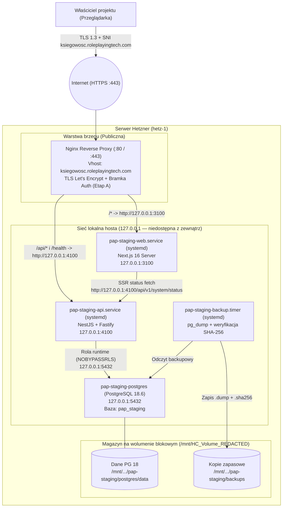

# Architektura prywatnego stagingu na serwerze Hetzner

- **Data:** 2026-10-28
- **Powiązane zadanie:** [Issue #19](https://github.com/RolePlayingTech/polish-accounting-platform/issues/19), [ADR-002](adr/002-stos-technologiczny-i-wdrozenia.md), [ADR-005](adr/005-rozwoj-lokalny.md), [ADR-006](adr/006-prywatny-staging-hetzner.md), [Audyt serwera Hetzner](HETZNER_SERVER_AUDIT_2026-10-28.md)
- **Docelowa domena (jedyna kanoniczna):** `https://ksiegowosc.roleplayingtech.com`
- **Status:** Projekt architektury zrealizowany w warstwie przygotowawczej (nieaktywne usługi oczekują na zgodę właściciela przed pierwszym uruchomieniem).

---

## 1. Założenia projektowe i ograniczenia rzeczywistego hosta

Na podstawie audytu serwera `hetz-1` (**[Potwierdzone na serwerze]**) architektura stagingu respektuje następujące warunki brzegowe:

1. **Ograniczona pamięć RAM (`3.7 GiB` łącznie, `~2.3 GiB` dostępne), `1.7 GiB` używanego swapu i 2 vCPU:**
   - Host zużywa `1.7 GiB` pamięci swap na wolumenie sieciowym (**[Potwierdzone na serwerze]**). Budowanie aplikacji (`pnpm build`, kompilacja TypeScript i bundlowanie Next.js) **nie może odbywać się na serwerze**, ponieważ szczytowe zużycie pamięci podczas `next build` mogłoby wypchnąć inne działające usługi do pliku wymiany (`swap`) lub wywołać `OOM Killer`.
   - Serwer otrzymuje wyłącznie gotowy, zbudowany i przetestowany w GitHub Actions artefakt wydania, a każda usługa PAP działa pod twardymi limitami `MemoryHigh`/`MemoryMax`, `MemorySwapMax`, `CPUQuota` oraz `IOWeight`.
2. **Współistnienie z 9 aktywnymi usługami i 14 vhostami Nginx:**
   - Globalne binarium `/usr/bin/node` (`v20.20.2`) jest wykorzystywane przez `mumro-articles`, `swiadek-dziejow-articles`, `historia-technologii` oraz `mfc-backend` — **nie wolno go aktualizować globalnie**.
   - Wszystkie nowe procesy i bazy działają pod dedykowanymi nazwami, na nieużywanych portach loopback i w wydzielonych katalogach.
3. **Ochrona sieciowa przez Hetzner Cloud Firewall (`firewall-1`) i izolacja loopback:**
   - Na samym hoście `ufw` ma status `inactive` (`INPUT ACCEPT`), natomiast przed instancją `hetz-1` działa zewnętrzny **Hetzner Cloud Firewall (`firewall-1`)**, który po usunięciu historycznej reguły `TCP 3001` blokuje z internetu porty `3001`, `3002`, `3003` i `5174`, przepuszczając wyłącznie ruch przychodzący na `TCP 22`, `80` i `443` (**[Potwierdzone na serwerze]**).
   - Niezależnie od zapory brzegowej żaden proces aplikacji ani bazy danych Polish Accounting Platform nie może nasłuchiwać na `0.0.0.0` lub `[::]`. Wszystkie gniazda wewnętrzne są bindowane wyłącznie do `127.0.0.1`.
   - Jedynym punktem wejścia z sieci publicznej jest istniejący serwer Nginx na porcie `443` (HTTPS) dla domeny `ksiegowosc.roleplayingtech.com`.

---

## 2. Porównanie modeli uruchomienia: Docker Compose vs. procesy systemowe (`systemd`)

| Kryterium | Wariant 1: Pełny Docker Compose (Web + API + PG 18 w kontenerach) | Wariant 2: Czysty `systemd` (Web + API + pakiet PGDG `postgresql-18` na hoście) | Wariant 3 (REKOMENDOWANY): `systemd` dla Web/API + izolowany kontener `postgres:18.6-alpine` (lub PGDG `postgresql-18`) |
| --- | --- | --- | --- |
| **Szacowane zużycie RAM w spoczynku (`[Założenie]` — hipoteza do weryfikacji pomiarami RSS)** | Wyższe (`~450–650 MiB` przez narzut osobnych runtime w kontenerach i procesów `containerd-shim`) | Najniższe (`~220–320 MiB` łącznie, przed obciążeniem) | Niskie (`~240–350 MiB` w spoczynku / `~350–500 MiB` pod umiarkowanym ruchem; ograniczane twardymi limitami `MemoryMax`: Web `384 MiB`, API `384 MiB`, PG `384 MiB`) |
| **Spójność z istniejącym hostem** | Częściowa (`shorts-api` i `reels-api` są w Dockerze, ale aplikacje webowe Node są w `systemd`) | Wysoka — powiela sprawdzony na tym serwerze wzorzec `durnoty.service` (`/opt/durnoty-runtime` + `systemd` sandboxing) | **Najwyższa** — Web/API używają wzorca `durnoty.service` z Node 24 w `/opt/pap-runtime`, a baza nie wymaga modyfikacji systemowych repozytoriów `apt` |
| **Dostępność PostgreSQL 18 na Ubuntu 24.04** | Natychmiastowa — oficjalny obraz `postgres:18.6-alpine` (identyczny SHA256 jak w `.github/workflows/ci.yml`) | Wymaga dodania zewnętrznego klucza GPG i repozytorium `apt.postgresql.org` (PGDG) do systemu hosta, gdyż Ubuntu 24.04 posiada tylko `postgresql-16` | Natychmiastowa dzięki `postgres:18.6-alpine` (100% zgodności z CI, w tym `btree_gist`), bez dodawania repozytoriów `apt` na hoście |
| **Bezpieczeństwo sieciowe przy `ufw inactive`** | Wymaga szczególnej ostrożności (błędne `-p 3100:3100` zamiast `127.0.0.1:3100:3100` otwiera port na świat przez łańcuch `DOCKER`) | Procesy Node z `HOST=127.0.0.1` i `systemd` (`PrivateTmp`, `ProtectSystem=strict`, `NoNewPrivileges`) nigdy nie modyfikują `iptables` | Web i API działają bez uprawnień root i bez `iptables`, a jedyny kontener DB ma sztywny binding `127.0.0.1:5432:5432` chroniony regułą `nftables raw PREROUTING` (`iifname != "lo" drop`) |
| **Wygoda aktualizacji i rollbacku** | Wymaga budowania/pobierania obrazów i `docker compose up -d` | Atomowe przełączenie symlinka `/var/www/pap-staging/current` + `systemctl restart` (`< 2 s`) | Atomowe przełączenie symlinka dla Web/API (`< 2 s`) oraz przypięty po digest obraz bazy danych |

---

## 3. Schemat architektury i komunikacji



### Zasady przepływu ruchu

1. **Żądania przeglądarki (`https://ksiegowosc.roleplayingtech.com`):**
   - Trafiają na port `443` do dedykowanego vhosta Nginx (`server_name ksiegowosc.roleplayingtech.com;`).
   - W **Etapie A (prywatny staging techniczny)** Nginx weryfikuje uwierzytelnienie brzegowe właściciela (`auth_basic` z plikiem `/etc/nginx/pap-staging.htpasswd`) **zanim** przekaże jakiekolwiek żądanie do procesów Node.js.
   - Ścieżki `/api/*` oraz `/health` są kierowane do `http://127.0.0.1:4100`.
   - Pozostałe ścieżki (`/`, `/app`, `/settings`, `/platform`, `/_next/*`) są kierowane do `http://127.0.0.1:3100`.
2. **Komunikacja Server-Side Rendering (Web -> API) — wyłącznie przez jawny loopback bez wyjątków w Basic Auth:**
   - Proces Next.js (`127.0.0.1:3100`) odpytuje API o status systemu po stronie serwera.
   - **Nie wprowadzamy w Nginx żadnych wyjątków wyłączających `auth_basic` dla `/api/v1/system/status`** — cały vhost w Etapie A pozostaje jednolicie chroniony przed nieautoryzowanym dostępem z zewnątrz.
   - W [PR #23](https://github.com/RolePlayingTech/polish-accounting-platform/pull/23) w `apps/web/lib/read-system-status.ts` wprowadzono zamkniętą allowlistę originów dla `NODE_ENV=production`:
     - W prywatnym Etapie A SSR używa **wyłącznie dokładnego originu** `http://127.0.0.1:4100` (`API_BASE_URL=http://127.0.0.1:4100` w `/etc/pap/pap-staging-web.env`), ponieważ publiczny origin `https://ksiegowosc.roleplayingtech.com` jest za bramką Basic Auth i zwróciłby `401 Unauthorized` dla żądania bez poświadczeń.
     - Kanoniczny origin `https://ksiegowosc.roleplayingtech.com` jest dopuszczony na allowliście tylko dla zaufanej konfiguracji DNS domeny właściciela w środowiskach bez Basic Auth na `/api/v1/system/status` (sama walidacja tekstu nazwy hosta nie zastępuje weryfikacji docelowego adresu IP w warstwie sieciowej).
     - Dowolny inny port loopback lub prywatny adres IP jest odrzucany, a `fetch` używa `redirect: 'error'`, by nigdy nie podążać za przekierowaniami HTTP.
3. **Przyszłe OIDC (`6D-2`) i MCP (`@pap/mcp`):**
   - Konfiguracja przyszłego OIDC (`Origin`, `redirect_uri`, `post_logout_redirect_uri` oraz ciasteczka `__Host-`) operuje wyłącznie na kanonicznym adresie ASCII `https://ksiegowosc.roleplayingtech.com`.
   - W **Etapie A** serwer MCP (`apps/mcp`) **nie jest uruchamiany na serwerze**, ponieważ w repozytorium obsługuje wyłącznie transport `STDIO` (**[Potwierdzone w repo]**).

---

## 4. Struktura katalogów, nazewnictwo i podział portów

### 4.1. Struktura katalogów na hoście (`[Potwierdzone na serwerze]`)

| Ścieżka | Dysk | Właściciel / Uprawnienia | Przeznaczenie |
| --- | --- | --- | --- |
| `/opt/pap-runtime/` | `/dev/sda1` (`/`) | `root:root` (`0755`) | Izolowane środowisko wykonawcze: symlink `/opt/pap-runtime/current -> /opt/pap-runtime/node-v24.22.1-linux-x64` (`node v24.22.1`), `/opt/pap-runtime/pnpm/pnpm` (`pnpm 12.15.0`) oraz `/opt/pap-runtime/corepack-home` — brak ingerencji w `/usr/bin/node` (`v20.20.2`) |
| `/var/www/pap-staging/` | `/dev/sda1` (`/`) | `root:pap` (`0750`) | Katalog główny wdrożeń aplikacji (`releases/`, `shared/`, `bin/`) |
| `/var/www/pap-staging/releases/<id>/` | `/dev/sda1` (`/`) | `root:pap` (`0750`, tylko do odczytu dla `pap`) | Niezmienialne drzewo konkretnego wydania (`ReadOnlyPaths=/var/www/pap-staging/releases`) |
| `/var/www/pap-staging/shared/next-cache/` | `/dev/sda1` (`/`) | `pap:pap` (`0750`) | Współdzielony katalog cache Next.js podlinkowany z `apps/web/.next/cache` (`ReadWritePaths=/var/www/pap-staging/shared`) |
| `/var/www/pap-staging/current` | `/dev/sda1` (`/`) | symlink `root:root` | Atomowy dowiąznik wskazujący na aktywne wydanie (tworzony podczas pierwszego wykonania `pap-deploy-release.sh`) |
| `/etc/pap/pap-staging-web.env` | `/dev/sda1` (`/`) | `root:pap` (`0640`) | Zmienne środowiskowe dla procesu Web (`EnvironmentFile=/etc/pap/pap-staging-web.env`) |
| `/etc/pap/pap-staging-api.env` | `/dev/sda1` (`/`) | `root:pap` (`0640`) | Zmienne środowiskowe dla procesu API (`EnvironmentFile=/etc/pap/pap-staging-api.env`) |
| `/etc/pap/pap-staging-db-runtime.env.example` | `/dev/sda1` (`/`) | `root:pap` (`0640`) | Szablon zmiennych połączenia DB runtime (`NODE_ENV=production`, `PAP_DATABASE_ENV=staging`, konto `pap_staging_app`) |
| `/etc/pap/pap-staging-migrate.env.example` | `/dev/sda1` (`/`) | `root:pap` (`0640`) | Szablon zmiennych migratora DB (`NODE_ENV=production`, `PAP_DATABASE_ENV=staging`, konto `pap_staging_migrator`) |
| `/var/lib/pap-acme/` | `/dev/sda1` (`/`) | **`root:www-data` (`0750`)** | Izolowany katalog ACME HTTP-01 webroot (`/.well-known/acme-challenge/`, `root /var/lib/pap-acme;` w Nginx). Certbot (`root`) ma prawo zapisu, a worker Nginx (`www-data`) wyłącznie prawo przejścia i odczytu (`r-x`), **bez prawa zapisu**. |
| `/etc/nginx/pap-staging.htpasswd` | `/dev/sda1` (`/`) | `root:www-data` (`0640`, tworzony przy starcie Etapu A) | Plik haseł HTTP Basic Auth wskazany w `auth_basic_user_file /etc/nginx/pap-staging.htpasswd;` w `/etc/nginx/sites-available/pap-staging.https.conf` |
| `/mnt/HC_Volume_<REDACTED>/pap-staging/` | `/dev/sdb` (Wolumen) | `root:root` (`0700`) | Katalog danych PostgreSQL 18 (`postgres/data`), lokalnych zrzutów (`backups/daily`, `backups/pre-deploy`) oraz konfiguracji Compose/SQL (`compose`, `sql`) |

### 4.2. Nazewnictwo kont, usług systemowych i limity zasobów

- **Konto systemowe aplikacji:** `pap` (`uid=999(pap) gid=987(pap)`, `/usr/sbin/nologin`, bez członkostwa w grupie `docker` i bez uprawnień `sudo`).
- **Jednostki `systemd` i twarde limity cgroups v2 (przygotowane w stanie `disabled` / `inactive`):**
  - `pap-staging-web.service` — proces Next.js (`@pap/web`, `ExecStart=/opt/pap-runtime/current/bin/node /var/www/pap-staging/current/apps/web/node_modules/next/dist/bin/next start --hostname 127.0.0.1 --port 3100`, `EnvironmentFile=/etc/pap/pap-staging-web.env`): `MemoryHigh=256M`, `MemoryMax=384M`, `MemorySwapMax=64M`, `CPUQuota=50%`, `IOWeight=50`, `TasksMax=64`.
  - `pap-staging-api.service` — proces NestJS/Fastify (`@pap/api`, `ExecStart=/opt/pap-runtime/current/bin/node /var/www/pap-staging/current/apps/api/dist/main.js`, `EnvironmentFile=/etc/pap/pap-staging-api.env`): `MemoryHigh=256M`, `MemoryMax=384M`, `MemorySwapMax=64M`, `CPUQuota=50%`, `IOWeight=50`, `TasksMax=64`.
  - `pap-staging-postgres` (`/mnt/HC_Volume_<REDACTED>/pap-staging/compose/docker-compose.postgres.yml`) — instancja PostgreSQL 18.6 z limitem kontenera `mem_limit: 384m`, `memswap_limit: 384m`, `cpus: 0.50` oraz parametrami `shared_buffers=96MB`, `work_mem=4MB`, `maintenance_work_mem=32MB`, `max_connections=40`.
  - `pap-staging-backup.service` + `pap-staging-backup.timer` — codzienny backup bazy danych o `03:15 UTC`.
  - `pap-staging-healthcheck.service` + `pap-staging-healthcheck.timer` — kontrola zdrowia usług co 5 minut.
- **Pliki vhosta Nginx (przygotowane w `/etc/nginx/sites-available/`, nieaktywne):**
  - `/etc/nginx/sites-available/pap-staging.bootstrap-http.conf` (etap ACME HTTP-01 dla `ksiegowosc.roleplayingtech.com`).
  - `/etc/nginx/sites-available/pap-staging.https.conf` (docelowy vhost HTTPS z `auth_basic` dla `ksiegowosc.roleplayingtech.com`).

### 4.3. Alokacja portów

| Usługa | Adres bindowania | Port | Uzasadnienie braku kolizji **[Potwierdzone na serwerze]** |
| --- | --- | --- | --- |
| Nginx (HTTP / HTTPS) | `0.0.0.0`, `[::]` | `80`, `443` | Współdzielony reverse proxy po nagłówku `Host` / TLS SNI (`ksiegowosc.roleplayingtech.com`) |
| `pap-staging-web` | `127.0.0.1` | **`3100`** | Omija zajęte porty `3001–3005` oraz `3010` (`durnoty.pl`) i domyślny `3000` |
| `pap-staging-api` | `127.0.0.1` | **`4100`** | Omija domyślny `4000` oraz porty `8000`, `8010`, `8903` |
| `pap-staging-mcp` *(przyszły)* | `127.0.0.1` | **`4110`** | Zarezerwowany na etap `E2-01` (`Issue #8`), obecnie nieuruchamiany |
| `pap-staging-postgres` | `127.0.0.1` | **`5432`** | Na hoście nie działa obecnie żaden proces na porcie `5432` |

---

## 5. Projekt PostgreSQL 18 i bezpieczeństwa danych

### 5.1. Separacja ról bazodanowych (Defense in Depth)

Projektujemy trzy poziomy ról w bazie `pap_staging` (`/mnt/HC_Volume_<REDACTED>/pap-staging/sql/init-roles.sql.template`):

| Rola PostgreSQL | Uprawnienia roli (`CREATE ROLE`) | Uprawnienia w bazie `pap_staging` | Kiedy używana |
| --- | --- | --- | --- |
| `postgres` (bootstrap administracyjny) | Superuser wewnątrz instancji PG | Tworzenie bazy `pap_staging`, ról `pap_staging_migrator` i `pap_staging_app`, `REVOKE ALL ON DATABASE pap_staging FROM PUBLIC` | Wyłącznie jednorazowo podczas inicjalizacji klastra |
| **`pap_staging_migrator`** | `LOGIN NOSUPERUSER NOCREATEDB NOCREATEROLE NOREPLICATION NOBYPASSRLS` | `OWNER` bazy `pap_staging` oraz schematów `public` i `drizzle` (posiada prawo `CREATE` na bazie wymagane przez `CREATE EXTENSION IF NOT EXISTS btree_gist` w migracji `0001_tenant-schema.sql`) | Wyłącznie w kroku `pnpm db:migrate` przed startem nowej wersji aplikacji |
| **`pap_staging_app`** (rola runtime) | `LOGIN NOSUPERUSER NOCREATEDB NOCREATEROLE NOREPLICATION NOBYPASSRLS` | `CONNECT` do `pap_staging`, `USAGE` na `public`, ściśle ograniczone uprawnienia DML zgodne z kontraktem [6D-R](24-bezpieczny-cykl-dostepu-6dr.md) i przyszłym `6D-3` (brak właścicielstwa obiektów, brak DDL/`CREATE`/`TRUNCATE`/`TRIGGER`/`REFERENCES`, brak dostępu do `drizzle.__drizzle_migrations`, brak `BYPASSRLS`). | W procesie `pap-staging-api` (od Etapu A.2 / B) |

### 5.2. Obsługa `btree_gist`, guardów `0002` i migracji Drizzle

1. Łańcuch migracji (`0000_technical-baseline.sql` -> `0001_tenant-schema.sql` -> `0002_access-lifecycle.sql` **[Potwierdzone w repo]**) wykonuje:
   - `CREATE EXTENSION IF NOT EXISTS btree_gist;` i weryfikację przynależności `btree_gist` do bieżącego schematu danych (`public`),
   - utworzenie 5 tabel modelu `6B` (`tenant`, `legal_entity`, `tenant_membership`, `entityProfileVersion`, `company_access_grant`), złożonych kluczy obcych oraz ograniczenia `EXCLUDE USING gist (... tstzrange(valid_from, valid_until, '[)') WITH &&)`,
   - utworzenie tabeli audytu `access_management_event` oraz funkcji i triggerów strażniczych (`protect_grant_revocation`, `revoke_grants_on_membership_transition`, `protect_access_management_event`).
2. W [PR #24](https://github.com/RolePlayingTech/polish-accounting-platform/pull/24) rozszerzono `packages/db/src/database-config.ts` o jawny profil `PAP_DATABASE_ENV=staging` (wymagający fail-closed `NODE_ENV=production`) z rozdziałem `roleScope: 'runtime'` (`pap_staging_app`) i `roleScope: 'migrator'` (`pap_staging_migrator`) na adresach IP loopback (`127.0.0.1` / `::1`). Walidacja nazwy użytkownika w `DATABASE_URL` jest kontrolą konfiguracji klienta przed otwarciem połączenia; faktyczne uprawnienia `GRANT`/`REVOKE`, `NOBYPASSRLS` oraz polityki RLS w PostgreSQL należą do inicjalizacji bazy w Etapie A.2 oraz zadania `6D-3`.

---

## 6. Logi, monitoring, kontrola odnawiania TLS i kopie zapasowe (Backup & Restore)

### 6.1. Kontrola odnawiania TLS w warunkach globalnego błędu `certbot.service`

- Na serwerze timer `certbot.timer` działa, ale `certbot.service` kończy się kodem błędu `1` z powodu historycznych certyfikatów `app.mumro.io` oraz `roleplayingtech.com-0001` (**[Potwierdzone na serwerze]**). Samo użycie `--webroot` dla `ksiegowosc.roleplayingtech.com` nie usuwa globalnego stanu `failed` jednostki `certbot.service` (nie modyfikujemy certyfikatów innych projektów bez zgody właściciela).
- W konsekwencji:
  1. Konfiguracja odnawiania dla `ksiegowosc.roleplayingtech.com` zawiera `--deploy-hook "systemctl reload nginx"`.
  2. Po wydaniu certyfikatu obowiązkowy jest celowany test odnowienia wyłącznie tej domeny: `sudo certbot renew --cert-name ksiegowosc.roleplayingtech.com --dry-run`.
  3. Monitoring (`/var/www/pap-staging/bin/pap-smoke-test.sh --edge`) bezpośrednio sprawdza datę wygaśnięcia certyfikatu prezentowanego przez Nginx na porcie `443`:
     ```bash
     echo | openssl s_client -connect 127.0.0.1:443 -servername ksiegowosc.roleplayingtech.com 2>/dev/null | openssl x509 -noout -subject -dates -checkend $((21 * 86400))
     ```

### 6.2. Strategia backupu i testu odtworzenia (Lokalny wolumen vs. Backup Off-Host)

1. **Etap A (wyłącznie dane syntetyczne, odtwarzalne z migracji `0000–0002` i seedów):** kopia na dodatkowym wolumenie blokowym `/mnt/HC_Volume_<REDACTED>/pap-staging/backups/` chroni przed błędem logicznym migracji lub przypadkowym uszkodzeniem struktur DB podczas testów i pozwala zweryfikować automatyzację `pg_dump` / `pg_restore` (`/var/www/pap-staging/bin/pap-db-backup.sh` oraz `pap-db-restore-drill.sh`).
2. **Wymóg przed danymi trwałymi / rzeczywistymi (Etap B+ / Produkcja):** przed dopuszczeniem jakichkolwiek danych trwałych obowiązkowe jest wdrożenie szyfrowanego po stronie klienta (`age` / `restic`) **backupu off-host** wysyłanego do zewnętrznego magazynu obiektowego w innym regionie UE/EOG w modelu append-only.
> Aktualny stan pracy (2026-10-29): istnieje prywatny staging techniczny Web/API pod `https://ksiegowosc.roleplayingtech.com` za HTTPS i HTTP Basic Auth, dostęp przez `ssh hetzner`. Kontrola odczytowa: Web/API aktywne; nie wykazano PostgreSQL ani wydzielonej bazy testowej. Opisy PG, backupów i nieaktywnych jednostek poniżej są planem/historyczną inwentaryzacją, nie potwierdzeniem obecnego działania. Testy 6D-3 wyłącznie na odizolowanych zasobach testowych, bez lokalnej instalacji DB u właściciela i bez używania bazy stagingu. Zasady ADR-006 i osobna zgoda na migracje, administrację oraz deployment pozostają obowiązujące.

