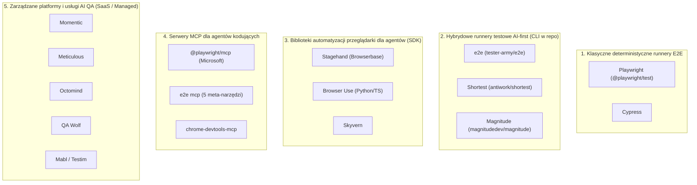

# Niezależny Audyt Technologiczno-Biznesowy: `e2e` (`tester-army/e2e`, d. TesterArmy)

**Status dokumentu:** Raport badawczy i due diligence techniczno-biznesowe (Issue [#64](https://github.com/RolePlayingTech/polish-accounting-platform/issues/64))  
**Przedmiot analizy:** Startup `e2e` (wcześniej działający pod nazwą **TesterArmy**, kohorta **Y Combinator Spring 2026 / YC P26**), twórca frameworka open-source [`tester-army/e2e`](https://github.com/tester-army/e2e) (`e2e@0.23.0`, `@e2e-dev/web@0.15.5`, `@e2e-dev/acp@0.1.1`, `@e2e-dev/decision@0.3.2`)  
**Data analizy:** Listopad 2026 r.  
** Kontekst projektu:** Polish Accounting Platform (`@pap/*`)

---

## Streszczenie wykonawcze (Executive Summary)

1. **Kim jest `e2e` (d. TesterArmy):** Polsko-amerykański startup założony w 2026 r. przez **Szymona Rybczaka** (CEO) oraz **Oskara Kwaśniewskiego** (CTO) — doświadczonych inżynierów wywodzących się z zespołu R&D firmy **Callstack** (znanych w ekosystemie React Native m.in. z biblioteki `react-native-bottom-tabs` oraz narzędzia `agent-device`). Po przejściu przez akcelerator **Y Combinator (YC P26)** jako zamknięta platforma SaaS QA pod nazwą **TesterArmy**, zespół przeprowadził **1 października 2026 r.** radykalny zwrot (pivot): porzucił zamkniętą aplikację webową na rzecz otwartoźródłowego (`Apache-2.0`) frameworka CLI i runnera testów E2E pod marką **`e2e`** (domena `e2e.com`).
2. **Finansowanie (~9,2 mln USD / ~8,05 mln EUR łącznie):**
   - **Pre-Seed (wrzesień 2026 r.):** **1,2 mln USD** (~1,04–1,05 mln EUR) od **Y Combinator**, **AIP Seed**, **Eight Capital** i **Script Capital** oraz aniołów biznesu: **Guillermo Rauch** (CEO Vercel), **Walden Yan** (współzałożyciel Cognition / Devin), **Charlie Cheever** (współzałożyciel Expo), **Zeno Rocha** (CEO Resend) i **Mike Grabowski** (współzałożyciel i CTO Callstack).
   - **Seed (ogłoszony 3 listopada 2026 r.):** **8,0 mln USD** (~7,0 mln EUR), runda współprowadzona (co-lead) przez **Credo Ventures** oraz **KAYA**, z udziałem **Point Nine**, **Baobab Ventures**, **Script Capital** oraz aniołów: **Marcina Żukowskiego** (współzałożyciel Snowflake) i **Oscara Salazara** (współzałożyciel i były CTO Uber).
   - **Wycena (valuation):** Oficjalna wycena post-money ani pre-money w żadnej z obu rund **nie została publicznie ujawniona** w komunikatach spółki ani rejestrach prasowych.
3. **Istota techniczna produktu:** Wbrew części narracji marketingowej („alternatywa dla Playwrighta zbudowana dla ery agentów"), analiza kodu źródłowego `e2e@0.23.0` i `@e2e-dev/web@0.15.5` dowodzi, że `e2e` **nie jest nowym silnikiem przeglądarkowym**, lecz **nakładką orkiestracyjną i semantyczną na `playwright-core@1.64.1`**. Jego realna wartość inżynierska leży w czterech elementach:
   - własnym, deterministycznym czytniku semantycznym DOM (`read-semantics.ts`, 1 632 LOC wstrzykiwane do strony), który buduje zwięzłe drzewo z kluczami `SemanticKey` i wyliczonymi stylami dla agentów AI,
   - hybrydowym API łączącym deterministyczne lokatory (`screen.*`, `browser.*`) z krokami agentowymi (`agent.act`, `agent.assert`, `agent.waitFor`, `agent.extract`),
   - lokalnym cache'u wykonanych ścieżek agenta (`.e2e/cache/*.json`, schemat `trace-1`) pozwalającym odtwarzać raz odkryte kroki AI bez wywoływania LLM w kolejnych przebiegach,
   - natywnej obsłudze protokołu ACP (`@e2e-dev/acp`), serwera MCP (`e2e mcp` z 5 meta-narzędziami) oraz czytelnych śladów tekstowych (`trace.md`) dla agentów kodujących (Claude Code, Codex, Cursor).
4. **Kluczowy wniosek biznesowo-architektoniczny:** `e2e` rozwiązuje realny problem ergonomii komunikacji między agentem kodującym a przeglądarką i redukuje koszt wielokrotnego wywoływania LLM dzięki cache'owi `trace-1`. Jednocześnie **fosa technologiczna (moat) samego runnera open-source jest płytka**, model monetyzacji po porzuceniu SaaS-u TesterArmy jest w fazie wczesnej budowy (własne modele decyzyjne `@e2e-dev/decision`, chmura wykonawcza, urządzenia mobilne), a w systemach regulowanych (takich jak **Polish Accounting Platform**) mechanizm „samonaprawiania" (`self-healing` / fallback z cache'u do agenta AI) stwarza ryzyko **zamaskowania regresji uprawnień, bezpieczeństwa lub prawa podatkowego**.

---

## A. Historia firmy, założyciele i ewolucja produktu (TesterArmy → `e2e`)

### A.1. Założyciele i rodowód techniczny (Callstack R&D)

| Osoba                 | Rola w `e2e`     | Doświadczenie i dorobek techniczny (fakty zweryfikowane)                                                                                                                                                                                                                                                                                 |
| --------------------- | ---------------- | ---------------------------------------------------------------------------------------------------------------------------------------------------------------------------------------------------------------------------------------------------------------------------------------------------------------------------------------- |
| **Szymon Rybczak**    | Co-Founder & CEO | Były inżynier R&D w polskiej firmie **Callstack** (Wrocław/Warszawa — jeden z głównych globalnych partnerów Meta i Microsoft w ekosystemie React Native). Twórca i współautor narzędzi wokół automatyzacji urządzeń i React Native, m.in. eksperymentalnego `agent-device`. Aktywny prelegent konferencji React Universe / React Native. |
| **Oskar Kwaśniewski** | Co-Founder & CTO | Były Senior Software Engineer / badacz R&D w **Callstack**, członek grona kontrybutorów React Native. Autor popularnej biblioteki open-source `react-native-bottom-tabs` (natywne dolne zakładki dla React Native) oraz narzędzi deweloperskich na styku natywnych widoków mobilnych (iOS/Android) i Web.                                |

**Znaczenie rodowodu Callstack:**

- Obaj założyciele posiadają silne, praktyczne zaplecze w budowie narzędzi deweloperskich (DX), mostków natywnych (React Native, iOS Simulator, Android ADB) oraz dystrybucji projektów open-source.
- Wyjaśnia to bezpośrednio architekturę `e2e`: choć pakiet `@e2e-dev/web` owija `playwright-core`, cały runner `e2e` został zaprojektowany wokół kontraktu **Engine SPI v1** (`defineEngine` w `packages/e2e/src/engine/`), który oddziela logikę runnera i pętli agentowej od platformy docelowej (Web, a docelowo iOS/Android/React Native — obszar, w którym Playwright jest historycznie nieobecny).
- Współzałożyciel i CTO Callstack, **Mike Grabowski**, wsparł spółkę jako anioł biznesu już w rundzie Pre-Seed.

### A.2. Oś czasu: od TesterArmy (YC P26) do pivotu na `e2e`

| Okres / Data                    | Wydarzenie                                                                                    | Fakty i źródła                                                                                                                                                                                                                                                                                                                                                                                                                                                                |
| ------------------------------- | --------------------------------------------------------------------------------------------- | ----------------------------------------------------------------------------------------------------------------------------------------------------------------------------------------------------------------------------------------------------------------------------------------------------------------------------------------------------------------------------------------------------------------------------------------------------------------------------- |
| **Wiosna / Lato 2026 (YC P26)** | Udział w **Y Combinator (kohorta P26 / Spring 2026)** jako **TesterArmy**                     | Spółka startuje pod nazwą **TesterArmy** (publikacja _Launch HN: TesterArmy (YC P26)_ na Hacker News). Pierwotny produkt to zarządzana platforma chmurowa SaaS z autonomicznymi agentami QA, które eksplorują aplikację webową i utrzymują testy E2E. Historyczny cennik SaaS TesterArmy obejmował progi **\$0 / \$99 / \$299 miesięcznie** oraz plan **Enterprise**.                                                                                                         |
| **Wrzesień 2026**               | Zamknięcie rundy **Pre-Seed (1,2 mln USD)**                                                   | Runda 1,2 mln USD (~1,04–1,05 mln EUR) z udziałem Y Combinator, AIP Seed, Eight Capital, Script Capital i prominentnych założycieli narzędzi deweloperskich (Rauch, Yan, Cheever, Rocha, Grabowski).                                                                                                                                                                                                                                                                          |
| **1 października 2026**         | **Radykalny pivot produktowy:** porzucenie SaaS-u TesterArmy i premiera open-source **`e2e`** | Założyciele ogłaszają zamknięcie dotychczasowej formy SaaS TesterArmy i udostępniają na licencji **Apache-2.0** repozytorium [`tester-army/e2e`](https://github.com/tester-army/e2e) oraz pakiet npm [`e2e`](https://www.npmjs.com/package/e2e) (wraz z domeną `e2e.com`). Wprost przyznają, że deweloperzy i autonomiczne agenty kodujące (Claude Code, Codex, Cursor) nie chcą wyklikiwać testów w osobnym dashboardzie SaaS, lecz potrzebują lokalnego CLI w repozytorium. |
| **Październik – Listopad 2026** | Szybki wzrost metryk open-source i wysoka częstotliwość wydań                                 | W ciągu ~5 tygodni od otwarcia kodu repozytorium `tester-army/e2e` zdobywa **~13,4 tys. gwiazdek na GitHubie** (~13 422 stars, ~569 forków na dzień 8 listopada 2026 r.), przekracza deklarowany przez spółkę próg **1 mln pobrań pakietów npm**, a zespół publikuje kilkadziesiąt wersji aż do `e2e@0.23.0` i `@e2e-dev/web@0.15.5` (wydanych 6 listopada 2026 r.).                                                                                                          |
| **3 listopada 2026**            | Ogłoszenie rundy **Seed (8,0 mln USD)**                                                       | Spółka ogłasza pozyskanie 8 mln USD (~7 mln EUR) rundy Seed współprowadzonej przez **Credo Ventures** i **KAYA** z udziałem **Point Nine**, **Baobab Ventures**, **Script Capital** oraz aniołów (**Marcin Żukowski**, **Oscar Salazar**). Łączne finansowanie sięga **~9,2 mln USD (~8,05 mln EUR)**.                                                                                                                                                                        |

---

## B. Rundy finansowania, inwestorzy i kwestia wyceny

### B.1. Zestawienie rund finansowania (fakty zweryfikowane)

| Parametr                                      | Runda Pre-Seed                                                                                                                                                                                       | Runda Seed                                                                                 | Łącznie (Total Funding)           |
| --------------------------------------------- | ---------------------------------------------------------------------------------------------------------------------------------------------------------------------------------------------------- | ------------------------------------------------------------------------------------------ | --------------------------------- |
| **Data ogłoszenia**                           | Wrzesień 2026 r.                                                                                                                                                                                     | 3 listopada 2026 r.                                                                        | Wrzesień – Listopad 2026 r.       |
| **Kwota w USD**                               | **1,2 mln USD**                                                                                                                                                                                      | **8,0 mln USD**                                                                            | **~9,2 mln USD**                  |
| **Kwota w EUR (wg komunikatów europejskich)** | **~1,04–1,05 mln EUR**                                                                                                                                                                               | **~7,0 mln EUR**                                                                           | **~8,05 mln EUR**                 |
| **Inwestorzy wiodący (Lead / Co-Lead)**       | Y Combinator, AIP Seed                                                                                                                                                                               | **Credo Ventures** (Praga) & **KAYA** (Praga/Warszawa)                                     | —                                 |
| **Pozostali fundusze VC**                     | Eight Capital, Script Capital                                                                                                                                                                        | **Point Nine** (Berlin), **Baobab Ventures**, **Script Capital** (follow-on)               | 7 funduszy instytucjonalnych + YC |
| **Aniołowie biznesu (ujawnieni publicznie)**  | **Guillermo Rauch** (CEO Vercel), **Walden Yan** (Co-Founder Cognition / Devin), **Charlie Cheever** (Co-Founder Expo), **Zeno Rocha** (CEO Resend), **Mike Grabowski** (Co-Founder & CTO Callstack) | **Marcin Żukowski** (Co-Founder Snowflake), **Oscar Salazar** (Co-Founder & były CTO Uber) | 7 ujawnionych aniołów Tier-1      |
| **Ujawniona wycena (Valuation)**              | **Nieujawniona publicznie**                                                                                                                                                                          | **Nieujawniona publicznie**                                                                | **Nieujawniona publicznie**       |

### B.2. Analiza profilu inwestorów i kwestii wyceny (oddzielenie faktów od szacunków)

1. **Fakt dotyczący wyceny:** Ani spółka `e2e` (TesterArmy Inc.), ani fundusze Credo Ventures, KAYA i Point Nine nie podały w komunikatach prasowych (EU-Startups, Vestbee, AIN.Capital, MamStartup, XYZ.pl, posty założycieli na X/LinkedIn z 3 listopada 2026 r.) wyceny pre-money bądź post-money dla rundy 8 mln USD Seed.
2. **Szacunek analityczny (kontekst rynkowy, nie fakt raportowany):** W realiach rund Seed z przełomu 2025/2026 dla spółek po Y Combinator z gwałtowną trakcją GitHub i udziałem europejskich funduszy Tier-1 (Point Nine, Credo, KAYA) standardowe rozwodnienie w rundzie 8 mln USD wynosi 15–20%, co implikuje typowy przedział rynkowy wyceny post-money rzędu **40–55 mln USD**. Należy to jednak traktować wyłącznie jako orientacyjny benchmark rynkowy VC, a nie potwierdzoną daną finansową spółki.
3. **Jakość kapitału (Signal Value):** Skład tabeli kapitałowej (cap table) jest wyjątkowo silny jak na tak młody projekt z Europy Środkowo-Wschodniej:
   - Obecność **Waldena Yana** (współtwórca **Devin / Cognition**) oraz **Guillermo Raucha** (**Vercel**) daje założycielom bezpośredni dostęp do twórców agentów kodujących i ekosystemu Next.js/Vercel AI SDK (z którego `e2e` bezpośrednio korzysta w `packages/e2e/src/ai/`).
   - Obecność **Point Nine** (historycznie wczesny inwestor w narzędzia dev/B2B SaaS, m.in. Algolia, Contentful, Revolut) oraz **Marcina Żukowskiego** (Snowflake) potwierdza, że inwestorzy kupili wizję infrastruktury dla autonomicznych agentów, a nie prostego skryptu nakładkowego na Playwrighta.

---

## C. Krytyczna weryfikacja 10 hipotez inwestycyjnych VC stojących za wyceną i rundą 8 mln USD

Poniżej poddajemy rygorystycznej weryfikacji inżynierskiej 10 głównych tez, które uzasadniają zainteresowanie funduszy VC projektem `e2e`.

### Hipoteza 1: _„Agenty kodujące (Claude Code, Codex, Cursor, Devin) generują kod 10x szybciej, więc wąskim gardłem SDLC staje się weryfikacja E2E w przeglądarce."_

- **Ocena:** **Prawdziwa diagnoza problemu rynkowego, ale nieoczywisty zwycięzca narzędziowy.**
- **Analiza:** Kiedy agent kodujący generuje lub modyfikuje dziesiątki plików w ciągu minuty, statyczna kontrola typów (`tsc`) i testy jednostkowe nie wykrywają błędów integracji na styku UI–BFF–API (co dobitnie pokazały błędy split-brain `#57`–`#63` w naszym własnym repozytorium). Agenty kodujące rzeczywiście potrzebują pętli zwrotnej z uruchomionej przeglądarki. Nie wynika z tego jednak automatycznie, że muszą używać nowego runnera testów zamiast Playwright CLI + `@playwright/mcp`.

### Hipoteza 2: _„Klasyczny Playwright jest zbyt niskopoziomowy i kruchy dla agentów AI, a jego drzewa DOM/Accessibility zużywają zbyt dużo tokenów."_

- **Ocena:** **Częściowo prawdziwa technicznie — to najsilniejszy argument inżynieryjny `e2e`.**
- **Dowód z kodu źródłowego:** W `@e2e-dev/web` (`packages/web/src/browser/injected/read-semantics.ts`, 1 632 linie kodu) twórcy `e2e` napisali własny, jedno-przebiegowy czytnik DOM uruchamiany w kontekście strony (`page.evaluate`). Zamiast zrzucać surowy HTML lub pełne drzewo CDP Accessibility:
  - nadaje węzłom stabilne klucze `SemanticKey` i identyfikatory `#n<id>`,
  - oblicza skrócony podpis stylu (`StyleKey`: widoczność, kolor, tło, obramowanie, rozmiar czcionki) i pomija elementy ukryte (`display: none`, `visibility: hidden`, `opacity: 0`, zerowy bounding box),
  - buduje kompaktowy tekstowy widok drzewa oraz strukturalny **增量 diff (różnicę przed/po akcji)** z limitem `maxObservationBytes = 262 144` bajtów i `maxAgentContextBytes = 16 384` bajtów.
- **Zastrzeżenie:** Microsoft w `@playwright/mcp` oraz w metodzie `locator.ariaSnapshot()` (wprowadzonej w Playwright 1.49+) również dostarcza zwięzłe drzewa YAML ARIA. Przewaga `e2e` polega na tym, że dołącza do każdego kroku automatyczny **diff semantyczny przed/po kliknięciu** oraz korelację z błędami sieci/konsoli w jednym pliku `trace.md`.

### Hipoteza 3: _„Hybrydowy model `Write in English, replay from cache` (napisz `agent.act(...)` po angielsku/polsku, zapisz ścieżkę w `.e2e/cache`, odtwarzaj deterministycznie za 0 USD) eliminuje koszt i powolność AI w CI."_

- **Ocena:** **Prawdziwa w scenariuszach stabilnego UI, ale obarczona fundamentalnym kompromisem bezpieczeństwa w systemach krytycznych.**
- **Dowód z kodu i pomiarów:** Plik cache w `.e2e/cache/<key>.json` (schemat `trace-1`) zapisuje wygenerowane przez LLM kroki niskopoziomowe (`click`, `fill`, `press`) wraz z odciskiem palca węzła (`NodeMatcher`: `key`, `role`, `name`, `tag`, `pathKeys`, `testId`, `id`, `href`, `placeholder`). Podczas kolejnego uruchomienia (`warm cache`) `e2e` wykonuje te kroki bez żadnego zapytania do modelu AI (`modelCalls: 0`, `modelTokens: 0`), w czasie zbliżonym do zwykłego testu deterministycznego.
- **Pułapka inżynierska:**
  1. W trybie domyślnym (`strictCache: false`), gdy element zmieni się na stronie, a 3-poziomowa relokacja (`strict` → `semantic` → `shape`) w `relocate.ts` nie znajdzie węzła lub zawiedzie warunek potwierdzenia (`confirm-1`), `e2e` **po cichu przełącza się z powrotem na agenta AI (`adaptFromTrace`)**, co wymaga klucza LLM na maszynie CI i może zaakceptować zmodyfikowany UI, który w rzeczywistości jest błędem biznesowym!
  2. Jeśli zaś włączymy `--strict-cache` (zalecane w CI bez kluczy LLM), przy każdej istotnej zmianie drzewa DOM test pada z kodem wyjścia `2` (`REPLAY_STALE`), czyli **zachowuje się dokładnie tak samo jak klasyczny Playwright**, wymagając ponownego nagrania cache'u przez dewelopera.

### Hipoteza 4: _„Własna rodzina wyspecjalizowanych małych modeli decyzyjnych (`@e2e-dev/decision`, `e2e-1`, `e2e-1-mini`) zastąpi drogie modele ogólne (Claude Sonnet / GPT-5) i stworzy własność intelektualną (IP) oraz marżę chmurową."_

- **Ocena:** **Kluczowa hipoteza monetyzacyjna spółki — obecnie we wczesnej fazie technicznej (v0.3.2).**
- **Dowód z kodu źródłowego:** Inspekcja pakietu `@e2e-dev/decision@0.3.2` (`packages/decision/src/`) ujawnia bardzo interesującą architekturę:
  - Pakiet definiuje dwa modele hostowane przez spółkę: **`e2e-1`** oraz **`e2e-1-mini`** (domyślny adres API: `https://decision.e2e.dev/v1`, uwierzytelniany zmienną `E2E_DECISION_API_KEY`).
  - Zamiast prowadzić wieloturową konwersację z dużym LLM, `@e2e-dev/decision` wysyła ustrukturyzowane drzewo widoku (`DecisionTreeNode`), cel (`goal`), historię ostatnich akcji i reguły potwierdzenia do szybkiego endpointu `/decide` (z budżetem opóźnienia `latencyBudgetMs`) oraz `/confirm`.
  - Co więcej, w `packages/e2e/src/ai/` widoczny jest moduł `collector.ts` zbierający trajektorie wykonania, które mogą służyć do douczania (fine-tuningu / destylacji) modeli `e2e-1`.
- **Wniosek:** To tutaj — a nie w samym runnerze open-source — leży docelowy model przychodowy spółki (sprzedaż szybkich, tanich tokenów decyzyjnych `decision.e2e.dev` zoptymalizowanych pod nawigację po drzewie semantycznym).

### Hipoteza 5: _„Posiadanie nazwy pakietu `e2e` w rejestrze npm (`npm i -D e2e`) oraz domeny `e2e.com` zapewnia ogromną przewagę dystrybucyjną w erze LLM."_

- **Ocena:** **Prawdziwa i niedoceniana przewaga dystrybucyjna.**
- **Analiza:** Pozyskanie dwuliterowo-cyfrowej nazwy pakietu `e2e` w głównym rejestrze npm oraz domeny `e2e.com` to majstersztyk marketingowo-dystrybucyjny. Zarówno ludzie wpisujący odruchowo komendy, jak i modele językowe (po aktualizacji danych treningowych lub załadowaniu pliku `.agents/skills/e2e/SKILL.md`) zapamiętują `npx e2e run` znacznie łatwiej niż nazwy złożone. Dodatkowo `e2e init` automatycznie wstrzykuje swoje instrukcje do `.agents/skills/e2e/SKILL.md`, `.claude/skills/e2e`, `.mcp.json` i `.cursor/mcp.json`, przejmując domyślny sposób uruchamiania testów przez agenta kodującego w danym repozytorium.

### Hipoteza 6: _„Serwer `e2e mcp` z tylko 5 meta-narzędziami jest lepszy dla agentów kodujących niż `@playwright/mcp` z ~25 osobnymi narzędziami."_

- **Ocena:** **Dobrze przemyślana decyzja architektoniczna, ale łatwa do skopiowania przez konkurencję.**
- **Dowód z testu empirycznego `e2e mcp`:** Uruchomiony przez nas serwer `e2e mcp` wystawia w protokole MCP (`2025-03-26`) dokładnie **5 narzędzi**: `open_session`, `tools`, `call`, `close_session` oraz `run_tests` (oraz 9 zasobów dokumentacyjnych `e2e://guide/*`). Dzięki temu nie zaśmieca okna kontekstowego agenta kodującego kilkudziesięcioma schematami JSON na starcie sesji (problem tzw. _tool bloat_ w MCP), a jednocześnie pozwala agentowi interaktywnie zbadać stronę (`open_session` → `call: observe` → `call: click`) i od razu zapisać gotowy plik `.e2e.ts`.

### Hipoteza 7: _„Wieloplatformowość (Web dziś, React Native / iOS / Android jutro dzięki Engine SPI) pozwoli `e2e` wyjść poza ograniczenia Playwrighta."_

- **Ocena:** **Wiarygodna długoterminowo ze względu na kompetencje założycieli z Callstack, ale dziś na produkcji działa wyłącznie silnik Web (`@e2e-dev/web`).**
- **Dowód z kodu:** W `packages/e2e/src/engine/` istnieje czysty kontrakt `EngineSPI` (`spiVersion: 1`) ze zdolnościami (`actions`, `artifacts`, `browser`, `keyboard`, `location`, `observation`, `pointer`, `state`), który nie zakłada istnienia DOM ani Chromium. Biorąc pod uwagę, że Rybczak i Kwaśniewski są ekspertami od React Native, dodanie silnika `@e2e-dev/mobile` (lub integracji z Maestro / WebDriverAgent / ADB) jest naturalnym krokiem, w którym Microsoft Playwright nie ma dobrej odpowiedzi. Na dzień 8 listopada 2026 r. w repozytorium i npm opublikowany jest jednak wyłącznie silnik `@e2e-dev/web`.

### Hipoteza 8: _„13,4 tys. gwiazdek na GitHubie i >1 mln pobrań npm w 5 tygodni dowodzą masowej adopcji produkcyjnej."_

- **Ocena:** **Wymaga ostrożności analitycznej — silny sygnał zainteresowania społeczności, ale nie dowód wdrożeń enterprise.**
- **Analiza:** Wzrost gwiazdek z ~0 do ~13 422 w 5 tygodni (wsparty viralowymi postami na X, wsparciem Guillermo Raucha i ogłoszeniem rundy 8 mln USD) potwierdza znakomity marketing deweloperski. Jednak:
  - licznik pobrań npm obejmuje wszystkie pakiety z przestrzeni `@e2e-dev/*` oraz automatyczne pobrania przez boty CI, mirrory rejestrów i skanery bezpieczeństwa,
  - sam pakiet jest w wersji `0.23.0` (przed `1.0.0`), z bardzo wysoką dynamiką zmian API (np. migracja konfiguracji modeli na obiekty dostawców lub `@e2e-dev/acp`).

### Hipoteza 9: _„Testy agentowe AI wykrywają błędy aplikacyjne, których nie wykrywa deterministyczny Playwright."_

- **Ocena:** **Obalona empirycznie w naszym benchmarku na Polish Accounting Platform (patrz Raport 1).**
- **Dowód empiryczny:** Zarówno deterministyczny Playwright, deterministyczny `e2e`, jak i agentowy `e2e` operujący na drzewie semantycznym UI **przechodzą na zielono** na widokach, które cierpią na błędy architektury _split-brain_ (`#57`, `#59`, `#60`, `#62`, `#63`), dopóki test sprawdza wyłącznie obecność banera „Zaksięgowano" na ekranie. Co więcej, w trybie agentowym istnieje ryzyko odwrotne: gdy przycisk w UI zmieni znaczenie biznesowe (np. z bezpiecznej propozycji na natychmiastowe księgowanie bez udziału człowieka), agent AI może uznać kliknięcie za „sukces realizacji celu", maskując krytyczną regresję zgodności!

### Hipoteza 10: _„Open-source pod licencją `Apache-2.0` pozwoli zdominować standard rynkowy zanim Microsoft rozbuduje Playwrighta o warstwy agentowe."_

- **Ocena:** **Ryzyko konkurencyjne ze strony Microsoftu (`@playwright/test` + `@playwright/mcp`) jest bardzo wysokie.**
- **Analiza:** Zespół Playwrighta w Microsofcie (kierowany przez Pavla Feldmana) rozwija już oficjalny serwer `@playwright/mcp`, integrację z GitHub Copilot Coding Agent oraz natywne snapshoty ARIA. Ponieważ `@e2e-dev/web` zależy bezpośrednio od `"playwright-core": "1.64.1"`, każda innowacja na poziomie protokołu przeglądarki pozostaje pod kontrolą zespołu Playwrighta.

---

## D. Analiza konkurencji i taksonomia rynku (5 kategorii narzędzi)

Jednym z najczęstszych błędów w analizach rynkowych wokół AI QA jest wrzucanie do jednego worka niskopoziomowych bibliotek automatyzacji przeglądarki, serwerów MCP, runnerów testowych i pełnych usług SaaS/QA-as-a-Service. Poniżej przedstawiamy precyzyjną taksonomię 5 kategorii wraz z miejscem `e2e`.

### D.1. Podział na 5 kategorii architektonicznych

### D.2. Szczegółowa macierz porównawcza konkurencji

| Narzędzie / Firma                        | Kategoria główna                                         | Silnik pod spodem                                                         | Licencja / Model                                                      | Sposób pisania testów                                                                              | Mechanizm AI i Cache                                                                                                                       | Kluczowa różnica względem `e2e`                                                                                                                                                                                    |
| ---------------------------------------- | -------------------------------------------------------- | ------------------------------------------------------------------------- | --------------------------------------------------------------------- | -------------------------------------------------------------------------------------------------- | ------------------------------------------------------------------------------------------------------------------------------------------ | ------------------------------------------------------------------------------------------------------------------------------------------------------------------------------------------------------------------ |
| **`e2e` (`tester-army/e2e`)**            | **2. Hybrydowy runner AI-first** + **4. Serwer MCP**     | `playwright-core@1.64.1` + własny in-page czytnik `read-semantics.ts`     | `Apache-2.0` (open-source CLI) + chmura decyzyjna `@e2e-dev/decision` | Kod TS (`.e2e.ts`): hybryda `screen.*`/`browser.*` + `agent.act`/`assert`/`extract`                | Własny czytnik DOM + Vercel AI SDK / ACP (`codex`/`claude`) + `@e2e-dev/decision` (`e2e-1`) + lokalny plik `.e2e/cache/*.json` (`trace-1`) | Łączy runner deterministyczny, kroki agentowe z cache'em `trace-1`, raport `trace.md` i 5-narzędziowy serwer `e2e mcp` w jednym pakiecie.                                                                          |
| **Playwright (`@playwright/test`)**      | **1. Klasyczny deterministyczny runner E2E**             | Własny silnik Microsoft (`playwright-core`: CDP / WebKit / Firefox)       | `Apache-2.0`                                                          | Kod TS/JS/Python/Java/.NET (`page.getByRole`, `expect`)                                            | Brak wbudowanego LLM w runnerze; natywne `ariaSnapshot()` i `Trace Viewer` (ZIP)                                                           | Złoty standard przemysłowy; 100% deterministyczny, brak narzutu warstwy pośredniej, pełna kontrola nad siecią (`page.route`), multi-browser (Chromium, Firefox, WebKit), `storageState`, sharding.                 |
| **Playwright MCP (`@playwright/mcp`)**   | **4. Serwer MCP dla agentów kodujących**                 | `playwright-core` (drzewo dostępności ARIA)                               | `Apache-2.0` (Microsoft)                                              | Interaktywne wywołania narzędzi MCP przez agenta kodującego                                        | Udostępnia ~25 narzędzi MCP (`browser_click`, `browser_snapshot`, `browser_type` itd.) opartych o ARIA snapshot                            | Służy do interaktywnej pracy agenta, a nie jako samodzielny runner `.e2e.ts` z cache'em kroków. Większa liczba narzędzi w kontekście MCP niż w `e2e mcp` (5 meta-narzędzi).                                        |
| **Cypress**                              | **1. Klasyczny deterministyczny runner E2E**             | Wykonanie wewnątrz pętli przeglądarki (in-browser runner) + Cypress Cloud | MIT (runner) + komercyjny Cypress Cloud (`cy.prompt`)                 | Kod JS/TS (`cy.get`, `cy.contains`) + eksperymentalny `cy.prompt` w chmurze                        | `cy.prompt` wymaga płatnej chmury Cypress Cloud                                                                                            | Starsza architektura jednowątkowa w przeglądarce; znacznie słabsza obsługa wielu kart/originów i gorsza ergonomia dla autonomicznych agentów CLI niż Playwright i `e2e`.                                           |
| **Stagehand (Browserbase)**              | **3. Biblioteka SDK automatyzacji przeglądarki**         | `playwright-core` / CDP + chmura Browserbase                              | MIT (SDK) + płatny PaaS Browserbase                                   | Kod TS: `stagehand.act()`, `stagehand.extract()`, `stagehand.observe()`                            | Bardzo podobne prymitywy (`act`, `extract`, `observe`) + auto-caching akcji; zoptymalizowane pod sesje chmurowe Browserbase                | Stagehand to **biblioteka SDK** (używana też do web scrapingu i RPA), a nie kompletny runner testowy z własnym systemem asercji, plikami `.e2e.ts` i raportami `trace.md`.                                         |
| **Browser Use**                          | **3. Biblioteka dla autonomicznych web-agentów**         | Playwright / CDP (głównie Python, port TS)                                | MIT + chmura Browser Use                                              | Zadania wysokopoziomowe dla agenta ogólnego przeznaczenia                                          | Pełna pętla agentowa (DOM + opcjonalnie Vision) do wykonywania zadań w sieci                                                               | Skierowany głównie do ekosystemu Python i ogólnych zadań agentowych (rezerwacje, scraping, formularze), a nie do szybkich testów regresyjnych CI w repozytorium TS.                                                |
| **Skyvern**                              | **3. Automatyzacja przeglądarki oparta o Vision + LLM**  | Playwright + modele wizyjne (VLM)                                         | AGPLv3 / Cloud                                                        | Zadania workflow na zewnętrznych portalach                                                         | Silny nacisk na analizę obrazu (screenshotów) i formularzy zewnętrznych                                                                    | Rozwiązuje problem automatyzacji cudzych, nieznanych stron (np. portale ubezpieczeniowe/rządowe), podczas gdy `e2e` testuje własną aplikację w CI na bazie szybkiego drzewa DOM.                                   |
| **Shortest (`antiwork/shortest`)**       | **2. Runner testów w języku naturalnym**                 | Playwright + Anthropic Claude API                                         | MIT (stworzony przez Sahila Lavingię / Antiwork)                      | Testy pisane niemal wyłącznie jako stringi w języku naturalnym: `shortest('Zaloguj się jako...')`  | Wywołania Claude Computer Use / API na bazie Playwrighta                                                                                   | Znacznie prostszy technicznie projekt niż `e2e`; brak zaawansowanego in-page czytnika semantycznego, kontraktu Engine SPI i wielopoziomowej relokacji cache'u.                                                     |
| **Magnitude (`magnitudedev/magnitude`)** | **2. Wizyjny runner E2E AI (po pivocie)**                | Playwright + modele Vision-first                                          | `Apache-2.0` (YC)                                                     | Deklaratywne przypadki testowe oparte na widoku ekranu                                             | **Vision-first** (koordynaty pikseli ze screenshotów zamiast polegania na DOM)                                                             | Bardzo pouczający przypadek porównawczy: **Magnitude niedawno ogłosiło pivot i wygaszanie prac nad swoim otwartym frameworkiem E2E**, co pokazuje, jak trudna jest monetyzacja samego otwartego runnera testów AI! |
| **Momentic**                             | **5. Platforma AI QA (Low-code + CLI)**                  | Playwright / Chromium                                                     | Komercyjny SaaS (YC W24)                                              | Edytor wizualny YAML/UI + kroki AI (`Locate with AI`, `Assert with AI`) + CLI                      | Chmurowe modele AI + lokatory intencyjne                                                                                                   | Produkt komercyjny (SaaS + lokalny agent) skierowany również do mniej technicznych zespołów QA; `e2e` po pivocie z TesterArmy celuje wyłącznie w deweloperów i agenty kodujące (code-first).                       |
| **Meticulous**                           | **5. Zero-config nagrywanie i odtwarzanie sesji**        | Chromium (deterministyczna wirtualizacja sieci i czasu)                   | Komercyjny SaaS (YC)                                                  | **Zero pisania testów** — nagrywa ruch z dev/staging/prod i odtwarza go na PR                      | Zamiast pisać testy w pliku, porównuje zachowanie frontendu na nagranych sesjach z zamockowanym backendem                                  | Zupełnie inna filozofia: Meticulous testuje wyłącznie frontend (z zamrożonym zrzutem odpowiedzi API), więc z definicji nie bada prawdziwego kontraktu z backendem i bazą danych.                                   |
| **Octomind**                             | **5. Zarządzana platforma auto-generowania Playwrighta** | Generuje i utrzymuje czysty kod `@playwright/test`                        | Komercyjny SaaS                                                       | Agent AI w chmurze odkrywa ścieżki i generuje standardowy kod Playwrighta                          | AI służy do wygenerowania i naprawy kodu Playwrighta, a wykonanie jest 100% Playwrightem                                                   | W Octomind artefaktem wynikowym jest standardowy kod Playwrighta bez lock-inu w osobny runner; w `e2e` używamy własnego runnera i składni `@e2e-dev/web`.                                                          |
| **QA Wolf**                              | **5. QA-as-a-Service (usługa + platforma)**              | Playwright (równoległa chmura)                                            | Komercyjny kontrakt usługowy (managed QA)                             | Zespół QA Wolf + ich wewnętrzne narzędzia AI piszą i utrzymują 100% testów Playwrighta dla klienta | Sprzedaje gwarancję pokrycia (np. 80% E2E) i święty spokój inżynierów, a nie sam framework                                                 | QA Wolf monetyzuje pełne przejęcie obowiązku utrzymania testów (wysokie ACV enterprise), podczas gdy `e2e` dostarcza narzędzie do ręki dewelopera/agenta.                                                          |
| **Mabl / Testim (Tricentis)**            | **5. Korporacyjne platformy Low-Code Test Automation**   | Własne agenty przeglądarkowe / Selenium / Playwright                      | Komercyjny Enterprise SaaS                                            | Nagrywanie w UI, low-code, korporacyjne raportowanie i self-healing                                | Klasyczny ML/heurystyczny self-healing selektorów + asystenci GenAI                                                                        | Narzędzia dla tradycyjnych działów korporacyjnego QA; niekompatybilne z filozofią autonomicznych agentów kodujących w terminalu.                                                                                   |

---

## E. Model biznesowy, ekonomika jednostkowa i fosa technologiczna (Moat)

### E.1. Co jest darmowe (`Apache-2.0`), a na czym spółka zamierza zarabiać?

Po zamknięciu płatnego SaaS-u TesterArmy (1 października 2026 r.) całe repozytorium `tester-army/e2e` (`e2e`, `@e2e-dev/web`, `@e2e-dev/acp`, `@e2e-dev/decision`) zostało wydane na permisywnej licencji **Apache-2.0**. Analiza kodu źródłowego i architektury pakietów ujawnia trzy filary przyszłej monetyzacji (model **Open-Core / Usage-Based Cloud**):

1. **Płatne API wyspecjalizowanych modeli decyzyjnych (`@e2e-dev/decision` → `https://decision.e2e.dev/v1`):**
   - W kodzie `packages/decision/src/client.ts` zaszyty jest oficjalny endpoint chmurowy `https://decision.e2e.dev/v1` obsługujący modele **`e2e-1`** oraz **`e2e-1-mini`** z kluczem `E2E_DECISION_API_KEY`.
   - Zamiast zmuszać użytkownika do płacenia OpenAI/Anthropic za ciężkie wywołania ogólnych modeli LLM (które są wolne i drogie na dużych drzewach DOM), `e2e` może oferować własny, wielokrotnie szybszy i tańszy model wyspecjalizowany w podejmowaniu decyzji na ustrukturyzowanym `DecisionTreeNode` oraz weryfikacji kroków (`/decide` i `/confirm`).
2. **Zarządzana infrastruktura wykonawcza CI / Cloud Runners & Shared Team Cache:**
   - Lokalny katalog `.e2e/cache/` w repozytorium git sprawdza się w małych zespołach, ale w większych organizacjach z dziesiątkami gałęzi pojawia się problem synchronizacji cache'u, przechowywania ciężkich artefaktów wideo/trace oraz równoległego uruchamiania przeglądarek i symulatorów mobilnych (iOS/Android).
3. **Enterprise Governance, Flota Urządzeń Mobilnych i Integracje CI/CD:**
   - Rozszerzenie `EngineSPI` na natywne aplikacje mobilne (iOS/Android/React Native) wymaga farmy symulatorów/urządzeń w chmurze, za którą firmy chętnie płacą w modelu subskrypcyjnym lub za minutę wykonania.

### E.2. Ekonomika jednostkowa (Unit Economics) testów AI na skali CI

Rozważmy realny koszt uruchomienia testów w trzech trybach:

1. **Tryb deterministyczny (`screen.*` / `browser.*`):**
   - Koszt tokenów AI: **0,00 USD**.
   - Czas wykonania 5 złożonych scenariuszy księgowych na naszej aplikacji (`N=5`, `25/25 PASS`): mediana **~10,1 s** (`10 119 ms` wall-clock / `9 450 ms` runner), podczas gdy w czystym Playwright wynosi **~7,2 s** (`7 193 ms` wall-clock / `6 800 ms` runner).
2. **Tryb agentowy bez cache'u (`--no-cache`) lub podczas pierwszego nagrania (`Cold Run`):**
   - Każdy krok `agent.act` / `agent.assert` wymaga zbudowania obserwacji (`read-semantics.ts`), przesłania drzewa semantycznego (~2–12 KB tekstu na krok) do modelu LLM (lub procesu ACP `codex`/`claude`), odebrania wywołania narzędzia i ponownej obserwacji po akcji.
   - Przy 6–10 turach na jeden test zużycie wynosi średnio **15 000 – 45 000 tokenów wejściowych** oraz **1 000 – 3 000 tokenów wyjściowych** (koszt rzędu **0,05 – 0,25 USD za pojedynczy test** na modelach klasy Claude Sonnet / GPT-5 oraz czas wykonania **25 – 90 sekund** na jeden test zamiast 3–4 sekund!).
   - Gdyby organizacja uruchamiała 200 takich testów na każdym z 50 PR dziennie bez cache'u (**10 000 uruchomień testów dziennie**), rachunek za same tokeny LLM wyniósłby **500 – 2 500 USD dziennie (15 000 – 75 000 USD miesięcznie)**, a czas CI wzrósłby dziesięciokrotnie.
3. **Tryb agentowy z ciepłym cache'em (`Warm Cache` — `.e2e/cache/*.json`):**
   - Koszt tokenów AI: **0,00 USD** (`modelCalls: 0`), czas bliski deterministycznemu (~3–5 s na test) — **dopóki UI nie ulegnie zmianie**.
   - Z chwilą przebudowy UI cache ulega unieważnieniu (`REPLAY_STALE`) i zespół ponownie ponosi koszt wywołania modelu AI w celu przeliczenia ścieżki.

### E.3. Ocena fosy technologicznej (Moat): jak trudno odtworzyć `e2e`?

Bądźmy bezwzględnie szczerzy na poziomie architektury kodu:

- **Co jest łatwe do skopiowania (niska fosa — 2 do 6 tygodni pracy doświadczonego zespołu):**
  - Sam zamysł pliku `.e2e/cache/*.json` zapisującego tablicę kroków `{ tool, input, target: NodeMatcher }` i odtwarzającego je przez `playwright-core` można zaimplementować jako lekki helper lub fixture bezpośrednio wewnątrz standardowego `@playwright/test` w kilkaset linii TypeScriptu.
  - Podobnie serwer MCP z 5 meta-narzędziami (`open_session`, `tools`, `call`, `close_session`, `run_tests`) oraz generator raportów Markdown (`trace.md`) to bardzo dobre wzorce projektowe, które można wprost przenieść do naszego repozytorium bez zmiany runnera.
- **Co stanowi głębszą wartość inżynierską `e2e` (średnia fosa):**
  - Dopracowany, 1632-liniowy in-page czytnik semantyczny (`read-semantics.ts`) z heurystykami widoczności, grupowania, obliczania różnic (`diff.ts`), stabilnych kluczy `SemanticKey` i 3-poziomowej relokacji węzłów (`relocate.ts`),
  - Potok potwierdzania efektu akcji (`confirm-1` w `confirmation.ts` + `act-Verify.ts`), który sprawdza, czy kliknięcie rzeczywiście zmieniło stan strony lub wywołało oczekiwaną nawigację,
  - Zbiór danych treningowych (trajektorii DOM → akcja → diff) do trenowania własnych małych modeli decyzyjnych `@e2e-dev/decision` (`e2e-1`).

---

## F. Bezpośrednie odpowiedzi inżynierskie na 8 pytań właściciela (Sekcja 7.F)

### Pytanie 1: _Czy `e2e` to prawdziwy przełom technologiczny, czy dobrze opakowana warstwa nad `playwright-core` + LLM + JSON cache?_

**Odpowiedź:** Pod względem silnika przeglądarkowego `e2e` **nie jest nowym silnikiem**, lecz bardzo starannie zaprojektowaną **warstwą semantyczno-orkiestracyjną nad `playwright-core@1.64.1`**, połączoną z lokalnym cache'em `trace-1` (`.e2e/cache/*.json`) i adapterami AI (Vercel AI SDK v7, ACP, `@e2e-dev/decision`). Natomiast jego własny czytnik semantyczny DOM (`read-semantics.ts`), różnicowe ślady tekstowe (`trace.md`) i architektura Engine SPI stoją na znacznie wyższym poziomie inżynierskim niż typowe, powierzchowne wrappery AI nad Playwrightem (pokroju `Shortest`). To ewolucyjne udoskonalenie ergonomii pracy agentów z przeglądarką, a nie fundamentalny przełom na miarę stworzenia nowego silnika renderującego lub protokołu przeglądarkowego.

### Pytanie 2: _W jakich scenariuszach `e2e` daje realną przewagę, a w jakich jest niepotrzebnym kosztem i ryzykiem?_

- **Gdzie `e2e` daje realną przewagę:**
  1. Szybka eksploracja i prototypowanie testów przez autonomiczne agenty kodujące (dzięki zwięzłemu `trace.md`, 5 meta-narzędziom `e2e mcp` i dyrektywom `.agents/skills/e2e/SKILL.md`).
  2. Aplikacje konsumenckie o często zmieniającym się copywritingu i strukturze wizualnej, gdzie drobna zmiana etykiety przycisku nie stanowi ryzyka regulacyjnego, a ręczna aktualizacja selektorów jest uciążliwa.
  3. Zespoły planujące w przyszłości wspólne testy Web + React Native (gdy `e2e` udostępni silnik mobilny zgodny z `EngineSPI`).
- **Gdzie `e2e` jest niepotrzebnym kosztem lub ryzykiem:**
  1. **Systemy finansowo-księgowe, podatkowe i regulowane (takie jak Polish Accounting Platform)** — gdzie zmiana etykiety przycisku (np. z _„Utwórz propozycję do weryfikacji"_ na _„Zaksięguj automatycznie"_) lub ukrycie ostrzeżenia o duplikacie SHA-256 musi natychmiast zatrzymać build CI na czerwono, a nie zostać „obejściem" przez agenta AI.
  2. Środowiska CI z rygorystyczną ochroną danych (zakaz wysyłania zrzutów DOM/PII do zewnętrznych modeli LLM oraz zakaz telemetrii zewnętrznej — przypomnijmy, że `e2e` ma domyślnie włączoną telemetrię PostHog do `https://eu.i.posthog.com`, wymagającą jawnego `E2E_TELEMETRY_DISABLED=1`).
  3. Zespoły wymagające zaawansowanych funkcji `@playwright/test`: natywnego interceptowania i modyfikacji ruchu sieciowego (`page.route`), testów między-przeglądarkowych (Firefox, WebKit), wbudowanego shardingu CI czy natywnej integracji z IDE VS Code.

### Pytanie 3: _Dlaczego nasze dotychczasowe testy Playwright nie wykryły błędów split-brain (`#57`–`#63`) i czy `e2e` by je wykrył?_

**Odpowiedź:** Dotychczasowe testy Playwright nie wykryły błędów `#57`–`#63` **wyłącznie z powodu sposobu napisania asercji w testach oraz architektury cichego fallbacku w Next.js BFF (`assertApiResponsePermitsFallback`)**, a **nie z winy narzędzia Playwright**. Jak udowodniliśmy empirycznie w `test/e2e-benchmark/diagnostics/split-brain-probe.spec.ts` i `split-brain-probe.e2e.ts`:

- Jeśli test w `e2e` (zarówno deterministyczny, jak i agentowy `agent.assert`) sprawdza jedynie to, co widzi użytkownik na ekranie (np. baner _„Dokument zatwierdzony przez człowieka i zaksięgowany"_), **`e2e` również przechodzi na zielono i nie wykrywa split-brainu**, ponieważ Next.js BFF po cichu zapisuje stan w pamięci RAM procesu webowego!
- Z kolei gdy dodamy weryfikację stanu backendu `@pap/api` (`/api/v1/tenants/.../documents`, `/api/v1/tenants/.../mcp/proposals`) oraz test zachowania przy niedostępności API (twardy błąd `502`/`503` zamiast `200 OK` z RAM), **zarówno Playwright, jak i `e2e` wykrywają wszystkie błędy `#57`–`#63` ze 100% skutecznością**.

### Pytanie 4: _Czy warto migrować Polish Accounting Platform z `@playwright/test` na `e2e`?_

**Odpowiedź (Rekomendacja architektoniczna): NIE — nie należy zastępować `@playwright/test` przez `e2e` jako głównego, blokującego runnera CI w Polish Accounting Platform.**

- `@playwright/test` jest szybszy (mediana **~7,2 s** vs **~10,1 s** dla identycznego zestawu 5 testów deterministycznych — narzut `+40,7%` po stronie `e2e`), całkowicie deterministyczny, nie wysyła telemetrii do zewnętrznych usług analitycznych, nie niesie ryzyka wycieku danych formularzy do LLM i posiada pełne API sieciowe (`page.route`, `request` fixture) niezbędne do testowania scenariuszy awarii backendu (fail-closed `#59`).

### Pytanie 5: _Jakie wzorce z `e2e` warto jednak zaadaptować w naszej architekturze testowej od zaraz?_

Choć nie rekomendujemy zmiany głównego runnera na `e2e`, z kodu `tester-army/e2e` warto przenieść bezpośrednio do naszego zestawu `@playwright/test` trzy znakomite wzorce inżynierskie:

1. **Automatyczne zrzucanie zwięzłego raportu tekstowego `trace.md` przy błędzie testu** (zawierającego ostatnie requesty sieciowe ze statusem `>=400` oraz drzewo ARIA/tekstowe alertów ze strony) — dzięki czemu agenty kodujące naprawiające błędy w repozytorium widzą przyczynę błędu (np. `POST /api/workspace/actions 404 Not Found` i treść alertu UI) bez konieczności otwierania binarnego archiwum ZIP w przeglądarce.
2. **Jawne asercje kontraktowe UI ↔ API ↔ DB w każdym teście mutującym** (wzorzec z naszej sondy `split-brain-probe`).
3. **Zachowanie odizolowanego zestawu porównawczego `test/e2e-benchmark/`** w repozytorium, aby móc jednym poleceniem (`node test/e2e-benchmark/run-benchmark.mjs`) weryfikować kolejne wersje obu narzędzi oraz zwalidować pełny stos po zakończeniu Fali 2 (PostgreSQL 18).

### Pytanie 6: _Co oznacza pivot konkurencyjnego projektu Magnitude (`magnitudedev/magnitude`) dla przyszłości `e2e`?_

**Odpowiedź:** Niedawne wygaszenie prac nad otwartym frameworkiem testowym przez zespół **Magnitude** (również wspierany przez YC) jest poważnym sygnałem ostrzegawczym dla całej kategorii samodzielnych otwartych runnerów AI E2E. Pokazuje ono, że:

1. Samo rozdawanie otwartego runnera (`Apache-2.0` / `MIT`), w którym użytkownik podłącza własny klucz OpenAI/Anthropic (BYOK) lub lokalnego agenta ACP (`codex`/`claude`), **nie generuje przychodu dla startupu**.
2. Aby uzasadnić rundę 8 mln USD Seed i kolejną rundę Series A, `e2e` musi w ciągu najbliższych 12–18 miesięcy udowodnić, że zespoły deweloperskie są skłonne płacić abonament za jego chmurę decyzyjną (`decision.e2e.dev` / modele `e2e-1`) oraz infrastrukturę CI/Mobile, zamiast korzystać wyłącznie z darmowego CLI z lokalnym cache'em.

### Pytanie 7: _Jakie są największe zagrożenia dla bezpieczeństwa i prywatności przy używaniu `e2e` w firmie?_

1. **Brak automatycznej redakcji PII i wrażliwych danych domenowych w `read-semantics.ts`:** Choć pola `<input type="password">` oraz jawnie zadeklarowane `secrets` są chronione przez `ExecutorObservation`, wszystkie zwykłe pola `<input type="text">`, `<textarea>` (`el.value.slice(0, 120)`) oraz komórki tabel z numerami NIP, PESEL, IBAN czy kwotami faktur są odczytywane wprost z DOM i wysyłane w prompcie do zewnętrznego dostawcy modelu AI.
2. **Domyślnie aktywna telemetria zewnętrzna (PostHog EU):** W pliku `packages/e2e/src/telemetry/posthog.ts` zaszyty jest klucz projektu PostHog (`phc_...`) wysyłający zdarzenia uruchomienia CLI do `https://eu.i.posthog.com`, o ile w środowisku nie ustawiono `E2E_TELEMETRY_DISABLED=1` lub `DO_NOT_TRACK=1`.
3. **Przekazywanie pełnych uprawnień subprocesowi ACP (`permissionMode: 'ApproveAll'`):** W `@e2e-dev/acp` adapter uruchamia lokalnego agenta (`codex-acp` lub `claude-agent-acp`) z automatycznym zatwierdzaniem wywołań narzędzi w sesji.

### Pytanie 8: _Czy zgromadzony materiał badawczy i empiryczny kwalifikuje się jako baza pod zewnętrzną publikację / artykuł techniczny?_

**Odpowiedź:** **Zdecydowanie tak.** Połączenie:

- głębokiej inspekcji kodu źródłowego `e2e@0.23.0` (`read-semantics.ts`, `confirm-1`, `trace-1`, `@e2e-dev/decision`),
- twardego benchmarku porównawczego (`N=5` przebiegów, czasy, LOC, cache, mutacje UI) na realnej aplikacji domenowej,
- praktycznego case study błędów **split-brain (`#57`–`#63`)**, pokazującego dlaczego żaden framework E2E (ani klasyczny, ani AI) nie zastąpi weryfikacji kontraktu API/DB,
- oraz rzetelnej analizy biznesowej rynku AI QA po rundzie 8 mln USD Seed dla `e2e`
  stanowi unikalny, oparty na faktach i pomiarach materiał inżynierski, który wyróżnia się na tle powierzchownych recenzji powielających komunikaty prasowe.

---

## G. Źródła i referencje

1. **Repozytorium i kod źródłowy `e2e`:** [`https://github.com/tester-army/e2e`](https://github.com/tester-army/e2e) (analiza rewizji odpowiadającej wydaniom `e2e@0.23.0`, `@e2e-dev/web@0.15.5`, `@e2e-dev/acp@0.1.1`, `@e2e-dev/decision@0.3.2` z listopada 2026 r.).
2. **Rejestr npm:** [`https://www.npmjs.com/package/e2e`](https://www.npmjs.com/package/e2e), [`https://www.npmjs.com/package/@e2e-dev/web`](https://www.npmjs.com/package/@e2e-dev/web), [`https://www.npmjs.com/package/@e2e-dev/acp`](https://www.npmjs.com/package/@e2e-dev/acp), [`https://www.npmjs.com/package/@e2e-dev/decision`](https://www.npmjs.com/package/@e2e-dev/decision).
3. **Komunikaty o rundach finansowania (Pre-Seed 1,2 mln USD wrzesień 2026 / Seed 8,0 mln USD z 3 listopada 2026):**
   - EU-Startups / Vestbee / AIN.Capital / MamStartup / XYZ.pl — relacje z ogłoszenia rundy 8 mln USD (~7 mln EUR) współprowadzonej przez Credo Ventures i KAYA z udziałem Point Nine, Baobab Ventures i Script Capital (listopad 2026 r.).
   - Profil Y Combinator: TesterArmy / `e2e` (kohorta YC P26 / Spring 2026) oraz wątek _Launch HN: TesterArmy (YC P26)_.
4. **Raport techniczno-benchmarkowy (Część 1):** [`docs/reports/e2e-vs-playwright.md`](./e2e-vs-playwright.md) oraz powtarzalny zestaw benchmarkowy w [`test/e2e-benchmark/`](../../test/e2e-benchmark/).
