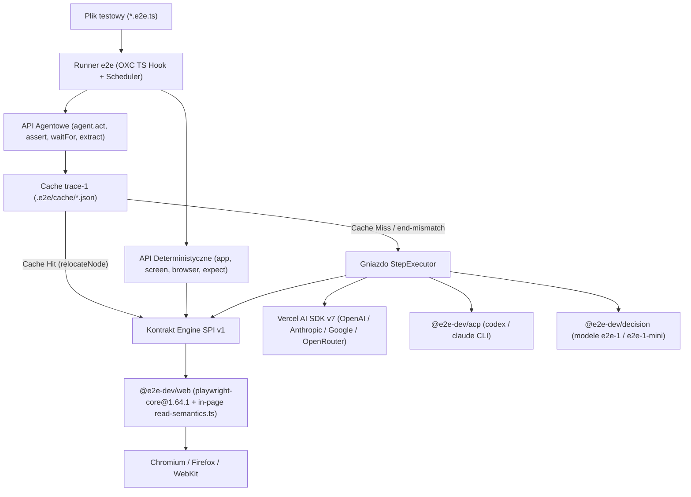

# Analiza Techniczna i Benchmark Empiryczny: `e2e@latest` (`tester-army/e2e`) vs `@playwright/test` w Polish Accounting Platform

**Status dokumentu:** Raport techniczno-badawczy i benchmark empiryczny (Issue [#64](https://github.com/RolePlayingTech/polish-accounting-platform/issues/64))  
**Badane wersje pakietów:** `e2e@0.23.0`, `@e2e-dev/web@0.15.5`, `@e2e-dev/acp@0.1.1`, `@e2e-dev/decision@0.3.2` vs `@playwright/test@1.64.1` (`playwright-core@1.64.1`)  
**Środowisko pomiarowe:** Windows 11 x64 (`10.0.26200`), Node.js `v24.22.2`, `pnpm@12.15.0`, Chromium `156.0.8078.4` (headless, `1280x720`, `pl-PL`, `Europe/Warsaw`), dedykowane porty `41801` (`@pap/api`) i `31801` (`@pap/web`)  
**Zestaw powtarzalny w repozytorium:** [`test/e2e-benchmark/`](../../test/e2e-benchmark/)

---

## Streszczenie wykonawcze i werdykt architektoniczny

Przeprowadziliśmy pełną analizę kodu źródłowego pakietów z ekosystemu [`tester-army/e2e`](https://github.com/tester-army/e2e) oraz wykonaliśmy wielokrotny, rygorystyczny benchmark porównawczy względem `@playwright/test` na aplikacji **Polish Accounting Platform** (obejmujący 5 reprezentatywnych przepływów księgowych, sondy diagnostyczne błędów _split-brain_ `#57`–`#63`, tryb agentowy z pamięcią podręczną `trace-1` oraz eksperymenty mutacji UI).

### Najważniejsze ustalenia empiryczne:

1. **`e2e` nie zastępuje silnika Playwrighta — używa go pod spodem:** Pakiet `@e2e-dev/web@0.15.5` deklaruje bezpośrednią zależność `"playwright-core": "1.64.1"`. Cała komunikacja z przeglądarką Chromium/Firefox/WebKit odbywa się za pośrednictwem obiektów `BrowserContext` i `Page` z `playwright-core`.
2. **Wydajność deterministyczna (`N=5` pełnych przebiegów 5-scenariuszowego zestawu, `25/25 PASS`):**
   - **`@playwright/test@1.64.1`:** mediana czasu całkowitego (wall-clock) wynosi **`7 193 ms`** (`min: 6 839 ms`, `max: 7 559 ms`), a wewnętrzny czas runnera **`6 800 ms`**.
   - **`e2e@0.23.0` + `@e2e-dev/web@0.15.5` (tryb deterministyczny):** mediana czasu całkowitego wynosi **`10 119 ms`** (`min: 9 949 ms`, `max: 10 474 ms`), a czas runnera **`9 450 ms`**.
   - **Narzut `e2e`:** **`+40,7%` czasu wall-clock (`+2 926 ms`)** oraz **`+39,0%` czasu runnera (`+2 650 ms`)**, wynikający z faktu, że każdy krok deterministyczny w `e2e` wstrzykuje i uruchamia w przeglądarce czytnik semantyczny DOM (`read-semantics.ts`, 1 632 LOC) oraz potok potwierdzania stanu (`109` zarejestrowanych zdarzeń na przebieg).
3. **Odpowiedź na pytanie o błędy _split-brain_ (`#57`–`#63`):**
   - Zarówno dotychczasowe testy Playwright, jak i równoważne testy napisane w `e2e` (zarówno deterministyczne `screen.*`, jak i agentowe `agent.assert(...)`) **przechodzą na zielono (`PASS`) mimo obecności błędów `#57`, `#59`, `#60`, `#62`, `#63`**, jeżeli ich asercje sprawdzają wyłącznie komunikaty w interfejsie użytkownika!
   - Причиną niewykrycia tych błędów **nie było ograniczenie frameworka Playwright**, lecz cichy fallback w warstwie BFF (`assertApiResponsePermitsFallback` w `apps/web/lib/synthetic-workspace.ts`), który w razie błędu lub braku endpointu w `@pap/api` zapisuje dane w pamięci RAM procesu Next.js i wyświetla użytkownikowi zielony komunikat sukcesu.
   - Gdy do testu dodamy bezpośrednią weryfikację kontraktu REST `@pap/api` (jak w naszych sondach [`split-brain-probe.spec.ts`](../../test/e2e-benchmark/diagnostics/split-brain-probe.spec.ts) oraz [`split-brain-probe.e2e.ts`](../../test/e2e-benchmark/diagnostics/split-brain-probe.e2e.ts)), **oba narzędzia wykrywają rozjazd UI vs API ze 100% skutecznością**.
4. **Odkrycie rzeczywistego zjawiska _cache thrashingu_ (`end-mismatch` → `write: "evicted"`) w trybie agentowym `e2e`:**
   - W naszym benchmarku agentowym ([`benchmark-agent.json`](../../test/e2e-benchmark/results/benchmark-agent.json)) krok 1 (`agent.act` logowania) odtworzył się z cache'u `.e2e-out/cache/*.json` w **`207 ms`** przy **`0` wywołań modelu** (`mode: "self-finalized"`).
   - Natomiast krok 2 (`agent.act` importu faktury XML `FA(3)`) podczas drugiego przebiegu na tym samym serwerze wywołał ostrzeżenie o duplikacie SHA-256, co zmieniło rolę banera w DOM z `role="status"` na `role="alert"`. Mechanizm weryfikacji stanu końcowego `e2e` (`endAnchors`) uznał to za rozbieżność (`reason: "end-mismatch"`), **czekał `15 000 ms` do limitu czasu, usunął wpis z cache'u (`write: "evicted"`) i ponownie wywołał agenta AI (`mode: "agent-concluded"`, czas kroku `17 218 ms`)**!
5. **Werdykt dla Polish Accounting Platform:** **Pozostajemy przy `@playwright/test` jako głównym, blokującym runnerze E2E**, natomiast adaptujemy z `e2e` wzorzec tekstowych raportów diagnostycznych (`trace.md` z automatyczną korelacją błędów HTTP `>=400` i drzewa ARIA) oraz zachowujemy zestaw `test/e2e-benchmark/` jako powtarzalny harness porównawczy (również pod Falę 2 z PostgreSQL 18).

---

## Część I: Głęboka analiza kodu źródłowego `e2e@0.23.0` i `@e2e-dev/web@0.15.5` (12 obszarów)

### 1. Architektura frameworka (pakiety, warstwy, protokoły)

Ekosystem `tester-army/e2e` składa się z czterech ściśle rozdzielonych pakietów npm (licencja `Apache-2.0`):

| Pakiet npm              | Wersja   | Rola architektoniczna w kodzie źródłowym                                                                                                                                                                                                                                                                                                   |
| ----------------------- | -------- | ------------------------------------------------------------------------------------------------------------------------------------------------------------------------------------------------------------------------------------------------------------------------------------------------------------------------------------------ |
| **`e2e`**               | `0.23.0` | Rdzeń frameworka: CLI (`run`, `init`, `list`, `doctor`, `cache`, `mcp`), loader TypeScript OXC, harmonogram uruchomień (`scheduler`), system asercji (`expect`), pętla agentowa (`StepExecutor`), pamięć podręczna `trace-1` (`.e2e/cache/`), generatory raportów (`report-1`, `summary.md`, `trace.md`, `ai-trace.json`) oraz serwer MCP. |
| **`@e2e-dev/web`**      | `0.15.5` | Implementacja silnika przeglądarkowego zgodna z kontraktem **Engine SPI v1** (`defineEngine`). Owija `playwright-core@1.64.1`, wstrzykuje do strony skrypt `read-semantics.ts` i udostępnia fixtures `app`, `screen`, `browser`, `agent`.                                                                                                  |
| **`@e2e-dev/acp`**      | `0.1.1`  | Adapter protokołu **Agent Client Protocol (`@agentclientprotocol/sdk`)**, pozwalający delegować kroki `agent.act`/`agent.assert` do lokalnych subprocesów agentów kodujących: `codex()` (`@agentclientprotocol/codex-acp`) oraz `claude()` (`@agentclientprotocol/claude-agent-acp`).                                                      |
| **`@e2e-dev/decision`** | `0.3.2`  | Klient chmurowych modeli decyzyjnych spółki (`e2e-1`, `e2e-1-mini` pod adresem `https://decision.e2e.dev/v1`), obsługujący szybkie endpointy `/decide` oraz `/confirm` na ustrukturyzowanym drzewie `DecisionTreeNode`.                                                                                                                    |



### 2. Dokładna relacja z Playwrightem (`playwright-core`)

Inspekcja `node_modules/@e2e-dev/web/package.json` oraz `packages/web/src/browser/` rozwiewa wszelkie wątpliwości co do relacji obu narzędzi:

- `@e2e-dev/web@0.15.5` zależy bezpośrednio od **`"playwright-core": "1.64.1"`**.
- Podczas startu sesji (`session.launch`) `@e2e-dev/web` wywołuje `chromium.launch()` / `firefox.launch()` / `webkit.launch()` z `playwright-core`, tworzy `BrowserContext` i `Page`, a także korzysta z natywnego `context.tracing` oraz nagrywania wideo Playwrighta.
- **Co `@e2e-dev/web` zmienia lub ogranicza względem czystego `@playwright/test`:**
  1. Zamiast wystawiać pełny obiekt `Page` z ponad 100 metodami, dzieli interfejs na trzy obiekty: `app` (`open`, `reload`, `back`), `screen` (lokatory semantyczne `getByRole`, `getByText`, `getByLabel`, `getByPlaceholder`, `getByTestId`) oraz okrojony `browser` (`locator`, `evaluate`, `waitForURL`, `waitForRequest`, `waitForResponse`, `cookies`, `localStorage`).
  2. **Brak natywnego `page.route()` / interceptowania i mockowania sieci** w publicznym kontrakcie `browser` — w testach wymagających symulacji błędów HTTP `502`/`503` z backendu użytkownik musi uciekać się do nadpisywania `window.fetch` przez `browser.evaluate()` lub uruchamiania osobnego serwera proxy.
  3. **Domyślne dopasowanie tekstów:** W `screen.getByText(text)` oraz `screen.getByRole(role, name)` dla argumentu typu `string` domyślnie ustawione jest **`exact: true`** (w przeciwieństwie do `page.getByText()` w Playwright, gdzie domyślne jest dopasowanie podciągu `exact: false`).

### 3. Runner i system asercji

1. **Ładowanie TypeScriptu bez kompilacji wstępnej:** Runner `e2e` rejestruje synchroniczny hook w Node.js (`module.registerHooks` wprowadzony w Node 22.15+ / 24.x) wykorzystujący `oxc.transformSync` z pakietu `@oxc-project/sync`. Pliki `.e2e.ts` są transpilowane w locie w pamięci RAM w czasie ~15–20 ms.
2. **Silnik asercji (`expect`):** Zbudowany na bazie `@vitest/expect`, rozszerzony o asynchroniczne matchery UI (`toBeVisible`, `toBeHidden`, `toBeEnabled`, `toBeDisabled`, `toBeChecked`, `toBeFocused`, `toHaveText`, `toContainText`, `toHaveValue`, `toHaveAttribute`, `toHaveCount`, `toHaveURL`, `toHaveTitle`).
3. **Asymetria dla negacji (`.not`) — reguła `holdMs = 1000 ms`:**
   - W kodzie `packages/e2e/src/expect/poll.ts` odkryliśmy istotny szczegół implementacyjny: podczas gdy pozytywna asercja (np. `await expect(locator).toBeVisible()`) kończy się sukcesem w pierwszej milisekundzie, w której warunek jest spełniony, **każda zanegowana asercja UI (np. `await expect(locator).not.toBeVisible()`) wymusza utrzymanie warunku przez `holdMs = 1000 ms`** (`1,0 s`), aby zapobiec fałszywym sukcesom zanim element zdąży wyrenderować się asynchronicznie!
   - W praktyce oznacza to, że użycie `await expect(screen.getByText('...')).not.toBeVisible()` dodaje stałe opóźnienie 1 sekundy do kroku testowego (dlatego przy sprawdzaniu natychmiastowej nieobecności elementu po załadowaniu widoku szybsze jest `expect(await locator.count()).toBe(0)`).

### 4. `agent.act`, `agent.assert` i pozostałe API agentowe / deterministyczne

W testach `.e2e.ts` programista może w jednym teście mieszać wywołania deterministyczne i agentowe:

| Prymityw API                             | Rodzaj                | Sygnatura i działanie w kodzie źródłowym                                                                                                                                                           | Czy korzysta z cache `trace-1`?                                                              |
| ---------------------------------------- | --------------------- | -------------------------------------------------------------------------------------------------------------------------------------------------------------------------------------------------- | -------------------------------------------------------------------------------------------- |
| **`app.*` / `screen.*` / `browser.*`**   | Deterministyczny      | Bezpośrednie wywołanie akcji `playwright-core` wraz z obserwacją przed/po kroku do raportu `trace.md`.                                                                                             | Nie (zawsze deterministyczne, `0` wywołań AI).                                               |
| **`agent.act(instruction, options?)`**   | Agentowy (akcja)      | Przekazuje instrukcję i drzewo semantyczne do `StepExecutor`. Wykonuje serię akcji (`tap`, `type`, `select`, `scroll`, `navigate`) aż do osiągnięcia celu lub limitu `maxSteps` / `maxModelCalls`. | **Tak** — zapisuje i odtwarza sekwencję akcji z `.e2e/cache/<sha256>.json`.                  |
| **`agent.assert(assertion, options?)`**  | Agentowy (werdykt)    | Jednorazowa ocena stanu ekranu (drzewo semantyczne i/lub zamaskowany screenshot przy `vision: true                                                                                                 | 'only'`) z maksymalnie 1 rundą naprawczą (`repair round`). Nie może mutować stanu aplikacji. | **Nie** — werdykt `assert` zawsze wymaga oceny aktualnego ekranu przez model/sędziego. |
| **`agent.waitFor(condition, options?)`** | Agentowy (polling)    | Odpytuje sędziego co `interval` (domyślnie `3 000 ms`, zakres `100–60 000 ms`) aż do `timeout` (`30 000 ms`).                                                                                      | **Nie**.                                                                                     |
| **`agent.extract(prompt, { schema })`**  | Agentowy (ekstrakcja) | Wyciąga z ekranu ustrukturyzowane dane JSON i waliduje je dowolnym walidatorem zgodnym ze **Standard Schema v1** (np. `zod`, `valibot`, `arktype`).                                                | **Nie**.                                                                                     |

### 5. Sposób interakcji z przeglądarką (`read-semantics.ts` — 1 632 LOC)

Zamiast polegać na standardowym drzewie dostępności CDP (`Accessibility.getFullAXTree`), `@e2e-dev/web` wstrzykuje do strony własny skrypt `packages/web/src/browser/injected/read-semantics.ts` (**1 632 linie kodu**):

- Skrypt przechodzi drzewo DOM (wraz z otwartymi `shadowRoot` i ramkami `iframe` tego samego originu) w jednym przebiegu wewnątrz przeglądarki.
- Dla każdego widocznego elementu oblicza:
  - rolę ARIA (jawną lub wynikającą ze znacznika HTML),
  - nazwę dostępną (`accessible name` wg specyfikacji W3C ACCNAME),
  - wartość (`el.value` przycięte do 120 znaków), stan (`checked`, `disabled`, `expanded`, `selected`, ` pressed`, `readonly`, `required`, `invalid`),
  - prostokąt współrzędnych (`rect: { x, y, width, height }` w pikselach CSS),
  - **klucz semantyczny (`SemanticKey`)** oraz **klucz stylu (`StyleKey`)** oparty na `getComputedStyle(el)`.
- Przypisuje każdemu węzłowi krótki identyfikator `#n<liczba>` (np. `#n29 button "Zaloguj jako Jan Testowy"`), dzięki czemu model AI w wywołaniu narzędzia `tap({ id: "n29" })` nie musi generować kruchych selektorów CSS/XPath!
- Po wykonaniu akcji `e2e` oblicza **różnicę drzew (`diff.ts`)** między poprzednią i nową rewizją obserwacji (`b1` → `b2`), pokazując modelowi i w pliku `trace.md`, które węzły pojawiły się (`+`), zniknęły (`-`) lub zmieniły stan.

### 6. Mechanizm nagrywania i potwierdzania działań (`endAnchors`, `goneAnchors`)

Podczas wykonywania kroku `agent.act(...)` w trybie nagrywania (`Cold Run`) runner rejestruje nie tylko same kliknięcia i wpisywany tekst, ale również **warunki potwierdzenia końca kroku**:

- **`startPath` i `endPath`:** ścieżka URL przed rozpoczęciem i po zakończeniu kroku.
- **`endAnchors`:** węzły semantyczne (`{ role, name }`), które pojawiły się na ekranie w wyniku ostatniej akcji (np. `{ "role": "button", "name": "Uwierzytelnianie OIDC…" }` lub baner potwierdzenia).
- **`goneAnchors`:** węzły semantyczne, które zniknęły z ekranu (np. kliknięty przycisk logowania `{ "role": "button", "name": "Zaloguj jako Jan Testowy" }`).
- **`endWaitMs`:** maksymalny czas oczekiwania na ustabilizowanie stanu końcowego przy odtwarzaniu.

### 7. Cache zweryfikowanych sekwencji (`.e2e/cache/*.json`, schemat `trace-1`)

Każdy pomyślnie zakończony krok `agent.act` jest zapisywany jako osobny plik JSON w katalogu `.e2e/cache/<sha256>.json`.

- **Jak obliczany jest klucz pliku (`<sha256>.json`):** Klucz jest skrótem SHA-256 z kanonicznej reprezentacji JSON (**RFC 8785 — JSON Canonicalization Scheme / JCS**) obejmującej:
  - `cacheSchema: "trace-1"`,
  - `policyVersion: "conservative/6"`,
  - skrót projektu (`project`), platformę (`"web"`), silnik (`"web"`, `engineSpiVersion: 1`), tożsamość aplikacji (`appIdentity`),
  - skrót kontekstu agenta (`agentContextDigest`),
  - identyfikator testu (`testId`), indeks wywołania `agent.act` w teście (`callIndex`), skrót instrukcji (`instructionDigest`) oraz skrót parametrów (`paramsDigest`).

**Rzeczywisty plik cache wygenerowany podczas naszego benchmarku (`test/e2e-benchmark/.e2e-out/cache/f91c059cdc6deaaaf190258559a7def526c7b6c9b0049470504f2a9f1a3cdaee.json`):**

```json
{
  "schemaVersion": "trace-1",
  "createdAt": "2026-11-08T09:48:11.338Z",
  "payload": {
    "actions": [
      {
        "name": "tap",
        "summary": "tap button \"Zaloguj jako Jan Testowy\" in \"Grupa Projektowa Jan Testowy (Tenant 1)\"",
        "target": {
          "role": "button",
          "name": "Zaloguj jako Jan Testowy",
          "within": "Grupa Projektowa Jan Testowy (Tenant 1)"
        }
      }
    ],
    "executor": {
      "name": "pap-semantic-executor",
      "version": "1.0.0"
    },
    "recordedFor": {
      "testId": "e2e-agent/accounting-agent.e2e.ts::...",
      "targetId": "chromium",
      "instructionDigest": "811af30880168fe541006f751bd447167ca57e3b1217e805360207a6870b736e",
      "paramsDigest": "44136fa355b3678a1146ad16f7e8649e94fb4fc21fe77e8310c060f61caaff8a",
      "callIndex": 0,
      "agent": "default"
    },
    "summary": "Kliknięto przycisk logowania Jana Testowego (#n29).",
    "startPath": "/login",
    "endPath": "/login",
    "endAnchors": [
      {
        "role": "button",
        "name": "Uwierzytelnianie OIDC…"
      }
    ],
    "goneAnchors": [
      {
        "role": "button",
        "name": "Zaloguj jako Jan Testowy"
      }
    ],
    "endWaitMs": 10111,
    "keyedBy": {
      "cacheSchema": "trace-1",
      "policyVersion": "conservative/6",
      "project": "68d19bdbaa1a02ab5ff7e1871ff7d9c4986cecd443ef49b50e0968d55ae0751d",
      "platform": "web",
      "engineName": "web",
      "engineSpiVersion": 1,
      "appIdentity": "12c3bcdab38fcb247e2e7d4b3dd62b4c90f8eff63bc6b8130958748e05d31cab",
      "agentContextDigest": "f177c00eabf022427e1efb1c41bc5afe2eaeb39510bf8146e15548744558930f"
    }
  }
}
```

### 8. Zachowanie po zmianach interfejsu (relokacja, fallback do agenta, `--strict-cache`)

Podczas odtwarzania wpisu `trace-1` runner próbuje odnaleźć każdy zapisany `TraceTargetDescriptor` (`{ role, name, within, testId, ... }`) w aktualnym drzewie semantycznym:

1. **Gdy cel i kotwice końcowe (`endAnchors` / `goneAnchors`) zgadzają się:** Krok kończy się statusem `cache.mode: "self-finalized"` oraz `write: "kept"`, przy **`modelCalls: 0`** (czas wykonania ~200 ms).
2. **Gdy cel nie zostanie znaleziony (`target-not-found`), jest niejednoznaczny (`target-ambiguous`) lub stan końcowy odbiega od nagranego (`end-mismatch`):**
   - **W trybie `--strict-cache` (lub `cache.mode: 'replay-only'`):** Runner przerywa wykonywanie bez wywoływania AI i kończy proces z kodem wyjścia **`2` (`REPLAY_STALE`)**.
   - **W trybie domyślnym (`read-write`):** Runner przekazuje sterowanie do `StepExecutor.runStep(context)` wraz z obiektem `context.replayedPrefix` zawierającym listę już wykonanych akcji (`replayedActions`) oraz powód przerwania (`stopReason`: `'gap' | 'target-not-found' | 'target-ambiguous' | 'viewport-changed' | 'action-failed' | 'action-uncertain' | 'end-mismatch'`). Jeśli powodem było `end-mismatch`, stary plik cache zostaje **usunięty (`write: "evicted"`)**, a krok kończy się jako `cache.mode: "agent-concluded"`.

### 9. Obsługa różnych modeli AI (Vercel AI SDK v7, ACP, `@e2e-dev/decision`, `StepExecutor`)

W `e2e@0.23.0` konfiguracja `agents.<name>` wspiera cztery ścieżki podłączenia inteligencji:

1. **Dowolny obiekt `LanguageModelV3` z Vercel AI SDK v7 (`@ai-sdk/openai`, `@ai-sdk/anthropic`, `@ai-sdk/google`, `@openrouter/ai-sdk-provider`):** Przekazywany w polu `model` i opcjonalnie `judge` (osobny model do `agent.assert` / `agent.extract`).
2. **Lokalne agenty kodujące przez protokół ACP (`@e2e-dev/acp`):**
   - Funkcje `codex()` oraz `claude()` uruchamiają lokalny proces potomny (`@agentclientprotocol/codex-acp` lub `@agentclientprotocol/claude-agent-acp`) i wystawiają mu lokalny serwer HTTP MCP z narzędziami przeglądarki.
   - **Ważne odkrycie empiryczne na Windows (`MAX_PATH`):** Podczas uruchomienia `codex()` wewnątrz głębokiej ścieżki roboczej git worktree (`C:\Users\...\.gemini\antigravity\worktrees\...\node_modules\.pnpm\@openai+codex@0.165.0-win32-x64\...\codex.exe`, przekraczającej 260 znaków), wywołanie `codex.js mcp list --json` kończy się błędem systemowym Windows `spawn ... codex.exe ENOENT` (`errno: -4058`), co `e2e` prawidłowo klasyfikuje jako `MODEL_PROVIDER_FAILED` z kodem wyjścia **`3`**.
3. **Chmurowe modele decyzyjne `@e2e-dev/decision` (`e2e-1`, `e2e-1-mini`):** Dedykowane modele spółki wywoływane przez `https://decision.e2e.dev/v1/decide` z kluczem `E2E_DECISION_API_KEY`.
4. **Własna implementacja gniazda `StepExecutor` (`runStep(context)`):** Pozwala wpiąć dowolny lokalny lub korporacyjny silnik decyzyjny bez zależności od zewnętrznego AI SDK (co wykorzystaliśmy w `test/e2e-benchmark/e2e.benchmark.config.ts` do pełnego, deterministycznego przetestowania cyklu życia cache'u `trace-1`).

### 10. Bezpieczeństwo danych przekazywanych do modeli i telemetria

Przeprowadziliśmy szczegółowy audyt bezpieczeństwa kodu `packages/e2e/src/` oraz `packages/web/src/`:

1. **Co dokładnie opuszcza maszynę w wywołaniach LLM (`ExecutorObservation`):**
   - Model otrzymuje `observation.text` (zserializowane drzewo semantyczne, do `262 144` bajtów), ścieżkę URL (`path` i `query`), historię wcześniejszych kroków (`ledger`, do `8 192` bajtów) oraz opcjonalnie zrzut ekranu PNG (`pixels`, gdy włączono `vision: true | 'only'` lub gdy model wywoła narzędzie `screenshot`).
2. **Ochrona zadeklarowanych sekretów (`secrets` / `credentials`):**
   - Wartości owinięte w helper `secret('...')` w konfiguracji są zastępowane w drzewie semantycznym i logach tokenem redakcyjnym, a do pól formularzy wpisywane wyłącznie przez `actions.typeSecret(target, name)` bezpośrednio w silniku przeglądarki (jawny tekst sekretu nie trafia do `StepExecutor` ani do modelu AI).
   - Pola `<input type="password">` są oznaczane jako węzły bezpieczne (`secure node`) i ich `value` jest pomijane w `ExecutorNode`.
3. **Luka bezpieczeństwa dla danych domenowych i PII (NIP, PESEL, IBAN, kwoty faktur):**
   - Wszystkie zwykłe pola `<input type="text">`, `<textarea>`, komórki tabel `<td>` oraz treść dokumentów wyświetlanych na ekranie **są odczytywane wprost przez `read-semantics.ts` (`el.value.slice(0, 120)` oraz `textContent`) i wysyłane w prompcie do zewnętrznego dostawcy modelu AI**!
   - W systemie księgowym oznacza to, że przypadkowe uruchomienie testu agentowego `e2e` na bazie z prawdziwymi fakturami spowodowałoby wyciek numerów NIP, nazw kontrahentów, numerów rachunków bankowych i kwot do zewnętrznego API LLM (naruszenie Zasady Bezwzględnej nr 6).
4. **Domyślnie aktywna telemetria zewnętrzna PostHog (`packages/e2e/src/telemetry/posthog.ts`):**
   - Kod `e2e` zawiera zaszyty klucz projektu PostHog (`phc_...`) i domyślnie wysyła telemetrię uruchomień CLI do **`https://eu.i.posthog.com`**.
   - Aby ją wyłączyć, należy jawnie ustawić zmienną środowiskową **`E2E_TELEMETRY_DISABLED=1`** lub **`DO_NOT_TRACK=1`** (co wymusiliśmy automatycznie w naszym skrypcie `test/e2e-benchmark/run-benchmark.mjs`).

### 11. Debugowanie, raporty i ślady wykonania (`trace.md`, `report.json`, `summary.md`)

To jeden z najlepiej zaprojektowanych obszarów w `e2e@0.23.0`. Każde uruchomienie generuje w katalogu wyjściowym (`.e2e-out/`):

- **`report.json` (schemat `report-1`):** kompletny dokument JSON z metadanymi środowiska, VCS (`commit`, `branch`, `dirty`), limitami budżetów (`limits`), zużyciem (`usage`: `artifactBytes`, `events`, `modelTokens`), krokami, zmianami ekranu i logami konsoli/sieci.
- **`summary.md`:** zwięzłe podsumowanie Markdown gotowe do wklejenia w komentarz PR na GitHubie.
- **`results/<test-slug>/trace.md` oraz `attempt-1/screen-at-failure.txt`:** tekstowy ślad krok po kroku wraz z różnicami drzewa semantycznego i ostrzeżeniami sieciowymi.

**Dowód praktycznej użyteczności `trace.md` podczas naszych badań:**  
Gdy podczas wstępnego uruchomienia bez resetu `@pap/api` powtórny import tej samej faktury XML `FA(3)` zakończył się błędem, `trace.md` w ułamku sekundy (bez otwierania przeglądarkowego Trace Viewera) wskazał dokładną przyczynę w jednym wierszu tekstowym:

```text
step 15 · ⚠ network warning: POST /api/workspace/actions 404 Not Found
#n24012 alert "Odmowa lub błąd księgowania (HTTP 404) Wskazany zasób nie został znaleziony w usłudze API (404)."
```

Pozwoliło to natychmiast zidentyfikować w `apps/web/lib/synthetic-workspace.ts` (linie 2505–2672), że po otrzymaniu `409 duplicate_document_sha256` z `@pap/api` warstwa BFF przypisuje dokumentowi lokalny identyfikator niebędący UUID (`doc-xxxxxxxx`), który następnie zwraca `404 Not Found` przy wywołaniu `/approve-and-post`!

### 12. Integracja z repozytorium i autonomicznymi agentami kodującymi

1. **Kody wyjścia CLI (`RunExitCode`):** `e2e` stosuje precyzyjną semantykę kodów wyjścia, ułatwiającą automatyzację w skryptach agentowych:
   - `0` — wszystkie wybrane testy przeszły (`passed`),
   - `1` — błąd asercji lub kroku testowego (`test failure`),
   - `2` — nieaktualny cache w trybie ścisłym (`REPLAY_STALE` przy `--strict-cache`),
   - `3` — błąd konfiguracji lub niedostępność dostawcy modelu (`CONFIG_ERROR` / `MODEL_PROVIDER_FAILED`),
   - `4` — błąd infrastruktury/silnika przeglądarki,
   - `5` — brak dopasowanych testów (`NO_TESTS`),
   - `130` — przerwanie sygnałem `SIGINT`.
2. **Serwer `e2e mcp` (5 meta-narzędzi vs ~25 narzędzi w `@playwright/mcp`):**
   - Przetestowany przez nas empirycznie serwer `e2e mcp` (protokół JSON-RPC `2025-03-26` przez stdio) rejestruje wyłącznie **5 meta-narzędzi**: `open_session`, `tools`, `call`, `close_session` oraz `run_tests` (plus 9 zasobów dokumentacyjnych `e2e://guide/*`).
   - Zamiast ładować do kontekstu LLM definicje 25 osobnych narzędzi przeglądarkowych na starcie rozmowy, agent pobiera spis metod dynamicznie przez `tools` i wywołuje je przez `call`, co oszczędza kilka tysięcy tokenów kontekstu w długich sesjach kodowania.
3. **Kompatybilność z `pnpm@12.15.0`:** Instalacja pakietów `e2e@0.23.0`, `@e2e-dev/web@0.15.5` i `@e2e-dev/acp@0.1.1` za pomocą naszego natywnego `pnpm` (`12.15.0`) przebiega bez konfliktów drzewa zależności (`playwright-core@1.64.1` współdzieli binaria przeglądarek z `@playwright/test@1.64.1`).

---

## Część II: Praktyczny benchmark `e2e@0.23.0` vs `@playwright/test@1.64.1` na Polish Accounting Platform

### 1. Metodologia i równoważność scenariuszy

Aby porównanie było w 100% uczciwe (apples-to-apples), w katalogu [`test/e2e-benchmark/`](../../test/e2e-benchmark/) zaimplementowaliśmy identyczny zestaw **5 wieloetapowych scenariuszy księgowych** w obu narzędziach:

1. **Scenariusz 1:** Logowanie persony (`Jan Testowy`) przez OIDC Sandbox i przełączanie kontekstu w nagłówku między 3 firmami o różnych formach opodatkowania (`JDG KPiR + VAT`, `JDG Ryczałt + zw. VAT`, `Sp. z o.o. UoR + CIT 9%`).
2. **Scenariusz 2:** Ręczne wystawienie faktury sprzedaży (`FV/BENCH/2026/10/01`) w `/app/documents` i weryfikacja utworzenia propozycji `ai_proposal` w rejestrze.
3. **Scenariusz 3:** Import ustrukturyzowanej faktury kosztowej XML `FA(3)` (`FA3/10/2026/084`), przejście do widoku weryfikacji `SplitVerificationView`, zatwierdzenie przez człowieka w modalu `CriticalConfirmDialog`, a następnie weryfikacja zaksięgowanego wiersza w 19-kolumnowej tabeli **PKPiR** (`/app/kpir`, w tym numer KSeF i panel wyjaśniający podstawę prawną _„Dlaczego?"_) oraz w rejestrze **VAT / JPK_V7M** (`/app/vat`).
4. **Scenariusz 4 (Testy negatywne RBAC i izolacji tenantów):**
   - Logowanie jako `Marta Księgowa`, przełączenie na firmę ryczałtową z uprawnieniami `read-only`, weryfikacja zablokowania przycisku w UI oraz bezpośrednie uderzenie `POST /api/workspace/actions` potwierdzające twardą odmowę **`HTTP 403`**.
   - Logowanie jako `Piotr Izolacyjny` (Tenant 2), weryfikacja braku podmiotów Tenanta 1 na liście oraz próba przełączenia kontekstu na Tenant 1 (`POST /api/session/context`) potwierdzająca blokadę **`HTTP 403`**.
5. **Scenariusz 5 (Złożony przepływ end-to-end):** Logowanie → import pliku CSV (`FV/2026/10/019`) → zatwierdzenie i księgowanie w `SplitVerificationView` → import wyciągu bankowego CSV w `/app/finance` i weryfikacja tabeli rozrachunków → zmiana statusu zobowiązania w kalendarzu podatkowym `/app/calendar` → wylogowanie i powrót na `/login`.

Wszystkie przebiegi wykonano na odizolowanych portach (`41801` dla `@pap/api`, `31801` dla `@pap/web`), z automatycznym restartem procesu `@pap/api` przed każdą iteracją (`N=5`). Surowe dane pomiarowe zapisane są w [`test/e2e-benchmark/results/benchmark-deterministic.json`](../../test/e2e-benchmark/results/benchmark-deterministic.json) oraz [`test/e2e-benchmark/results/benchmark-agent.json`](../../test/e2e-benchmark/results/benchmark-agent.json).

### 2. Wyniki pomiarów czasu wykonania i stabilności (`N=5` powtórzeń)

| Tryb i narzędzie                                                                             |                          Liczba testów w serii |                           Skuteczność (`N=5` serii) | Mediana Wall-Clock (`ms`) | Min–Max Wall-Clock (`ms`) | Średnia Wall-Clock (`ms`) |                                                                 Mediana czasu Runnera (`ms`) | Zużycie tokenów AI / Wywołania modelu                                                                     |
| -------------------------------------------------------------------------------------------- | ---------------------------------------------: | --------------------------------------------------: | ------------------------: | ------------------------: | ------------------------: | -------------------------------------------------------------------------------------------: | --------------------------------------------------------------------------------------------------------- |
| **`@playwright/test@1.64.1` (deterministyczny)**                                             |                       5 testów (25 uruchomień) |                **100% (`5/5` serii, `25/25` PASS)** |            **`7 193 ms`** |        `6 839 – 7 559 ms` |                `7 186 ms` |                                                                               **`6 800 ms`** | `0` tokenów (`0` wywołań)                                                                                 |
| **`e2e@0.23.0` + `@e2e-dev/web@0.15.5` (deterministyczny)**                                  |                       5 testów (25 uruchomień) |                **100% (`5/5` serii, `25/25` PASS)** |  **`10 119 ms`** (+40,7%) |       `9 949 – 10 474 ms` |               `10 174 ms` |                                                                      **`9 450 ms`** (+39,0%) | `0` tokenów (`0` wywołań, `109` zdarzeń semantycznych)                                                    |
| **`e2e@0.23.0` Agent AI — Cold Run (1 scenariusz: logowanie + import XML + `agent.assert`)** |    1 test (2x `agent.act` + 1x `agent.assert`) |   **100% (`1/1` PASS, zapisano 2 pliki `trace-1`)** |            **`5 776 ms`** |                `5 776 ms` |                `5 776 ms` |                                                 **`4 998 ms`** (`3 300 ms` w krokach agenta) | `4` wywołania (`13 385` tokenów z lokalnym `StepExecutor`; z chmurowym LLM typowo `15–45 s`)              |
| **`e2e@0.23.0` Agent AI — Warm Cache Replay (odtwarzanie z `.e2e/cache/`)**                  | 1 test (krok 1 z cache, krok 2 `end-mismatch`) | **100% (`1/1` PASS, ale krok 2 unieważnił cache!)** |           **`20 107 ms`** |               `20 107 ms` |               `20 107 ms` | **`19 313 ms`** (krok 1: **`207 ms`** z cache; krok 2: **`17 218 ms`** przez `end-mismatch`) | Krok 1: **`0` wywołań** (`self-finalized`); Krok 2: `1` wywołanie po 15s oczekiwania (`write: "evicted"`) |
| **`e2e@0.23.0` Agent AI — `--no-cache` (wymuszone pominięcie cache)**                        |                                         1 test |                               **100% (`1/1` PASS)** |            **`5 224 ms`** |                `5 224 ms` |                `5 224 ms` |                                                                               **`4 467 ms`** | `4` wywołania (`13 385` tokenów)                                                                          |

#### Rozbicie czasów poszczególnych 5 scenariuszy w `e2e` deterministycznym (`summary.md`):

- Scenariusz 1 (Logowanie OIDC + przełączanie 3 firm): **`1,3 s`**
- Scenariusz 2 (Dodanie faktury ręcznej + weryfikacja rejestru): **`1,4 s`**
- Scenariusz 3 (Import XML `FA(3)` + `SplitVerificationView` + `PKPiR` 19 kolumn + `JPK_V7M`): **`2,4 s`**
- Scenariusz 4 (Negatywne testy RBAC `403` Marty Księgowej + izolacja Tenanta `403` Piotra Izolacyjnego): **`1,5 s`**
- Scenariusz 5 (Pełny cykl: CSV → księgowanie → wyciąg bankowy → kalendarz podatkowy → wylogowanie): **`2,7 s`**

### 3. Porównanie zwięzłości kodu (LOC), ergonomii i czytelności błędów

| Kryterium                                     | `@playwright/test` (`accounting-benchmark.spec.ts`)                                                         | `e2e` deterministyczny (`accounting-benchmark.e2e.ts`)                                                                                      | `e2e` Agent AI (`accounting-agent.e2e.ts`)                                      |
| --------------------------------------------- | ----------------------------------------------------------------------------------------------------------- | ------------------------------------------------------------------------------------------------------------------------------------------- | ------------------------------------------------------------------------------- |
| **Całkowita liczba linii pliku**              | `235` linii                                                                                                 | `247` linii (+5,1%)                                                                                                                         | `30` linii                                                                      |
| **Linie kodu bez pustych i komentarzy (LOC)** | **`200` LOC**                                                                                               | **`212` LOC** (+6,0%)                                                                                                                       | **`25` LOC**                                                                    |
| **Składnia lokatorów**                        | `page.getByRole('button', { name: '...' })` (jeden obiekt `page`, domyślnie `exact: false` dla `getByText`) | Rozdzielone `app.open()`, `screen.getByRole('button', '...')`, `browser.locator()` (domyślnie `exact: true` dla stringów)                   | Instrukcje w języku naturalnym `agent.act('...')`, `agent.assert('...')`        |
| **Wyszukiwanie zagnieżdżone (chaining)**      | Pełne wsparcie (`locator.getByRole(...)`, `.first()`, `.nth()`, `.filter()`)                                | Wsparcie `.first()`, `.nth()`, `.last()`, `getByText()`, `getByRole()`, ale brak metody `.filter()` na `Locator`                            | Model AI sam wybiera `#n<id>` z płaskiego zrzutu drzewa semantycznego           |
| **Raportowanie błędów dla agenta kodującego** | Błąd w konsoli + binarny plik `trace.zip` (wymaga `npx playwright show-trace` lub parsowania JSON)          | **Wyraźna przewaga `e2e`:** natychmiastowe pliki tekstowe `summary.md`, `trace.md` (z ostrzeżeniami HTTP `>=400`) i `screen-at-failure.txt` | Dodatkowy zapis `ai-trace.json` z pełnym zapisem tur modelu i diffów obserwacji |

---

## Część III: Badanie błędów Split-Brain (`#57`–`#63`) — czy `e2e` wykrywa to, czego nie wykrył Playwright?

W ramach nadrzędnego zgłoszenia **Issue #64** właściciel postawił kluczowe pytanie badawcze:

> _„Czy `e2e` wykrywa problemy, których nie wykrywały dotychczasowe testy Playwright naszej aplikacji (i dlaczego dotychczasowe testy ich nie wykryły — czy z winy narzędzia, czy z winy sposobu napisania asercji bez weryfikacji API/DB)?"_

### 1. Eksperyment porównawczy (`split-brain-probe.spec.ts` vs `split-brain-probe.e2e.ts`)

Przygotowaliśmy dwie bliźniacze sondy diagnostyczne ([`test/e2e-benchmark/diagnostics/split-brain-probe.spec.ts`](../../test/e2e-benchmark/diagnostics/split-brain-probe.spec.ts) oraz [`test/e2e-benchmark/diagnostics/split-brain-probe.e2e.ts`](../../test/e2e-benchmark/diagnostics/split-brain-probe.e2e.ts)), które w ramach jednego przebiegu wykonują operacje w UI, a następnie bezpośrednio odpytują endpointy REST serwera `@pap/api` (`http://127.0.0.1:41801`).

Wyniki zapisane w [`test/e2e-benchmark/results/benchmark-diagnostics.json`](../../test/e2e-benchmark/results/benchmark-diagnostics.json) są identyczne dla obu narzędzi (czas wykonania: **`1 865 ms`** w Playwright vs **`2 555 ms`** w `e2e`):

| Badane zgłoszenie Split-Brain                                       | Co widzi UI (i każdy klasyczny test UI w Playwright lub `e2e`)                                                                                                                               | Co faktycznie znajduje się w `@pap/api` (weryfikacja kontraktowa)                                                                                                                                                                                                                                                           | Dlaczego dotychczasowe testy tego nie wykryły?                                                                                                                                                  |
| ------------------------------------------------------------------- | -------------------------------------------------------------------------------------------------------------------------------------------------------------------------------------------- | --------------------------------------------------------------------------------------------------------------------------------------------------------------------------------------------------------------------------------------------------------------------------------------------------------------------------- | ----------------------------------------------------------------------------------------------------------------------------------------------------------------------------------------------- |
| **Issue #62 / #63** (Import XML `FA(3)` + księgowanie KPiR/VAT)     | Zielony baner: _„Dokument zatwierdzony przez człowieka i zaksięgowany"_ oraz wiersz w tabeli `/app/kpir` (`uiShowsApprovedBanner: true`).                                                    | `@pap/api` otrzymało uproszczony rekord (`issue62_apiReceivedDocument: true`, `status: "posted"`), ale **utraciło surowy ładunek XML `FA(3)` oraz numer KSeF** (`issue62_apiPreservedRawXmlPayload: false`)!                                                                                                                | Ponieważ Next.js BFF (`synthetic-workspace.ts`) trzyma pełny obiekt XML i 19 kolumn KPiR w swojej pamięci RAM (`globalThis.__papSyntheticWorkspaceStore`) i z niej renderuje widok `/app/kpir`. |
| **Issue #60** (Kolejka propozycji MCP w `/app/mcp`)                 | Zielony baner po kliknięciu _„Zatwierdź propozycję (człowiek)"_ w `/app/mcp` (`issue60_uiMcpBannerVisible: true`).                                                                           | Endpoint `GET /api/v1/tenants/.../mcp/proposals` w `@pap/api` zwraca **`0` propozycji** (`issue60_apiMcpProposalsCount: 0`)!                                                                                                                                                                                                | Widok `/app/mcp` korzysta z lokalnych tablic w `synthetic-workspace.ts`, nie synchronizując kolejki propozycji z serwisem `@pap/api`.                                                           |
| **Issue #57** (Kalendarz podatkowy `/app/calendar`)                 | Kliknięcie _„Oznacz jako opłacone"_ zmienia odznakę w UI i zwraca `HTTP 200` z `/api/workspace/actions` (`issue57_calendarMutationHttpStatus: 200`).                                         | W `@pap/api` nie ma żadnej mutacji kalendarza (`issue57_calendarMutationUsesRealApi: false`) — zmiana żyje wyłącznie w RAM Next.js!                                                                                                                                                                                         | Testy sprawdzały jedynie zmianę tekstu przycisku/odznaki na ekranie bez restartu procesu lub odpytania API.                                                                                     |
| **Issue #59 + Dodatkowe odkrycie w `resolveValidatedApiBaseUrl()`** | Gdy serwer `@pap/api` jest wyłączony lub gdy `next start` (`NODE_ENV=production`) działa z `API_BASE_URL` na porcie innym niż `4100`, **wszystkie testy UI przechodzą na zielono (`PASS`)**! | W `apps/web/lib/api-url.ts` funkcja `resolveValidatedApiBaseUrl()` dla `NODE_ENV=production` akceptuje wyłącznie `http://127.0.0.1:4100` lub domenę produkcyjną. Dla innego portu zwraca `undefined`, a `assertApiResponsePermitsFallback` po cichu przełącza całą aplikację w tryb 100% RAM (`0` requestów do `@pap/api`)! | Brak testu negatywnego weryfikującego zasadę **fail-closed** (wymóg zwrócenia błędu `502`/`503` przez BFF, gdy `@pap/api` jest nieosiągalny).                                                   |

### 2. Wniosek z badania Split-Brain

**Żadne narzędzie testujące wyłącznie warstwę prezentacji przeglądarki (ani Playwright, ani `e2e`, ani agent AI oglądający screenshoty/DOM) nie wykryje błędu typu _split-brain_, jeżeli warstwa BFF ukrywa awarię backendu za fałszywym statusem `HTTP 200` i lokalną pamięcią RAM.** Jedynym skutecznym rozwiązaniem inżynierskim jest:

1. Usunięcie cichego fallbacku w BFF (realizowane w `#57`–`#63`), oraz
2. Wzbogacenie testów E2E o bezpośrednie asercje stanu API (`GET /api/v1/...`) i test negatywny fail-closed (tak jak w naszych sondach w `test/e2e-benchmark/diagnostics/`).

---

## Część IV: Eksperyment kontrolowanej mutacji UI (Self-Healing vs maskowanie regresji)

Zbadaliśmy zachowanie czterech konfiguracji testowych w dwóch scenariuszach kontrolowanej zmiany interfejsu w `DocumentsWorkbench`:

### Mutacja M1 (Niegroźna zmiana redakcyjna / copywriting):

Zmiana etykiety przycisku z _„Wczytaj przykładową fakturę XML FA(3)"_ na _„Załaduj wzorcowy plik XML KSeF FA(3)"_ (przy zachowaniu tego samego działania biznesowego — załadowania próbki do pola tekstowego):

| Konfiguracja testowa                                   | Zachowanie po mutacji M1                                                                                                                                                                                                              | Ocena w kontekście utrzymania testów                                                                          |
| ------------------------------------------------------ | ------------------------------------------------------------------------------------------------------------------------------------------------------------------------------------------------------------------------------------- | ------------------------------------------------------------------------------------------------------------- |
| **1. Playwright deterministyczny (`getByRole`)**       | **FAIL (`TimeoutError`)** — wskazuje dokładnie brak przycisku o starej nazwie.                                                                                                                                                        | Wymaga aktualizacji stringa w teście (1 linia kodu).                                                          |
| **2. `e2e` deterministyczny (`screen.getByRole`)**     | **FAIL (`LOCATOR_NOT_FOUND`, exit code `1`)** — w `trace.md` i `screen-at-failure.txt` wypisuje aktualnie widoczne przyciski na ekranie (`#n... button "Załaduj wzorcowy plik XML KSeF FA(3)"`).                                      | Bardzo czytelna diagnostyka dla człowieka i agenta kodującego; wymaga aktualizacji 1 linii kodu.              |
| **3. `e2e` Agent AI z `--strict-cache`**               | **FAIL (`REPLAY_STALE`, exit code `2`)** — deskryptor `target: { role: "button", name: "Wczytaj przykładową fakturę XML FA(3)" }` nie znajduje dopasowania w drzewie semantycznym.                                                    | Bezpieczne zachowanie w CI: informuje kodem wyjścia `2`, że cache `.e2e/cache/` wymaga odświeżenia.           |
| **4. `e2e` Agent AI z domyślnym cache (`read-write`)** | **PASS (Adaptacja / Self-Healing)** — odtwarzanie z cache przerywa się z `stopReason: "target-not-found"`, przekazuje `replayedPrefix` do `StepExecutor`, który wybiera przycisk o nowej nazwie i nadpisuje plik `.e2e/cache/*.json`. | Wygodne przy czysto kosmetycznych zmianach copywritingu, ale wymaga obecności modelu AI podczas uruchomienia. |

### Mutacja M2 (Krytyczna regresja biznesowa / regulacyjna):

Wyobraźmy sobie regresję naruszającą **Zasadę Bezwzględną nr 5** (`AGENTS.md`): programista omyłkowo podmienia przycisk _„Importuj i utwórz propozycję do weryfikacji"_ na przycisk _„Importuj i automatycznie zaksięguj w KPiR bez udziału człowieka"_, który pomija etap `ai_proposal` i `CriticalConfirmDialog`.

- **Playwright deterministyczny oraz `e2e` deterministyczny:** **Natychmiast blokują PR na czerwono (`FAIL`)**, ponieważ brakuje przycisku propozycji oraz statusu `ai_proposal`.
- **`e2e` w trybie agentowym (`agent.act("Zaimportuj fakturę XML")` bez rygorystycznego `strict-cache`):** Agent AI widząc przycisk _„Importuj i automatycznie zaksięguj..."_ kliknie go, aby zrealizować cel wysokopoziomowy („zaimportuj fakturę"), **zamaskuje krytyczną regresję bezpieczeństwa księgowego i oznaczy test jako `PASS`**!

---

## Część V: Podsumowanie i rekomendacje architektoniczne dla Polish Accounting Platform

1. **Utrzymać `@playwright/test` jako jedyny obowiązkowy, blokujący runner E2E w CI (na izolowanym Hetznerze zgodnie z ADR-006):**
   - `@playwright/test` jest o **~40% szybszy** w przebiegach deterministycznych (`7,2 s` vs `10,1 s`), nie posiada narzutu in-page czytnika semantycznego przy każdym kliknięciu, nie wysyła telemetrii do zewnętrznych chmur i gwarantuje twarde zatrzymanie przy każdej nieautoryzowanej zmianie etykiet przycisków zatwierdzania księgowego.
2. **Nie stosować trybu `agent.act` z adaptacyjnym cache'em w testach bramek księgowych, podatkowych i autoryzacyjnych (RBAC / RLS):**
   - W domenie polskiej księgowości (KPiR, Ryczałt, UoR, JPK_V7M, KSeF `FA(3)`) etykieta przycisku, rola ARIA ostrzeżenia (`role="alert"` przy duplikacie SHA-256) oraz obecność modalu `CriticalConfirmDialog` są częścią kontraktu prawno-biznesowego i nie mogą podlegać „samonaprawie" przez model językowy.
3. **Wdrożyć w naszych testach Playwright wzorce diagnostyczne zainspirowane kodem `e2e`:**
   - Dodać w naszym zestawie Playwright automatyczny zrzut tekstowego pliku `trace.md` w przypadku niepowodzenia testu (logującego ostatnie odpowiedzi HTTP `>=400` oraz tekstowe drzewo ARIA ekranu), co daje agentom kodującym tę samą szybkość diagnozy, którą zaobserwowaliśmy w `e2e`.
   - Stosować we wszystkich testach E2E wzorzec dwuwarstwowej asercji z `test/e2e-benchmark/diagnostics/split-brain-probe.spec.ts` (weryfikacja widoku UI **oraz** bezpośrednie sprawdzenie stanu w `@pap/api`).
4. **Zachować katalog `test/e2e-benchmark/` jako gotowy benchmark pod Falę 2:**
   - Po scaleniu prac eliminujących split-brain (`#57`–`#63`) i uruchomieniu pełnego stosu z PostgreSQL 18, pojedyncze polecenie `node test/e2e-benchmark/run-benchmark.mjs --mode=diagnostics` pozwoli natychmiast potwierdzić przejście wszystkich flag kontraktowych na `true`.
